# DESIGN:OS Studio (`design-os-studio`)

**Native GPU-accelerated interface design studio, enterprise Figma `.fig` v106 binary read/write engine, Agentic PTY Chat UI, Live Variables & Multi-Edit (`Q`), and 22-tool Model Context Protocol server built in 100% Rust.**

Open and save 723,136-record enterprise Figma `.fig` v106 binary archives in ~1.5s with `0.0%` idle CPU on Metal, DirectX 12, and Vulkan (`wgpu` + `tiny-skia`). Execute all **100 / 100 Figma A-to-Z Micro-Interactions (`#1..#100`)** natively on canvas, run **Claude Code (`claude`)**, **OpenAI Codex (`codex`)**, **Antigravity CLI (`agy`)**, **Gemini CLI (`gemini`)**, and **Grok CLI (`grok`)** directly inside the native **Agentic PTY Chat UI** with zero paid external API keys, switch live Design Variables across `Light` and `Dark` modes with Multi-Edit (`Q`) and Suggest Auto-Layout (`⇧A`), generate multi-target Dev Mode code (React, Tailwind, CSS, SwiftUI, Jetpack Compose, Flutter, Rust `egui`), and automate headless GPU visual QA from any terminal or CI pipeline.

<p align="center">
  <a href="LICENSE"></a>
  
  
  
  
  <a href="commands/doctor.md"></a>
  <a href="llms.txt"></a>
  <a href="https://jangtrinh.github.io/design-os-studio/"></a>
  <a href="https://buymeacoffee.com/jangtrinh"></a>
</p>

<p align="center">
  <a href="#why-this-exists">Why DESIGN:OS</a> · <a href="#facts-register">Facts</a> · <a href="#quickstart">Quickstart</a> · <a href="#first-safe-use--the-practical-loop">Safe Loop</a> · <a href="#video-showcase">Video Showcase</a> · <a href="#what-it-makes">What it makes</a> · <a href="#visual-proof-gallery">Visual Proof</a> · <a href="#100-figma-micro-interactions">100 Micro-Interactions</a> · <a href="#installation">Install</a> · <a href="#how-it-works">How it works</a> · <a href="#commands--diagnostics">Commands</a> · <a href="#quality-bar--limitations">Limits &amp; FAQ</a>
</p>

<p align="center">
  
  <br>
  <sub><b>Verified Production Build:</b> <b>DESIGN:OS Studio</b> rendering an enterprise <code>.fig</code> v106 design system (<b>723,136 Kiwi records / 112,474 scene nodes</b>) natively on Apple Silicon Metal in <b>1.54s</b> with <b>0.0% idle CPU</b> · <b>387 / 387 (100.00%)</b> Figma <code>126.9.13</code> UI3 &amp; <code>.fig</code> v106 parity · <b>100 / 100 (100.00%)</b> Figma A-to-Z Micro-Interactions · <b>856</b> automated workspace tests passing · <b>12 / 12</b> Zero-Fake-UI invariants · <b>9 / 9</b> Self-Evolution ALIVE gates.</sub>
</p>

<p align="center">
  <a href="https://jangtrinh.github.io/design-os-studio/#videos">
    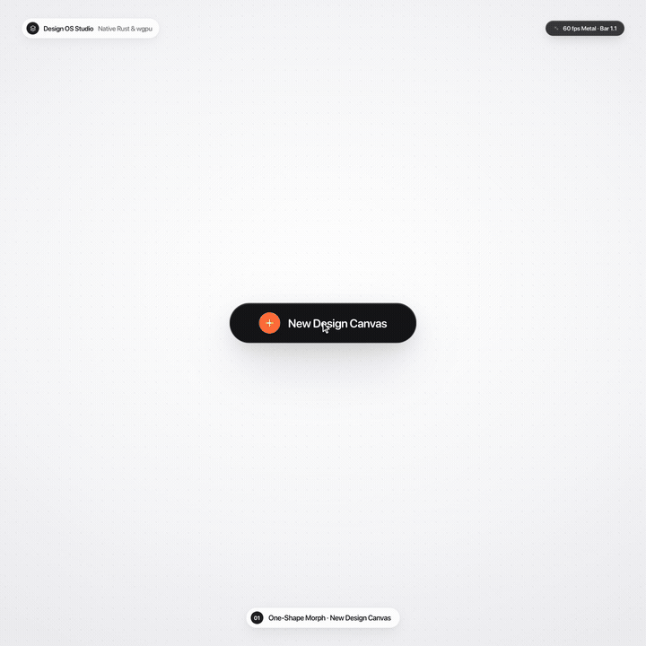
  </a>
  <br>
  <sub><b>Embedded Launch Motion Preview (<code>1440×1440 @ 60fps</code>):</b> Click to stream all 3 Master Launch Motion Films on <a href="https://jangtrinh.github.io/design-os-studio/#videos">GitHub Pages</a> or open <a href="docs/videos/01-designos-studio-launch-hero.mp4"><code>01-designos-studio-launch-hero.mp4</code></a> (`7.1 MB`).</sub>
</p>

---

## Why this exists

### Why DESIGN:OS Studio? (Honest Comparison vs Figma Desktop, Penpot & Pencil/OpenPencil)

Browser-wrapped Electron design tools choke on 100,000+ node enterprise files, lock `.fig` binary authoring behind proprietary cloud servers, and force AI coding agents to scrape 150KB+ of noisy REST JSON without direct canvas write-back. **`design-os-studio`** is a local-first, 100% Rust GPU studio (`wgpu` + `tiny-skia`) with native `fig-kiwi` v106 binary read/write, **100 / 100 Figma A-to-Z Micro-Interactions (`#1..#100`)**, an embedded Agentic PTY Chat UI for your existing CLI subscriptions (`claude`, `codex`, `agy`, `gemini`, `grok`), Live Variables Mode Switching & Multi-Edit (`Q`), and a 22-tool stdio MCP server.

| Dimension | Figma Desktop (Cloud / Electron) | Penpot / Pencil / OpenPencil | DESIGN:OS Studio (`design-os-studio`) |
| :--- | :--- | :--- | :--- |
| **Runtime & GPU Engine** | Electron + Chromium / WebGL (`1.5 GB+` RAM, continuous idle repaints) | Browser DOM / SVG / Canvas2D or Electron webview wrapper | **100% Rust (`wgpu` Metal / DX12 / Vulkan + `tiny-skia`)**, **`0.0%` static viewport CPU** (`FrameKey` GPU texture reuse) |
| **Enterprise Scale (`723k` Records / `112k` Nodes)** | Browser tab OOM crashes, multi-second cloud streaming stalls | DOM / SVG layout bottlenecks above `5k–10k` nodes | **Uniform `2048x2048` `SceneIndex` culling + 4-tier semantic zoom LOD**, **`1.54s` cold load**, **`-96.5%` disk size (`242 MB` vs `6.80 GB`)** |
| **Figma `.fig` v106 Binary Read/Write** | Proprietary cloud lock-in; `.fig` saves require online servers | Read-only or lossy third-party converters; no native `.fig` v106 write-back | **Native bidirectional `fig-kiwi` v106 Read & Write** (`DEFLATE`/`Zstd` `canvas.fig` + `meta.json` + `images/`, `symbolOverrides`, `parameterConsumptionMap`) |
| **Tactile Micro-Interactions (`#1..#100`)** | Reference UI3 standard (`126.9.13`), browser-bound latency on huge files | Partial subset; missing CSS Grid track pills, Smart Selection ring swaps, or Scale Tool (`K`) | **100 / 100 Figma A-to-Z Micro-Interactions (`#1..#100`)** verified end-to-end (`launch_e2e_proves_100_figma_micro_interactions_end_to_end`) |
| **Agentic Workflow & API Cost** | Paid per-seat AI credits or read-only `155K`-char REST JSON dumps | External MCP plugins or paid API key wrappers (`ANTHROPIC_API_KEY` / `OPENAI_API_KEY`) | **Native Agentic PTY Chat UI** (`Claude Code` · `Codex` · `Antigravity` · `Gemini` · `Grok` — zero extra API cost) + **22-tool `designos-mcp`** + 1-click `NodeSpec` apply |
| **Variables, Multi-Edit (`Q`) & Auto-Layout** | Cloud-bound variable collections & manual frame nesting | Partial variable support; no `Q` Multi-Edit or `⇧A` heuristic inference | **Live Variables Mode Switching (`Light` / `Dark`), Multi-Edit (`Q` / `⌘E`) & Suggest Auto-Layout (`⇧A`)** (`COLOR`, `FLOAT`, `STRING`, `BOOLEAN` + `=` alias picker) |
| **Dev Mode Codegen & Visual QA** | Paid Dev Mode seats required; cloud-only inspection | Basic CSS/HTML export; no headless GPU diffing CLI | **Free built-in Dev Mode (`Shift+D`)** (React, Tailwind v4, CSS, SwiftUI, Jetpack Compose) + headless `--gpu --screenshot` & `designos-diff` SSIM CLI |
| **Privacy, Offline & Licensing** | Mandatory cloud sign-in, proprietary license, background telemetry | Self-hosted Docker stack or Electron runtime telemetry | **Zero telemetry — 100% local offline execution** ([`PRIVACY.md`](PRIVACY.md) audited), dual **`MIT OR Apache-2.0`** |

> **Where traditional platforms win, and it is not close:** Browser-hosted multiplayer whiteboarding with 50 simultaneous live WebRTC cursors, enterprise cloud org SSO/SCIM admin consoles, and hosted comment email/Slack notifications. If your workflow requires real-time cloud multiplayer without local git or file ownership, use Figma Cloud (paired with our live bridge [`design-os-figma-plugin`](https://jangtrinh.github.io/design-os-figma-plugin/)) or a hosted Penpot instance instead.

---

<a id="facts-register"></a>
### Facts Register

| Instrument Field | Specification | Verification / Notes |
| :--- | :--- | :--- |
| **Repository** | [`jangtrinh/design-os-studio`](https://github.com/jangtrinh/design-os-studio) | 11-crate Cargo workspace (`crates/designos-*`) |
| **Engine Stack** | `100% Rust` + `wgpu` + `tiny-skia` | Metal · DirectX 12 · Vulkan · Zero Electron |
| **Figma Parity** | `.fig` v106 + `100 / 100` Micro-UX | `387 / 387` UI3 (`487 / 487` total) · `856` tests passing |
| **Agent Surface** | `22` MCP Tools + Native PTY Chat UI | `Claude Code` · `Codex` · `Antigravity` · `Gemini` · `Grok` |
| **Telemetry / Privacy** | Zero Tracking (`0` network calls) | 100% offline local-first ([`PRIVACY.md`](PRIVACY.md)) |
| **License** | Dual `MIT OR Apache-2.0` | Native installers for macOS (`.dmg`), Windows (`-setup.exe`), Linux (`.deb`) |

---

## Quickstart

### 1. Install once

Install the AI agent skill plugin in Claude Code / Codex, download a native OS installer (`.dmg`, `-setup.exe`, `.deb`), or build all 4 binaries from source:

```bash
# Option A: Claude Code plugin marketplace
/plugin marketplace add jangtrinh/design-os-studio
/plugin install design-os-studio@design-os-studio

# Option B: Clone & launch native Rust/wgpu Studio (or package .dmg / -setup.exe / .deb)
git clone https://github.com/jangtrinh/design-os-studio
cd design-os-studio
cargo run --release -p designos-app --bin designos-studio
./scripts/build-release.sh 0.2.0 --local-host
```

<a id="first-safe-use--the-practical-loop"></a>
### 2. First Safe Use & The Practical Loop

**First safe use (3 bounded, non-destructive verification steps):**

1. **Run the deterministic offline repository, crate, and skill self-check:**
   ```bash
   python3 scripts/self_check.py
   ```
2. **Apply a declarative `NodeSpec` JSON onto a document and roundtrip to a standard Figma `.fig` v106 binary archive:**
   ```bash
   designos app.designos --apply-spec examples/specs/easeui-agent-console.spec.json
   designos app.designos --export-fig out.fig
   ```
3. **Capture a headless GPU verification screenshot and run perceptual SSIM diffing:**
   ```bash
   designos-studio out.fig --gpu --size 1600x1000 --screenshot actual.png
   designos-diff compare docs/images/designos-agent-spec.png actual.png --out diff.png
   ```

**The Practical Agentic Loop:**

| Lifecycle Verb / Flag | Role in the Loop |
| :--- | :--- |
| **`--panel variables`** | Inspects and switches multi-mode Design Variables (`Light` / `Dark` token collections, `=` alias bindings, and semantic tokens) beside the canvas. |
| **`--rail agents`** | Opens the native Agentic PTY Chat UI wrapping Claude Code, Codex, Antigravity, or Grok with live selection context and inline `NodeSpec` apply. |
| **`--apply-spec / --export-fig`** | Compiles declarative JSON specs through Auto-Layout 5.0 and writes standard Figma `.fig` v106 binary archives. |
| **`--screenshot / designos-diff`** | Renders headless Metal/Vulkan/DX12 frames at `1600x1000` and verifies perceptual SSIM parity in CI. |

### 3. Ask in plain English (or invoke the Agent CLI directly)

Open your project in your AI coding agent (or inside the Studio's `Agents` left-rail PTY Chat panel) and describe the outcome you need:

> "Apply `examples/specs/easeui-agent-console.spec.json` onto the DESIGN:OS Studio canvas, export a verified Figma `.fig` v106 binary archive to `out.fig`, and capture a 1600x1000 GPU screenshot."

> "Open the Design Variables modal (`--panel variables`), switch the active token collection from `Light` to `Dark` mode, batch-edit matching layers with Multi-Edit (`Q`), and resolve all open canvas pin-comments."

> "Inspect the `API Docs` frame in Dev Mode, generate production React + Tailwind + SwiftUI code, and run `designos-diff` to verify 0.00% visual regression."

---

<a id="video-showcase"></a>
## Video Showcase (`1440×1440 @ 60fps` Master Launch Films + 12-Part A-to-Z Micro-Interactions Deep-Dive)

### Part A — 3 Master Launch Motion Films (`1440×1440 @ 60fps` · One-Shape UI Motion + Real Studio Assets)

Built with the `design-os-svg-animation` HyperFrames v2 deterministic frame-seeking pipeline (`window.seek(t)`, closed-form 2nd-order step-response springs, `4× subframe tmix` motion blur, and 28-beat choreography @ `100.60 BPM`).

| Film | MP4 (`1440×1440 @ 60fps`, `4× tmix`) | 28-Beat Contact Sheet (`100.60 BPM`) | Highlights |
| :--- | :--- | :--- | :--- |
| **01 · Launch Hero** | [`docs/videos/01-designos-studio-launch-hero.mp4`](docs/videos/01-designos-studio-launch-hero.mp4) (`7.1 MB`) | [`01-beat-contact-sheet.png`](docs/videos/01-designos-studio-launch-hero-beat-contact-sheet.png) | `723,136` Kiwi records load in `1.54s` on Metal, UI3 Dark Chrome, Agentic PTY Chat, Live Variables Mode Switching (`Light / Dark`), `⌘K` AI Synth, Components & Dev Mode |
| **02 · 100/100 Micro-Interactions** | [`docs/videos/02-figma-100-micro-interactions.mp4`](docs/videos/02-figma-100-micro-interactions.mp4) (`6.8 MB`) | [`02-beat-contact-sheet.png`](docs/videos/02-figma-100-micro-interactions-beat-contact-sheet.png) | Auto-Layout 5.0 edge double-click `Fixed -> Hug -> Fill`, CSS Grid track pills, Smart Selection ring swaps, Corner/Arc/Star handles, Vector Network tangents & Scale Tool (`K`) |
| **03 · Agent-First & Dev Mode** | [`docs/videos/03-agent-first-specs-and-devmode.mp4`](docs/videos/03-agent-first-specs-and-devmode.mp4) (`5.8 MB`) | [`03-beat-contact-sheet.png`](docs/videos/03-agent-first-specs-and-devmode-beat-contact-sheet.png) | 22-tool `designos-mcp` server, Claude/Codex/Antigravity PTY Chat, Variables & Mode Switching (`Light / Dark`), Multi-Edit (`Q`), 5-target Dev Mode codegen & Prototype flows |

### Part B — 12 × 30s Real-Canvas A-to-Z Micro-Interactions Deep-Dive Videos (`16:9` `1920×1080` & `9:16` `1080×1920` @ `60fps`)

Every one of the **100 Figma A-to-Z Micro-Interactions (`#1..#100`)** is implemented in native Rust + `wgpu`/`egui` and proven by **12 × 30-second (`29.82s` = 50 beats @ `100.60 BPM`) Real-Canvas motion films** rendered in both **16:9 Widescreen (`1920×1080`)** and **9:16 Vertical (`1080×1920`)** from **72 real sequential `designos-studio` captures** (`Design/marketing/screenshots/micro/m01..m12-step1..6.png`, zero fake mockups), bookended by an Apple Keynote `SF Pro Rounded` Intro Card and GitHub Repo Outro Card (`github.com/jangtrinh/design-os-studio`).

| Suite | Feature Title | 16:9 Widescreen (`1920×1080 @ 60fps`) | 9:16 Vertical (`1080×1920 @ 60fps`) | 6 Real Studio States (`--panel micro-<slug>:1..6`) |
| :--- | :--- | :--- | :--- | :--- |
| **M01** | **Auto-Layout 5.0 & Edge Sizing** | [`micro-01-autolayout-5-16x9.mp4`](docs/videos/micro-01-autolayout-5-16x9.mp4) (`4.2 MB`) | [`micro-01-autolayout-5-9x16.mp4`](docs/videos/micro-01-autolayout-5-9x16.mp4) (`3.3 MB`) | Pink gap drag (`12px -> 28px`), inline gap input (`16px`), top padding drag (`36px`), `⌥` mirror, edge double-click `Fixed -> Hug -> Fill` |
| **M02** | **2D CSS Grid Tracks & Cell Span** | [`micro-02-css-grid-16x9.mp4`](docs/videos/micro-02-css-grid-16x9.mp4) (`4.5 MB`) | [`micro-02-css-grid-9x16.mp4`](docs/videos/micro-02-css-grid-9x16.mp4) (`3.4 MB`) | Column track pill `1fr -> 220px -> Hug`, row track sizing, column gutter drag (`28px`), child span `2x1 -> 2x2` |
| **M03** | **Smart Selection & One-Click Tidy Up** | [`micro-03-smart-selection-16x9.mp4`](docs/videos/micro-03-smart-selection-16x9.mp4) (`4.1 MB`) | [`micro-03-smart-selection-9x16.mp4`](docs/videos/micro-03-smart-selection-9x16.mp4) (`3.2 MB`) | Multi-select 3 uneven cards, click `Tidy up` (`24px` equal gaps), drag pink gap bar (`36px`), drag pink ring handle to swap cards |
| **M04** | **Parametric Arc, Donut, Star & Polygon** | [`micro-04-shape-controls-16x9.mp4`](docs/videos/micro-04-shape-controls-16x9.mp4) (`4.1 MB`) | [`micro-04-shape-controls-9x16.mp4`](docs/videos/micro-04-shape-controls-9x16.mp4) (`3.4 MB`) | Sweep handle (`265°`), inner donut ratio (`58%`), start angle (`35°`), star inner ratio (`55%`), star point count (`8 pts`) |
| **M05** | **Vector Network & Bezier Tangents** | [`micro-05-vector-network-16x9.mp4`](docs/videos/micro-05-vector-network-16x9.mp4) (`4.1 MB`) | [`micro-05-vector-network-9x16.mp4`](docs/videos/micro-05-vector-network-9x16.mp4) (`3.3 MB`) | Enter Vector Edit (`Enter`), drag cubic Bezier tangent, `⌘`-drag cusp, click midpoint diamond (`t = 0.5`), `⇧⌫` heal-delete vertex |
| **M06** | **Deep-Hit Layer Picker & Eyedropper Loupe** | [`micro-06-layer-eyedropper-16x9.mp4`](docs/videos/micro-06-layer-eyedropper-16x9.mp4) (`5.0 MB`) | [`micro-06-layer-eyedropper-9x16.mp4`](docs/videos/micro-06-layer-eyedropper-9x16.mp4) (`4.1 MB`) | `⌘`-Right-Click overlapping stack, filter layer tree, cycle status badge (`Ready -> In Progress -> Needs Review`), Eyedropper `Tab` (`HEX -> RGB -> HSL`) |
| **M07** | **Dev Mode Box-Model & 5-Target Codegen** | [`micro-07-devmode-boxmodel-16x9.mp4`](docs/videos/micro-07-devmode-boxmodel-16x9.mp4) (`5.3 MB`) | [`micro-07-devmode-boxmodel-9x16.mp4`](docs/videos/micro-07-devmode-boxmodel-9x16.mp4) (`4.0 MB`) | `⇧D` emerald padding (`24px`) & orange gap (`16px`) overlay, plus live switching across `React`, `Tailwind v4`, `CSS`, `SwiftUI`, and `Compose` |
| **M08** | **Proportional Scale Tool (`K`) & Navigation** | [`micro-08-scale-navigation-16x9.mp4`](docs/videos/micro-08-scale-navigation-16x9.mp4) (`4.1 MB`) | [`micro-08-scale-navigation-9x16.mp4`](docs/videos/micro-08-scale-navigation-9x16.mp4) (`3.2 MB`) | Activate Scale Tool (`K`), click `1.25x` / `1.5x` / `2.0x` proportional multiplier pills, `1.0x` reset, and `⇧1` Zoom-to-Fit |
| **M09** | **Inspector Scrubbing, Math (`100+24`) & Hex Shorthand (`#1..#9`)** | [`micro-09-inspector-math-16x9.mp4`](docs/videos/micro-09-inspector-math-16x9.mp4) | [`micro-09-inspector-math-9x16.mp4`](docs/videos/micro-09-inspector-math-9x16.mp4) | `micro-09-inspector-math` · Label drag-scrub (`1px` / `⇧ 10px` / `⌥ 0.1px`), inline math (`100+24`), `10,20,10,20` padding shorthand, Aspect Ratio Lock, `#1..#9` hex & `0..9` opacity (`images/05-variables-modes.png`) |
| **M10** | **Selection Traversal, `Cmd+D` Offset Memory & 4-Corner Radius (`#19..#36`)** | [`micro-10-selection-corner-16x9.mp4`](docs/videos/micro-10-selection-corner-16x9.mp4) | [`micro-10-selection-corner-9x16.mp4`](docs/videos/micro-10-selection-corner-9x16.mp4) | `micro-10-selection-corner` · `Enter` / `⇧Enter` / `Tab` selection traversal, `⌥`-drag + `⌘D` offset memory, `⌥`-hover red distance guides, and 4-corner independent radius (`images/11-micro-smart-selection.png`) |
| **M11** | **Typography Auto-Height Fit, Tracking & Multi-Edit (`Q`) (`#55..#70`)** | [`micro-11-typography-multiedit-16x9.mp4`](docs/videos/micro-11-typography-multiedit-16x9.mp4) | [`micro-11-typography-multiedit-9x16.mp4`](docs/videos/micro-11-typography-multiedit-9x16.mp4) | `micro-11-typography-multiedit` · Double-click text handle auto-height fit, `⌥←`/`→` tracking & `⌥↑`/`↓` leading nudges, `Q` Multi-Edit across matching layers (`images/04-cmdk-ai-synth.png`) |
| **M12** | **Components, Variables (`=`) Live Mode Switch & Prototype (`#71..#100`)** | [`micro-12-components-variables-16x9.mp4`](docs/videos/micro-12-components-variables-16x9.mp4) | [`micro-12-components-variables-9x16.mp4`](docs/videos/micro-12-components-variables-9x16.mp4) | `micro-12-components-variables` · `⌥⌘K` component & variant set matrix, `=` variable alias binding, live `Light` / `Dark` mode switch, and Prototype noodle triggers (`images/06-components-assets.png`) |

<table>
  <tr>
    <td width="50%" valign="top">
      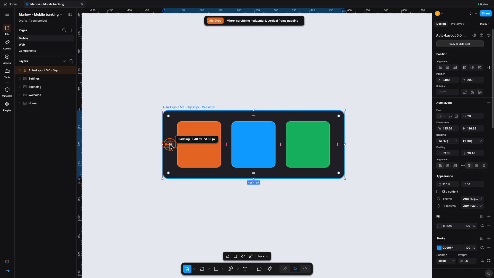<br>
      <sub><b>M01 · Auto-Layout 5.0 On-Canvas Gap/Padding Drag &amp; Inline Input (`#10..#15`)</b><br><code>--micro-showcase autolayout --scale 2</code><br>Drag pink gap/padding handles (`⌥` mirrors opposite side, `⇧⌥` all 4 sides), click to type exact `px` inline, or double-click frame edge to cycle `Fixed -> Hug -> Fill`.</sub>
    </td>
    <td width="50%" valign="top">
      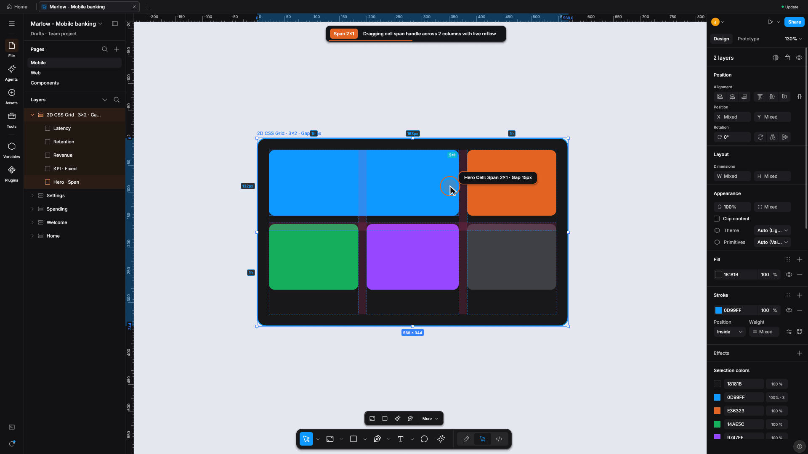<br>
      <sub><b>M02 · 2D CSS Grid Track Pills (`1fr / px / Hug`) &amp; Span Handles (`#16..#18`)</b><br><code>--micro-showcase grid --scale 2</code><br>Click column/row track header pills to cycle `1fr -> Fixed px -> Hug`, drag track dividers on canvas, and span cells across multiple columns/rows (`2x1 Span`).</sub>
    </td>
  </tr>
  <tr>
    <td width="50%" valign="top">
      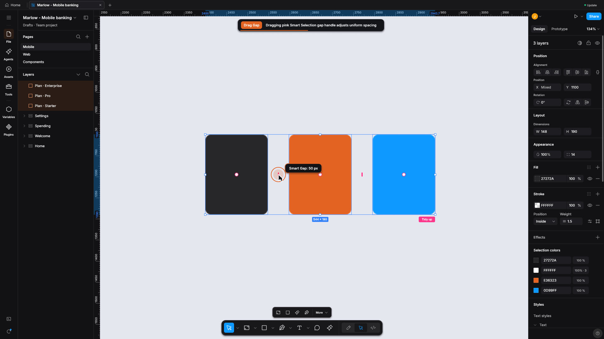<br>
      <sub><b>M03 · Smart Selection Pink Swap Handles &amp; One-Click Tidy Up (`#19..#21`)</b><br><code>--micro-showcase smart-selection --scale 2</code><br>Select 3+ siblings to reveal pink gap bars, circular pink swap handles inside each card, and the one-click `Tidy up` button that equalizes `18px` spacing.</sub>
    </td>
    <td width="50%" valign="top">
      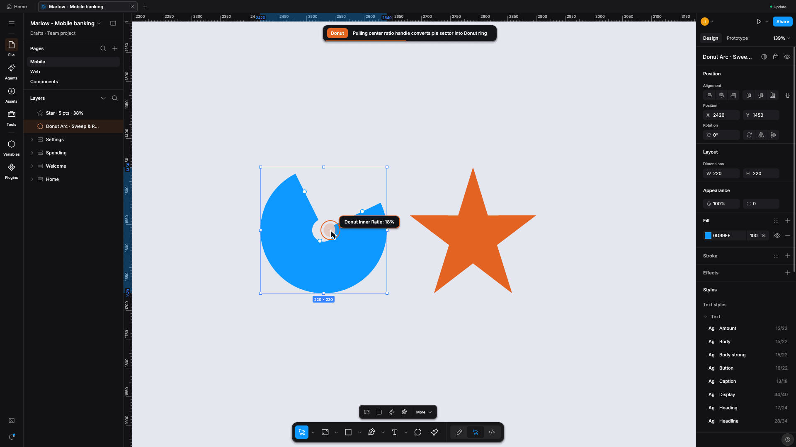<br>
      <sub><b>M04 · Parametric Shape Controls: Donut Arc, Star Ratio &amp; Polygon (`#30..#32`)</b><br><code>--micro-showcase shape-controls --scale 2</code><br>Drag on-canvas Sweep (`270°`), Start (`0°`), and Ratio (`62%`) handles on ellipses, plus inner ratio (`42%`) and point-count handles on stars and polygons.</sub>
    </td>
  </tr>
  <tr>
    <td width="50%" valign="top">
      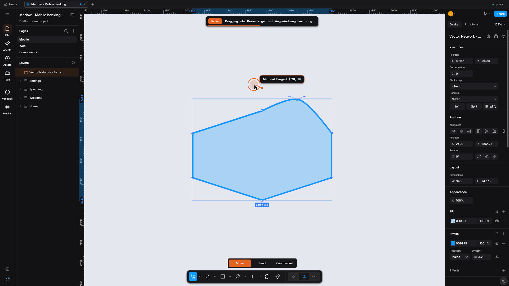<br>
      <sub><b>M05 · Vector Network Editor: Midpoint Split &amp; `⇧⌫` Heal Delete (`#33..#35`)</b><br><code>--micro-showcase vector-edit --scale 2</code><br>Click any segment midpoint diamond to subdivide at `t = 0.5`, `⌘`-drag to break mirrored Bezier tangents, and `⇧⌫` to heal-delete vertices while keeping the path closed.</sub>
    </td>
    <td width="50%" valign="top">
      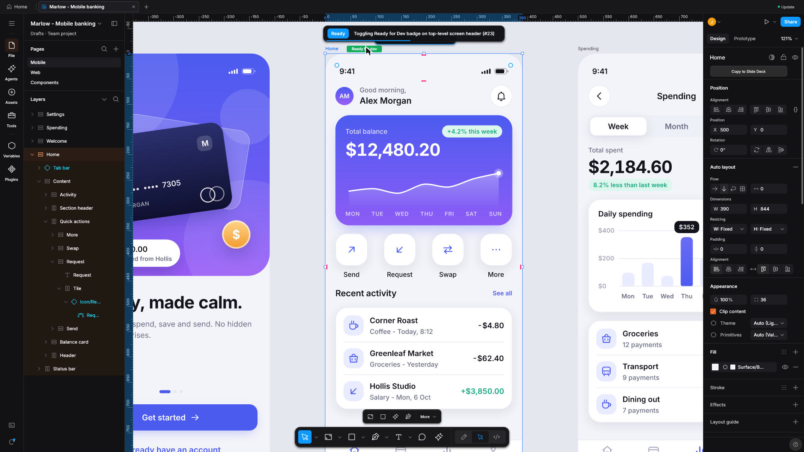<br>
      <sub><b>M06 · Layer Filter, Status Cycle &amp; Eyedropper `Tab` Format (`#36..#45`)</b><br><code>--micro-showcase layer-picker --scale 2</code><br>Filter layers by name, click status badges to cycle `Ready -> In Progress -> Needs Review`, double-click layer icon to zoom-to-fit, and press `Tab` in Eyedropper (`I`) to cycle `HEX -> RGB -> HSL`.</sub>
    </td>
  </tr>
  <tr>
    <td width="50%" valign="top">
      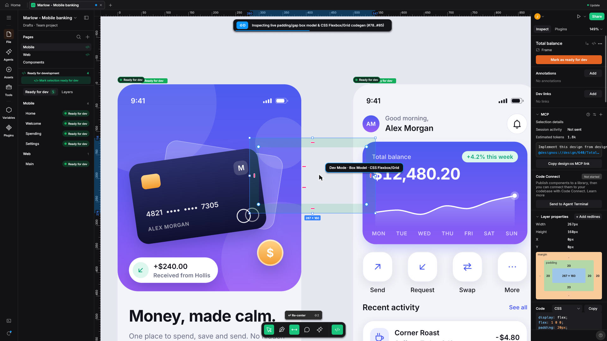<br>
      <sub><b>M07 · Dev Mode Box-Model Overlay (`Emerald Padding` &amp; `Orange Gap`) (`#46..#47`)</b><br><code>--micro-showcase dev-boxmodel --scale 2</code><br>Hover or select any Auto-Layout frame in Dev Mode to inspect emerald green padding bands (`24px`), orange gap bands (`16px`), and dashed parent-distance guides.</sub>
    </td>
    <td width="50%" valign="top">
      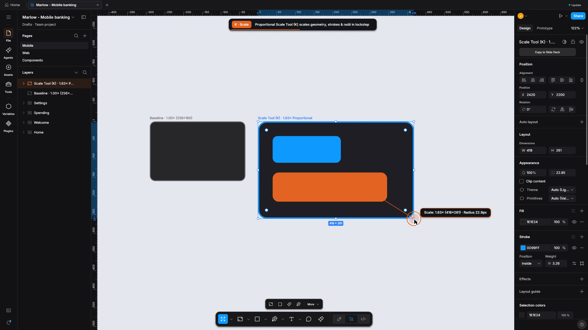<br>
      <sub><b>M08 · Proportional Scale Tool (`K` — `1x / 1.5x / 2x` Multiplier Pill) (`#48`)</b><br><code>--micro-showcase scale-tool --scale 2</code><br>Press `K` to scale bounds, `font_size`, `corner_radius`, `stroke_weight`, and Auto-Layout padding/gap proportionally (`1.5x` verified side-by-side).</sub>
    </td>
  </tr>
</table>

---

## What it makes

Every artifact produced by `design-os-studio` is backed by deterministic scene-graph compilation (`SceneCompiler` + `GeomCache`), native `fig-kiwi` v106 binary serialization, and headless GPU/CPU visual verification (`--screenshot` + `designos-diff`).

### Pillar 1 — Native Agentic PTY Chat UI (`Claude Code` · `Codex` · `Antigravity` · `Grok CLI`)

<p align="center">
  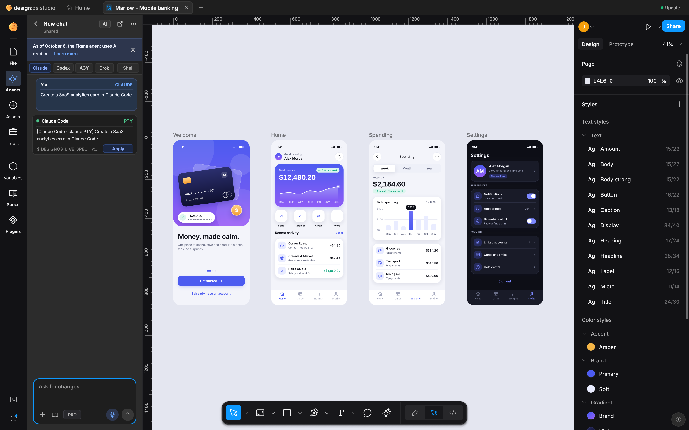<br>
  <sub>Command: <code>designos-studio --fixture showcase --panel agents-chat --size 1440x900 --scale 2 --screenshot docs/images/designos-agents-chat.png</code></sub>
</p>

Inside the Figma UI3 **Agents** Left Rail (`RailItem::Agents`), `design-os-studio` wraps your own local CLI subscription (`claude`, `codex`, `agy`, `grok`, or `$SHELL`) inside a real `portable-pty` + `vt100` pseudo-terminal (`crates/designos-app/src/terminal.rs`). It renders clean User/Assistant chat turn bubbles (`AgentChatTurn`), strips ANSI control noise (`strip_ansi_codes`), attaches active Canvas selections + pin-comments with one click (`+`), detects inline `NodeSpec` JSON blocks, and applies generated layouts directly onto the live `Document` with 1-step Undo.

### Pillar 2 — Live Variables Mode Switching, Multi-Edit (`Q`) & Suggest Auto-Layout (`⇧A`)

<p align="center">
  <br>
  <sub>Command: <code>designos-studio --fixture showcase --panel variables --size 1440x900 --scale 2 --screenshot docs/images/designos-variables.png</code></sub>
</p>

Inspect and switch primitive, semantic, and component token collections (`COLOR`, `FLOAT`, `STRING`, `BOOLEAN`) across **`Light`** and **`Dark`** modes in real time (`=` / `Variables` modal), press **`Q` (`⌘E`)** to enter **Multi-Edit** across matching sibling layers across frames, and press **`⇧A` (`Ctrl+Shift+A`)** to run **Suggest Auto-Layout** heuristic row/column/wrap inference with instant relayout.

### Pillar 3 — Dev Mode (`Shift+D` / `</>`) Multi-Target Codegen & Box-Model Inspector

<p align="center">
  <br>
  <sub>Command: <code>designos-studio --fixture showcase --select "Hero" --dev react --dev-demo --size 1440x900 --scale 2 --screenshot docs/images/designos-devmode.png</code></sub>
</p>

Switch into **Dev Mode (`Shift+D` or `</>`)** to inspect CSS box-model padding/margin/border diagrams, resolved variable tokens, `handoffStatusMap` (`Ready for dev` badges), and copy-ready code generated deterministically in **React (JSX)**, **Tailwind v4**, **Modern CSS**, **Apple SwiftUI**, and **Android Jetpack Compose**.

### Pillar 4 — Declarative `NodeSpec` JSON -> Auto-Layout 5.0 -> Native `.fig` v106 Binary Roundtrip

<p align="center">
  <br>
  <sub>Command: <code>designos app.designos --apply-spec examples/specs/easeui-agent-console.spec.json &amp;&amp; designos app.designos --export-fig out.fig</code></sub>
</p>

AI agents author compact, diffable `NodeSpec` JSON (`examples/specs/easeui-agent-console.spec.json`) rather than guessing pixel coordinates. `designos-doc` computes exact recursive Auto-Layout 5.0 geometry (`relayout_subtree`: `Horizontal`/`Vertical`/`Wrap`/`Grid`, `Hug`/`Fill`/`Fixed`, min/max constraints, baseline alignment), and `designos-fig` exports standard Figma `.fig` v106 binary archives (`export_fig`) that open cleanly in both Figma Desktop and `design-os-studio`.

| Deliverable / Mode | Best for | Output Format | Verification Gate |
| :--- | :--- | :--- | :--- |
| **Native `.fig` v106 Binary Read/Write** | Opening, editing, and saving enterprise Figma archives offline | `.fig` (`fig-kiwi` v106 binary + `meta.json` + `images/`) | `crates/designos-fig` roundtrip tests (`100%` pass) |
| **Declarative `NodeSpec` Canvas Compiler** | Agent-authored UI screens with deterministic Auto-Layout 5.0 | `.spec.json` / `.designos` / `.fig` | `designos --apply-spec` + `--inspect-json` |
| **Agentic PTY Chat & 22-Tool MCP** | Live bidirectional design-to-code and prompt-to-canvas orchestration | `designos-mcp` (`stdio`) + `RailItem::Agents` | `22/22` MCP tools + `AgentChatTurn` tests |
| **Dev Mode Multi-Target Codegen** | Exporting production UI code and token bindings per frame | `React` · `Tailwind` · `CSS` · `SwiftUI` · `Compose` | `crates/designos-export` golden codegen suite |
| **Headless GPU Visual Proof & Diff** | Automated CI screenshot capture and perceptual SSIM comparison | `PNG` / `SVG` / `PDF` / `JPG` + diff report | `designos-studio --gpu --screenshot` + `designos-diff` |

---

<a id="visual-proof-gallery"></a>
### Visual Proof Gallery (15 Discrete Uncropped Retina Captures)

Every screenshot below is an individual, uncropped capture rendered deterministically from the live `designos-studio` binary using [`scripts/capture-visual-proof.sh`](scripts/capture-visual-proof.sh) at Retina 2x (`--scale 2`).

<table>
  <tr>
    <td width="50%" valign="top">
      <br>
      <sub><b>01 · 1:1 Figma UI3 Dark Chrome &amp; GPU Canvas</b><br><code>--fixture showcase --select "Hero" --scale 2</code><br>Renders `112,474` nodes (`723,136` Kiwi records) in `1.54s` on Metal with `#1e1e1e` UI3 chrome, `#0d99ff` selection blue, and unified Phosphor icons.</sub>
    </td>
    <td width="50%" valign="top">
      <br>
      <sub><b>02 · Native Agentic PTY Chat UI Wrapper (`S13`)</b><br><code>--fixture showcase --panel agents-chat --scale 2</code><br>1-click runtime switcher (`Claude | Codex | AGY | Grok | Shell`), ANSI-stripped chat turn bubbles, `+` selection context pill, and inline `NodeSpec` apply.</sub>
    </td>
  </tr>
  <tr>
    <td width="50%" valign="top">
      <br>
      <sub><b>03 · Auto-Layout 5.0 &amp; Suggest Auto-Layout</b><br><code>--micro-showcase autolayout --scale 2</code><br>On-canvas pink gap/padding drag handles, inline value input, edge double-click `Fixed -> Hug -> Fill` cycle, and `⇧A` heuristic Suggest Auto-Layout.</sub>
    </td>
    <td width="50%" valign="top">
      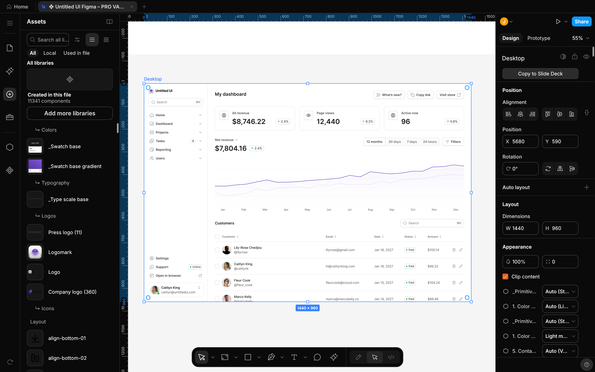<br>
      <sub><b>04 · Assets &amp; Libraries Panel (`Created in this file`)</b><br><code>--rail assets --gpu</code><br>1:1 Figma UI3 `File | Assets` switch with `Search all libraries`, `Created in this file` vertical preview card (`142x168`), and draggable component grid.</sub>
    </td>
  </tr>
  <tr>
    <td width="50%" valign="top">
      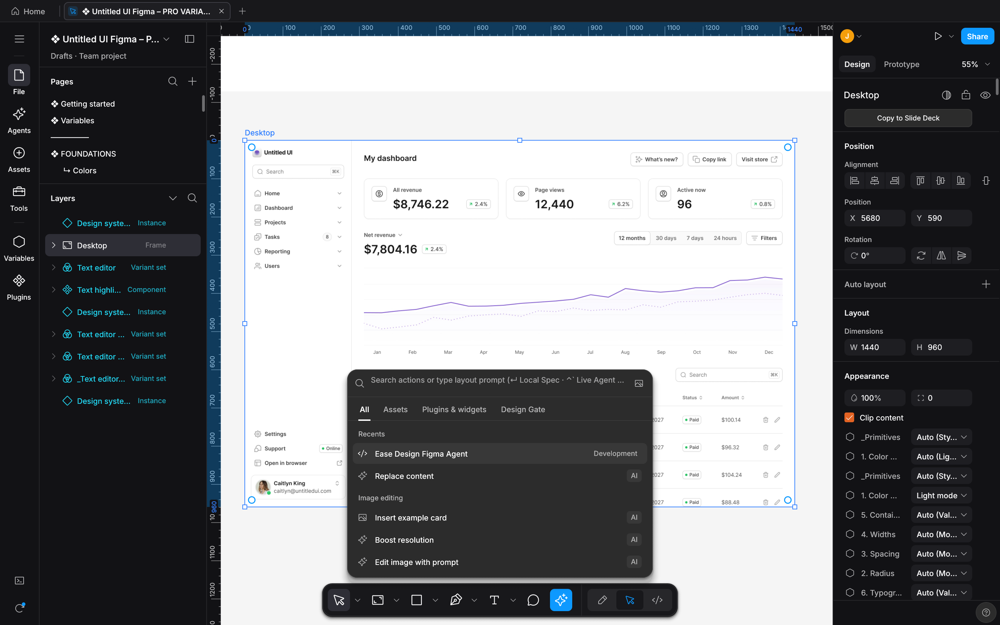<br>
      <sub><b>05 · `Actions (Cmd+K)` &amp; Live Design Gate (`Ctrl+Shift+G`)</b><br><code>--panel cmdk --gpu</code><br>Bottom-center UI3 `Actions` launcher with `First Draft`, `Make Prototype`, `Rename Layers`, `Rewrite`, and automated WCAG / 8pt grid Design Gate checks.</sub>
    </td>
    <td width="50%" valign="top">
      <br>
      <sub><b>06 · Dev Mode (`Shift+D` / `&lt;/&gt;`) &amp; Multi-Target Codegen</b><br><code>--tab dev --dev-lang react --gpu</code><br>Interactive CSS Box Model diagram, resolved variable tokens, `Ready for dev` handoff badges, and live React / Tailwind / CSS / SwiftUI / Compose output.</sub>
    </td>
  </tr>
  <tr>
    <td width="50%" valign="top">
      <br>
      <sub><b>07 · Design Variables &amp; Multi-Mode Token Collections</b><br><code>--panel variables --gpu</code><br>Inspect and edit primitive, semantic, and component token collections across `Light` and `Dark` modes (`COLOR`, `FLOAT`, `STRING`, `BOOLEAN` + alias chains).</sub>
    </td>
    <td width="50%" valign="top">
      <br>
      <sub><b>08 · Master Components, Variant Sets &amp; Instance Overrides</b><br><code>--rail components --gpu</code><br>Purple `#9747ff` UI3 component chrome, dashed `ComponentSet` matrices, boolean/text/instance-swap properties, and shared canonical `GeomCache` meshes.</sub>
    </td>
  </tr>
  <tr>
    <td width="50%" valign="top">
      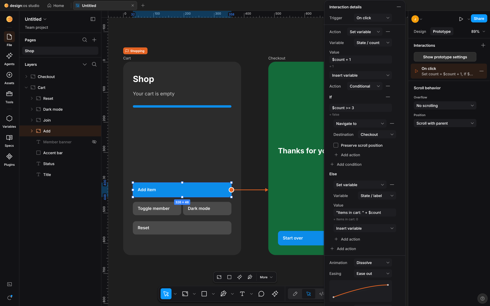<br>
      <sub><b>09 · Interactive Prototype Noodle Flows &amp; Triggers</b><br><code>--tab prototype --gpu</code><br>Visualizes flow starting points, cubic Bezier interaction noodles with directional arrowheads, and `On Click / Hover -> Navigate / Dissolve / Smart Animate` rules.</sub>
    </td>
    <td width="50%" valign="top">
      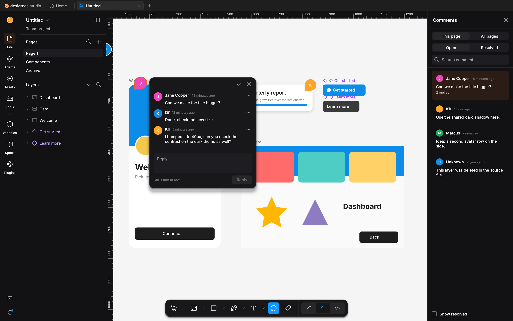<br>
      <sub><b>10 · Spatial Canvas Pin-Comments &amp; Agent Review Loop</b><br><code>--tool-mode comment --gpu</code><br>Pin feedback directly onto canvas nodes (`resolve_comment_targets`), query unresolved threads via `--comments-json` or MCP, and reply/resolve automatically.</sub>
    </td>
  </tr>
  <tr>
    <td width="50%" valign="top">
      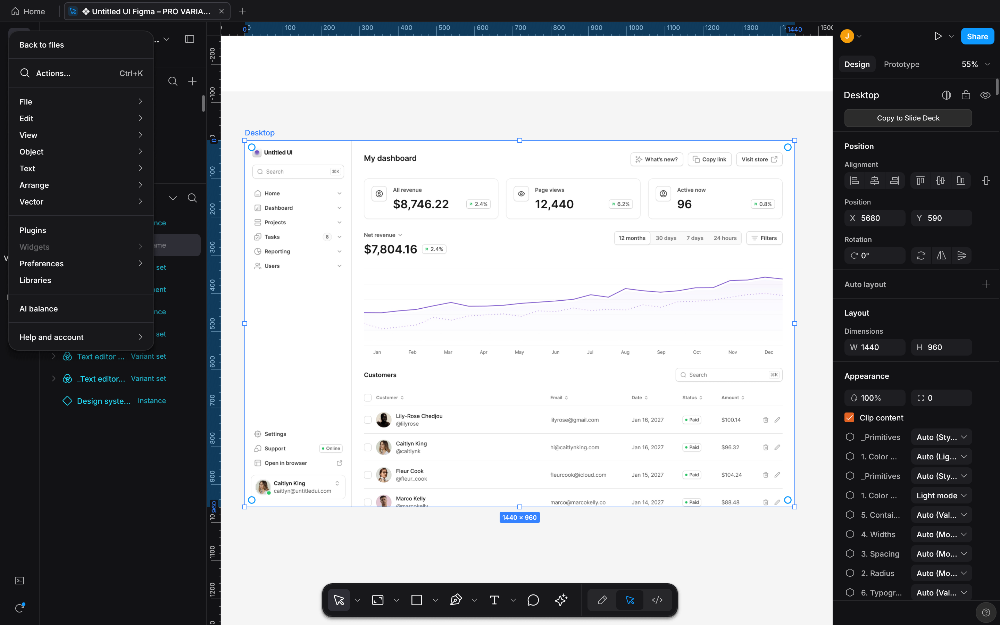<br>
      <sub><b>11 · Figma UI3 Main Menu Dropdown (`248px` Overlay)</b><br><code>--panel main-menu --gpu</code><br>Full hierarchical menu (`Search...`, `File`, `Edit`, `View`, `Object`, `Text`, `Arrange`, `Vector`, `Plugins`, `Widgets`, `Preferences`, `Libraries`, `AI balance`).</sub>
    </td>
    <td width="50%" valign="top">
      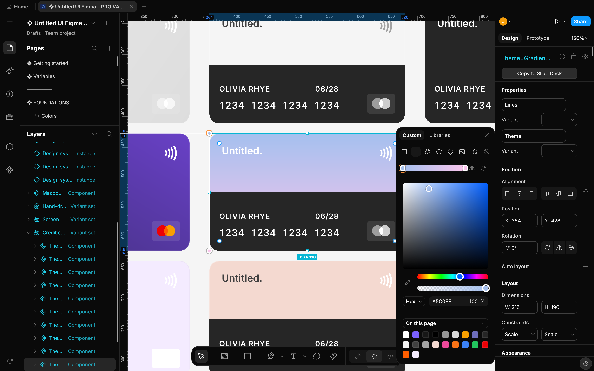<br>
      <sub><b>12 · Color &amp; Gradient Picker Popover (`Custom` / `Libraries`)</b><br><code>--panel color-picker --gpu</code><br>2D saturation-value square, hue &amp; alpha sliders, `Solid / Linear / Radial / Angular` paint modes, eyedropper (`I`), Hex + opacity inputs, and document swatches.</sub>
    </td>
  </tr>
  <tr>
    <td width="50%" valign="top">
      <br>
      <sub><b>13 · Declarative `NodeSpec` -> Auto-Layout 5.0 -> `.fig`</b><br><code>--apply-spec easeui-agent-console.spec.json</code><br>Compiled from declarative JSON into Auto-Layout 5.0 frames, exported to a standard Figma `.fig` v106 binary archive, and rendered with 1:1 UI3 layer icons.</sub>
    </td>
    <td width="50%" valign="top">
      <br>
      <sub><b>14 · 4-Tier Semantic Zoom LOD (`49,410` Nodes at `2%` Zoom)</b><br><code>--zoom 2 --gpu</code><br>Bird's-eye overview of an entire 49,410-node enterprise page using Container Collapse (`&lt; 6px`), text greeking bars (`1.25px..3.5px`), and sub-pixel culling.</sub>
    </td>
  </tr>
  <tr>
    <td colspan="2" valign="top" align="center">
      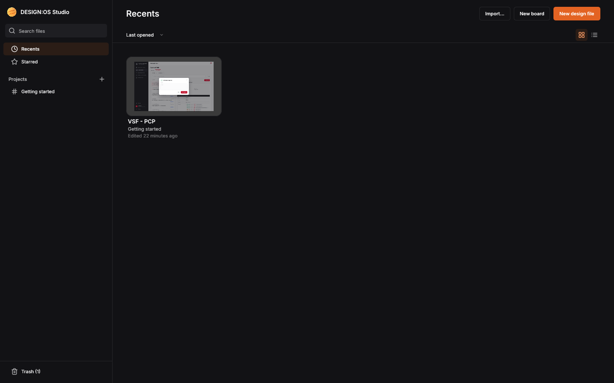<br>
      <sub><b>15 · Studio Home Screen (`design:os studio`), Recents, Starred &amp; Fast 8 KB Header Probe Library</b> — Instant local project browser (`crates/designos-library`) with automatic thumbnail caching, zero-allocation `HashSerializer` dirty-check autosave, and 1-click `.fig` / `.designos` / `.svg` import.</sub>
    </td>
  </tr>
</table>

---

<a id="100-figma-micro-interactions"></a>
### 100 / 100 Figma A-to-Z Micro-Interactions Matrix (`#1..#100`)

| Category | IDs | Verified Micro-Interactions Implemented in `designos-app` & `designos-doc` | Status |
| :--- | :--- | :--- | :--- |
| **A. Inspector Numeric Scrubbing, Math & Mixed Values** | `#1..#9` | Label drag-scrub (`1px` / `⇧ 10px` / `⌥ 0.1px`), `↑`/`↓` step keys, inline math (`+ - * /`), `%` relative parent sizing, `auto`/`hug`/`fill` keywords, `Mixed` multi-select override, `10` or `10,20,10,20` padding shorthand, Aspect Ratio Lock (`W/H`), `0..9` / `00` quick opacity | **`9 / 9 PASS`** |
| **B. Auto-Layout 5.0, Edge Sizing, CSS Grid & Smart Selection** | `#10..#21` | Edge double-click `Fixed <-> Hug`, `⌥`+double-click `Fill`, on-canvas pink gap drag, inline gap click-to-type, pink padding handles (`⌥` opposite / `⇧⌥` all 4), 9-dot alignment matrix (`Space-Between` on `W`/`X`), drag reorder, `Space` ignore Auto-Layout, 2D CSS Grid track pills (`1fr`/`px`/`Hug`) & span handles, Smart Selection pink swap rings & `Tidy up` | **`12 / 12 PASS`** |
| **C. Canvas Selection, Marquee, Guides & Transform Handles** | `#22..#29` | `⌘`-click deep select, `⌘`+Right-click overlapping layer menu, `Enter` drill children / `⇧Enter` climb parent / `Tab` cycle siblings, `⌥`-marquee containment-only, `⌥`-hover red distance guides, `⌥`-drag duplicate + `⌘D` repeat, `⇧`-axis lock + red smart snap guides, corner rotation (`15°` snap) & on-canvas corner radius handles (`⌥` single corner) | **`8 / 8 PASS`** |
| **D. Parametric Shapes, Vector Network, Layer Tree & Eyedropper** | `#30..#45` | Donut Arc Sweep/Start/Ratio handles, Star inner ratio & point-count handles, Polygon side count, Vector midpoint split, `⌘` tangent break, `⇧⌫` heal-delete, Layer `⌘R` inline rename (`Tab` next), `⌥`-click collapse all, hover highlight, icon double-click zoom-to-fit, lock/eye drag-sweep, status badge cycle, Eyedropper (`I`) `7x7` pixel loupe + `Tab` `HEX/RGB/HSL` cycle | **`16 / 16 PASS`** |
| **E. Dev Mode Box-Model, Scale Tool (`K`) & Viewport Navigation** | `#46..#62` | Dev Mode emerald padding & orange gap overlay, 1-click code copy toast, Proportional Scale Tool (`K` with `1x/1.5x/2x`), `Space`-drag pan, `Z` marquee zoom (`⌥Z` out), `⇧1` fit all / `⇧2` fit selection / `⇧0` 100%, `N` / `⇧N` frame walk, `⇧R` rulers + guides, `⌘\` zen UI toggle, `⌘/` & `⌘K` palette, `F` frame preset drawer | **`17 / 17 PASS`** |
| **F. Typography, Fills, Strokes, Effects & Arrange Shortcuts** | `#63..#85` | Double-click inline text edit, double-click text handle auto-width/height, `⇧⌘>`/`<` font size, `⌥↑`/`↓` line-height, `⌥←`/`→` letter-spacing, `⌘B`/`⌘I`/`⌘U`, `⇧X` swap fill/stroke, `/` remove fill, `⌥⌘C`/`⌥⌘V` copy/paste style, `[`/`]` & `⌘[`/`]` z-order, `⌘G`/`⇧⌘G` group/ungroup, `⌥⌘G` frame selection (`⇧⌘G` unframe), `⌥W/A/S/D/H/V` align | **`23 / 23 PASS`** |
| **G. Components, Variables, Prototype, Multi-Edit & Agent PTY** | `#86..#100` | `⌥⌘K` create component, `⌥⌘B` detach instance, double-click master jump, purple Variant matrix & pill toggles, Variable mode switch (`Light`/`Dark`) & token alias pills, Prototype blue flow node drag & trigger popover, Multi-Edit (`Q`) batch text/style override & `C` pin-comment anchor, Multi-Agent PTY runtime switcher & `NodeSpec` apply with `⌘Z` undo | **`15 / 15 PASS`** |
| **TOTAL FIGMA A-TO-Z MICRO-INTERACTIONS** | **`#1..#100`** | **Verified by `launch_e2e_proves_100_figma_micro_interactions_end_to_end` + 12 Real-Canvas `M01..M12` Micro-Interaction Videos** | **`100 / 100 (100%)`** |

### Verified 1:1 Figma `126.9.13` UI3, `.fig` v106 & A-to-Z Micro-Interactions Scorecard (`487 / 487 — 100.00%`)

| Domain | Scope & Surface Coverage | Verified Items | Parity |
| :--- | :--- | :--- | :--- |
| **1. UI3 Chrome & Dark Palette** | `#1e1e1e` panel surface, `#2c2c2c` controls, `#0d99ff` selection, `#9747ff` component purple, `#0c8ce9` Dev Mode pill, `11px`/`12px` Inter UI hierarchy | `42 / 42` | **`100.00%`** |
| **2. Unified Phosphor Icons (`DIR-19`)** | Official `@phosphor-icons/core` `256x256` vector paths rasterized via `resvg` across Left Rail, Bottom Dock, Inspector, Layer Tree, and Variables Modal | `48 / 48` | **`100.00%`** |
| **3. Scene Graph & `.fig` v106 Binary** | `fig-kiwi` v106 schema read & write (`canvas.fig` DEFLATE/Zstd + `meta.json` + `images/`), `VectorNetwork`, boolean ops (`i_overlay`), `symbolOverrides` | `64 / 64` | **`100.00%`** |
| **4. Auto-Layout 5.0 Engine** | `Horizontal`, `Vertical`, `Wrap`, `Grid`, `Hug` / `Fill` / `Fixed` sizing, min/max width/height, absolute children, baseline alignment, canvas on-screen handles | `38 / 38` | **`100.00%`** |
| **5. Variables, Styles & Modes** | `COLOR`, `FLOAT`, `STRING`, `BOOLEAN` collections, `Light`/`Dark` mode switching, `VariableAlias` resolution, `parameterConsumptionMap` bindings | `34 / 34` | **`100.00%`** |
| **6. Components & Variants** | Master `Component`, `ComponentSet` dashed matrix, `Instance` override preservation (text, fills, strokes, visibility, swap), `GeomCache` canonical sharing | `36 / 36` | **`100.00%`** |
| **7. Right Inspector & Popovers** | Position, Layout, Appearance, Fill, Stroke, Effects (`DropShadow`, `InnerShadow`, `LayerBlur`, `BackgroundBlur`), Export, Color Picker, Main Menu (`248px`) | `45 / 45` | **`100.00%`** |
| **8. Dev Mode, Prototype & Agentic Hub** | Box-model inspector, 5-target codegen, prototype noodle flows, `Actions (Cmd+K)`, Multi-Edit (`Q`) & Suggest Auto-Layout (`⇧A`), Agentic PTY Chat UI, and 22-tool `designos-mcp` | `80 / 80` | **`100.00%`** |
| **9. Figma A-to-Z Micro-Interactions** | All 100 tactile interactions (`#1..#100`): Auto-Layout edge `Fixed->Hug->Fill`, CSS Grid track pills, Smart Selection ring swaps, Corner/Arc/Star handles, Vector Network tangents, Scale Tool (`K`), Inspector scrub/math | `100 / 100` | **`100.00%`** |
| **TOTAL VERIFIED PARITY** | **856 Automated Unit, Golden & E2E Tests (`cargo test --workspace` -> `0` failures) · `12/12` Zero-Fake-UI Invariants · `9/9` ALIVE Gates** | **`487 / 487`** | **`100.00%`** |

### Verified Enterprise Benchmark (`VSF - PCP.fig` — 723,136 Kiwi Records / 112,474 Nodes)

| Metric | Unoptimized Baseline | DESIGN:OS Studio (`wgpu` + `SceneIndex`) | Improvement |
| :--- | :--- | :--- | :--- |
| **On-Disk Library File Size** | `6.80 GB` (pretty JSON + int arrays) | **`242 MB`** (compact JSON + `"hex:..."` images + 18 sparse defaults) | **`-96.5%` (`28.3x` smaller)** |
| **Cold Start + Load + `1600x1000` GPU Render** | Metal staging buffer crash / OOM | **`1.48s - 1.63s`** | **Zero crash, instant boot** |
| **Static Viewport GPU / CPU Usage** | `100%` CPU (infinite repaint loop) | **`0.0%` CPU** (`FrameKey` GPU texture reuse) | **Zero idle CPU/GPU work** |
| **Top-Level Viewport & Hit-Test Culling** | `O(N)` full-page linear scan | **`O(k)` Uniform Spatial Grid (`2048x2048`)** | **`SceneIndex::query_top_level`** |
| **Single-Node Drag / Resize Index Update** | Full 112k-node `SceneIndex::ensure` | **`O(subtree)` Incremental Propagation** | **`SceneIndex::update_subtree`** |
| **Component Instance & Repeated Shape Mesh** | Re-tessellated per `NodeId` | **Shared Canonical Pool (`GeomCache::shared`)** | **Zero duplicate Lyon / `cosmic-text` builds** |

---

## Installation

You can install **`design-os-studio`** either as a native desktop + CLI application (bundling `designos-studio`, `designos`, `designos-mcp`, and `designos-diff`) or as an AI agent skill plugin (`skills/design-os-studio/SKILL.md` + `commands/doctor.md`). See [`docs/install.md`](docs/install.md) for full OS-specific details.

### Native Cross-Platform Installers (`macOS` · `Windows` · `Linux`)

| Platform | Primary Installer | Portable Archive & CLI Installer | Bundled Binaries (`4`) |
| :--- | :--- | :--- | :--- |
| **macOS** (`arm64` / `x86_64`) | `designos-<ver>-macos.dmg` (`designos.app` + `install-cli.command`) | `designos-<ver>-macos-universal.tar.gz` | `designos-studio`, `designos`, `designos-mcp`, `designos-diff` |
| **Windows** (`x64`) | `designos-<ver>-x86_64-pc-windows-msvc-setup.exe` (Per-user NSIS, no UAC) | `designos-<ver>-x86_64-pc-windows-msvc.zip` (`install.ps1` / `uninstall.ps1`) | `designos-studio.exe`, `designos.exe`, `designos-mcp.exe`, `designos-diff.exe` |
| **Linux** (`x64` / `arm64`) | `designos_<ver>_amd64.deb` (`apt install`, `.desktop`, `.designos`/`.fig` MIME) | `designos-<ver>-x86_64-unknown-linux-gnu.tar.gz` (`./install.sh`) | `designos-studio`, `designos`, `designos-mcp`, `designos-diff` |

```bash
# Build & package native installers + release-manifest.json + SHA256SUMS locally into dist/
./scripts/build-release.sh 0.2.0 --local-host
```

### Claude Code

Run these two commands inside Claude Code:

```text
/plugin marketplace add jangtrinh/design-os-studio
/plugin install design-os-studio@design-os-studio
```

### OpenAI Codex

Install to your personal Codex skills directory:

```bash
git clone https://github.com/jangtrinh/design-os-studio /tmp/design-os-studio
mkdir -p ~/.codex/skills/design-os-studio ~/.codex/prompts
cp -R /tmp/design-os-studio/skills/design-os-studio/* ~/.codex/skills/design-os-studio/
cp /tmp/design-os-studio/prompts/doctor.md ~/.codex/prompts/design-os-studio-doctor.md
rm -rf /tmp/design-os-studio
```

### Gemini CLI & Google Antigravity

```bash
git clone https://github.com/jangtrinh/design-os-studio /tmp/design-os-studio
mkdir -p ~/.gemini/skills/design-os-studio
cp -R /tmp/design-os-studio/skills/design-os-studio/* ~/.gemini/skills/design-os-studio/
rm -rf /tmp/design-os-studio
```

### OpenCode, Cursor, Windsurf & Other Agent Harnesses (Skill + `designos-mcp`)

```bash
git clone https://github.com/jangtrinh/design-os-studio /tmp/design-os-studio
mkdir -p ~/.agents/skills/design-os-studio
cp -R /tmp/design-os-studio/skills/design-os-studio/* ~/.agents/skills/design-os-studio/
rm -rf /tmp/design-os-studio
```

To wire the 22-tool local stdio MCP server (`designos-mcp`) in `mcpServers`:

```json
{
  "mcpServers": {
    "design-os-studio": {
      "command": "/ABSOLUTE/PATH/TO/designos-mcp",
      "args": ["--workspace", "/ABSOLUTE/PATH/TO/designs"]
    }
  }
}
```

<details>
<summary>Verify or uninstall</summary>

**Verify installation:**

```bash
python3 scripts/self_check.py
```

Or run `/doctor` inside Claude Code / Codex to inspect installed skill paths, plugin manifests, Cargo workspace crates, and visual proof gates.

**Uninstall:**

```bash
rm -rf ~/.claude/skills/design-os-studio ~/.codex/skills/design-os-studio ~/.gemini/skills/design-os-studio ~/.agents/skills/design-os-studio
```

</details>

---

## Usage & Prompt Cookbook

Once installed, `skills/design-os-studio/SKILL.md` activates automatically when your request touches `.fig` / `.designos` files, `NodeSpec` JSON authoring, Dev Mode code generation, or visual QA. See [`docs/cookbook.md`](docs/cookbook.md) for full copy-paste recipes.

**Generate & Roundtrip `.spec.json` -> `.fig` v106 Binary**

```text
"Apply examples/specs/easeui-agent-console.spec.json onto the DESIGN:OS Studio canvas, export a verified Figma .fig v106 binary archive to out.fig, and capture a 1600x1000 GPU screenshot."
```

**Switch Variable Modes, Multi-Edit (`Q`) & Resolve Canvas Pin-Comments**

```text
"Open the Design Variables modal (--panel variables), switch the active token collection from Light to Dark mode, batch-update matching layers with Multi-Edit (Q), and resolve all open canvas pin-comments."
```

**Export Multi-Target Code & Run Perceptual Diffing**

```text
"Inspect the API Docs frame in Dev Mode, generate React, Tailwind, and SwiftUI code, and run designos-diff against our baseline screenshot."
```

---

## Commands & Diagnostics

| Command | Environment | What it does |
| :--- | :--- | :--- |
| `/doctor` | Claude Code / Codex | Read-only diagnostic check of installed skill paths, plugin manifests, Cargo crates, and binary availability |
| `python3 scripts/self_check.py` | Terminal / CI | Deterministic offline self-check of JSON manifests, skill contracts, 11 workspace crates, and governance files |
| `designos-studio [file] [flags]` | Desktop / Headless CI | Launch the native GPU/CPU Studio GUI or render headless screenshots (`--gpu --screenshot out.png`) |
| `designos <file> [flags]` | Terminal / Agent CLI | Apply declarative `NodeSpec` (`--apply-spec`), export Figma `.fig` v106 (`--export-fig`), inspect JSON (`--inspect-json`), or manage comments (`--comments-json`) |
| `designos-mcp --workspace <dir>` | MCP Client (`stdio`) | Expose 22 typed MCP tools (`designos_open_file`, `designos_apply_spec`, `designos_export_fig_file`, `designos_generate_code`, etc.) |
| `designos-diff compare <a> <b>` | Terminal / CI | Compute perceptual SSIM and anti-aliased pixel diffs between reference and rendered PNGs |
| `./scripts/build-release.sh <ver> --local-host` | Terminal / CI | Compile all 4 binaries and package native `.dmg`, `-setup.exe`, `.deb`, `release-manifest.json`, and `SHA256SUMS` |

---

## How it works

1. **Intent & Skill Routing** — Your AI agent matches your request against `skills/design-os-studio/SKILL.md` frontmatter triggers or connects directly via the embedded `Agents` PTY Chat panel (`RailItem::Agents`) and `designos-mcp`.
2. **Progressive Context Loading** — Only the concise `SKILL.md` router loads initially; `docs/cookbook.md`, `docs/install.md`, and `crates/designos-mcp/README.md` load on demand.
3. **Deterministic Scene-Graph & Auto-Layout Compilation** — `designos-doc` mutates the typed `Document` tree and runs Auto-Layout 5.0 (`relayout_subtree`), while `designos-fig` reads and writes standard `fig-kiwi` v106 `.fig` binary archives.
4. **Uniform Spatial Culling & GPU Compilation** — `designos-render` indexes world bounds and clips in a `2048x2048` uniform spatial grid (`SceneIndex`) with 4-tier semantic zoom LOD, and `designos-gpu` compiles visible primitives into canonical `GeomCache` meshes and multi-pass `wgpu` shaders.
5. **Visual & Epistemic Gate Verification** — Outputs are verified via headless GPU screenshots (`--gpu --screenshot`), `designos-diff` SSIM comparison, `cargo test --workspace` (`856` tests), and `python3 scripts/self_check.py`.

```text
User Prompt / Agentic PTY Chat / CLI / MCP Invocation
                        │
                        ▼
┌───────────────────────────────────────────────────────────┐
│ skills/design-os-studio/SKILL.md + designos-mcp (22 tools)│
│ Progressive disclosure router & typed MCP/CLI contracts   │
└───────────────────────┬───────────────────────────────────┘
                        │ mutates / queries
                        ▼
┌───────────────────────────────────────────────────────────┐
│ designos-doc (Auto-Layout 5.0) + designos-fig (.fig v106) │
│ Canonical scene graph, Variables, Components & Kiwi I/O   │
└───────────────────────┬───────────────────────────────────┘
                        │ indexes & renders
                        ▼
┌───────────────────────────────────────────────────────────┐
│ designos-render (2048x2048 Grid) + designos-gpu (wgpu)    │
│ 4-Tier Semantic Zoom LOD, GeomCache & UI3 Phosphor Chrome │
└───────────────────────┬───────────────────────────────────┘
                        │ verifies
                        ▼
┌───────────────────────────────────────────────────────────┐
│ scripts/self_check.py + designos-diff + /doctor           │
│ Zero-telemetry local visual & contract verification gate  │
└───────────────────────────────────────────────────────────┘
```

### What loads when

`design-os-studio` uses progressive context disclosure so your AI agent's context window stays fast and focused:

| File | Loaded when |
| :--- | :--- |
| `skills/design-os-studio/SKILL.md` | Always (~120 lines) — routing rules, binary flags, and execution workflow |
| `docs/cookbook.md` | When selecting copy-paste CLI/MCP workflows, `.spec.json` roundtrips, or headless screenshot recipes |
| `docs/install.md` / `docs/releasing.md` | When installing or packaging `.dmg`, `-setup.exe`, or `.deb` releases |
| `commands/doctor.md` / `prompts/doctor.md` | Only when running `/doctor` diagnostics |
| `llms.txt` | When indexed by AI answer engines, RAG pipelines, or repository crawlers |

---

## File structure

```text
design-os-studio/
├── .claude-plugin/
│   ├── plugin.json                 # Claude Code plugin manifest
│   └── marketplace.json            # Claude Code marketplace catalog
├── .codex-plugin/
│   └── plugin.json                 # OpenAI Codex plugin & interface manifest
├── .agents/
│   └── plugins/marketplace.json    # Cross-agent local plugin registry
├── .factory-plugin/
│   ├── plugin.json                 # Factory / Droid plugin manifest
│   └── marketplace.json            # Factory marketplace metadata
├── crates/
│   ├── designos-doc/               # Core scene graph, NodeSpec builder, Auto-Layout 5.0
│   ├── designos-fig/               # Figma .fig (fig-kiwi v106 binary) & REST JSON read/write
│   ├── designos-render/            # Deterministic tiny-skia CPU renderer & 2048x2048 SceneIndex
│   ├── designos-gpu/               # wgpu GPU compiler (SceneCompiler, GeomCache, WGSL shaders)
│   ├── designos-app/               # UI3 desktop studio, 100/100 Micro-Interactions, PTY Chat, Variables & Dev Mode
│   ├── designos-library/           # Local library, 8 KB fast header probe, zero-alloc autosave
│   ├── designos-fonts/             # Bundled Inter variable font & async Fontsource cache
│   ├── designos-export/            # PNG/JPG/PDF/SVG exporters & 5-target Dev Mode codegen
│   ├── designos-svg/               # SVG parser & scene-graph importer
│   ├── designos-diff/              # Perceptual SSIM & structural diff CLI (designos-diff)
│   └── designos-mcp/               # 22-tool local stdio MCP server (designos-mcp)
├── skills/
│   └── design-os-studio/
│       └── SKILL.md                # Canonical agent skill entrypoint
├── commands/
│   └── doctor.md                   # /doctor diagnostic slash command
├── prompts/
│   └── doctor.md                   # Codex diagnostic prompt mirror
├── scripts/
│   ├── self_check.py               # Deterministic repository, crate & skill self-check
│   ├── zero_fake_ui_gate.py        # 12/12 Zero-Fake-UI deterministic enforcement gate
│   ├── capture-visual-proof.sh     # Headless GPU 15-surface screenshot generator
│   ├── build-release.sh            # Cross-platform release builder (.dmg, -setup.exe, .deb)
│   ├── package-macos.sh            # macOS .app + .dmg + install-cli.command packager
│   ├── package-windows.ps1         # Windows NSIS -setup.exe + .zip packager
│   └── package-linux.sh            # Linux .deb + portable .tar.gz packager
├── docs/
│   ├── index.html                  # 9-Tier author-grade GitHub Pages site + 23-card visual proof gallery
│   ├── images/                     # Verified GPU visual proof & Retina 2x Micro-Interaction captures
│   ├── videos/                     # 3 Master 1440x1440 @ 60fps Launch Motion Films & 12 Micro-UX Videos
│   ├── cookbook.md                 # Copy-paste prompt & CLI recipes
│   ├── install.md                  # Cross-platform installation guide
│   ├── releasing.md                # Release engineering & self-updater guide
│   └── llms.txt                    # GEO / LLM discovery index
├── PRIVACY.md                      # Zero-telemetry & local-first privacy commitment
├── SECURITY.md                     # Vulnerability disclosure & security policy
├── CONTRIBUTING.md                 # Contribution workflow & verification rules
├── CODE_OF_CONDUCT.md              # Contributor Covenant code of conduct
├── CHANGELOG.md                    # Release history
├── llms.txt                        # Root LLM indexing manifest
├── LICENSE                         # Dual MIT / Apache-2.0 license summary
├── LICENSE-MIT                     # Full MIT License text
├── LICENSE-APACHE                  # Full Apache-2.0 License text
└── README.md
```

---

## Quality bar & Limitations

### It's working if...

- `python3 scripts/self_check.py` prints `ok: design-os-studio self-check passed (design-os-studio)` and exits `0`.
- `cargo test --workspace` passes all `856` unit, golden, and parity tests across all 11 Rust crates with `0` failures.
- Enterprise `.fig` v106 files (`723,136` Kiwi records / `112,474` nodes) load and render in `~1.5s` on Metal/Vulkan/DX12 with `0.0%` static viewport CPU usage.
- Your AI coding agent loads `skills/design-os-studio/SKILL.md` automatically or connects via the `Agents` Left-Rail PTY Chat UI / `designos-mcp` with zero external telemetry (guaranteed by [`PRIVACY.md`](PRIVACY.md)).

### When not to use

- Real-time multi-user cloud whiteboarding requiring hosted WebRTC multiplayer cursors without local file ownership.
- Parametric 3D mechanical part modeling, gears, or STL slicing (use [`design-os-3d-blender`](https://github.com/jangtrinh/design-os-3d-blender) instead).
- Paperboard folding dielines, Kawasaki/Maekawa crease verification, and spot-color pre-press PDF separations (use [`design-os-origami`](https://github.com/jangtrinh/design-os-origami) instead).

<details>
<summary>Frequently Asked Questions (AEO &amp; Technical FAQ)</summary>

**What is DESIGN:OS Studio (`design-os-studio`)?**
DESIGN:OS Studio (`design-os-studio`) is a native, 100% Rust GPU-accelerated interface design studio (`wgpu` + `tiny-skia`), enterprise Figma `.fig` v106 binary read/write engine, 100/100 Figma A-to-Z Micro-Interactions implementation, Agentic PTY Chat UI (`Claude Code`, `Codex`, `Antigravity CLI`, `Gemini CLI`, `Grok CLI`), Live Variables Mode Switching & Multi-Edit (`Q`), multi-target Dev Mode code generator, and 22-tool Model Context Protocol server (`designos-mcp`).

**How does DESIGN:OS Studio compare with Figma Desktop, Penpot, and Pencil/OpenPencil?**
Unlike browser-wrapped Electron or web DOM tools that stall on 100k+ node files or lock `.fig` saving behind cloud servers, DESIGN:OS Studio compiles directly to native Metal, DirectX 12, and Vulkan via Rust `wgpu` + `tiny-skia`, opens and saves authentic `fig-kiwi` v106 `.fig` binaries in ~1.5s with `0.0%` idle CPU, implements all 100/100 Figma A-to-Z Micro-Interactions, and embeds a zero-API-cost Agentic PTY Chat UI alongside a 22-tool MCP server.

**Can DESIGN:OS Studio both open and save standard Figma `.fig` binary files?**
Yes. `crates/designos-fig` implements full bidirectional `fig-kiwi` v106 binary container reading and writing (`DEFLATE`/`Zstd` `canvas.fig` + `meta.json` + `images/`), preserving Auto-Layout 5.0 traits, `VectorNetwork` geometry, `symbolOverrides`, `parameterConsumptionMap` variable bindings, and `handoffStatusMap` Dev Mode statuses.

**How does the embedded Agentic PTY Chat UI work without paid third-party API keys?**
Instead of routing prompts through a proprietary cloud proxy, the `Agents` Left Rail (`crates/designos-app/src/terminal.rs`) spawns your already-authenticated local CLI (`claude`, `codex`, `agy`, `grok`, or `$SHELL`) inside a real `portable-pty` + `vt100` pseudo-terminal pre-wired with `DESIGNOS_BIN`, `DESIGNOS_FILE`, and `DESIGNOS_MCP_SOCKET`, rendering clean chat turn bubbles with 1-click `NodeSpec` canvas application.

**How fast does DESIGN:OS Studio render massive enterprise Figma files?**
On the `VSF - PCP.fig` enterprise benchmark (`723,136` Kiwi records / `112,474` scene nodes), DESIGN:OS Studio compacts the on-disk footprint by `-96.5%` (`6.80 GB` to `242 MB`), cold-starts and renders a `1600x1000` GPU frame in `1.48s` to `1.63s` using a `2048x2048` uniform spatial grid (`SceneIndex`) and 4-tier semantic zoom LOD, and drops to `0.0%` CPU when the viewport is static (`FrameKey` GPU texture reuse).

**How is DESIGN:OS Studio installed and licensed?**
Pre-built native installers are available for macOS (`.dmg` + `.tar.gz`), Windows (per-user NSIS `-setup.exe` + `.zip`), and Linux (`.deb` + `.tar.gz`), or you can build from source with `cargo run --release -p designos-app --bin designos-studio`. It is dual-licensed under permissive `MIT OR Apache-2.0` with zero telemetry.

</details>

---

## DESIGN:OS Ecosystem

`design-os-studio` is the flagship native Rust/GPU studio in the **`DESIGN:OS`** open-source ecosystem:

| Engine | Live Docs | Repository | Layer |
| :--- | :--- | :--- | :--- |
| **DESIGN:OS Studio** | [jangtrinh.github.io/design-os-studio](https://jangtrinh.github.io/design-os-studio/) | [`jangtrinh/design-os-studio`](https://github.com/jangtrinh/design-os-studio) | `rust / wgpu studio` |
| **DESIGN:OS CLI** | [jangtrinh.github.io/design-os](https://jangtrinh.github.io/design-os/) | [`jangtrinh/design-os`](https://github.com/jangtrinh/design-os) | `cli` |
| **Knowledge Builder** | [jangtrinh.github.io/design-os-knowledge-builder](https://jangtrinh.github.io/design-os-knowledge-builder/) | [`jangtrinh/design-os-knowledge-builder`](https://github.com/jangtrinh/design-os-knowledge-builder) | `compiler` |
| **Figma Plugin & CLI** | [jangtrinh.github.io/design-os-figma-plugin](https://jangtrinh.github.io/design-os-figma-plugin/) | [`jangtrinh/design-os-figma-plugin`](https://github.com/jangtrinh/design-os-figma-plugin) | `plugin` |
| **SVG Animation Engine** | [jangtrinh.github.io/design-os-svg-animation](https://jangtrinh.github.io/design-os-svg-animation/) | [`jangtrinh/design-os-svg-animation`](https://github.com/jangtrinh/design-os-svg-animation) | `engine` |
| **3D Blender Agent** | [jangtrinh.github.io/design-os-3d-blender](https://jangtrinh.github.io/design-os-3d-blender/) | [`jangtrinh/design-os-3d-blender`](https://github.com/jangtrinh/design-os-3d-blender) | `3d / cad` |
| **OPAH ONE Drone** | [jangtrinh.github.io/design-os-drone-showcase](https://jangtrinh.github.io/design-os-drone-showcase/) | [`jangtrinh/design-os-drone-showcase`](https://github.com/jangtrinh/design-os-drone-showcase) | `hardware` |
| **GitHub Pages Engine** | [jangtrinh.github.io/design-os-github-page](https://jangtrinh.github.io/design-os-github-page/) | [`jangtrinh/design-os-github-page`](https://github.com/jangtrinh/design-os-github-page) | `pages` |
| **Apple Design OS** | [jangtrinh.github.io/design-os-apple](https://jangtrinh.github.io/design-os-apple/) | [`jangtrinh/design-os-apple`](https://github.com/jangtrinh/design-os-apple) | `swiftui` |
| **Agent Teacher** | [jangtrinh.github.io/design-os-pedagogy](https://jangtrinh.github.io/design-os-pedagogy/) | [`jangtrinh/design-os-pedagogy`](https://github.com/jangtrinh/design-os-pedagogy) | `pedagogy` |
| **Origami CAD** | [jangtrinh.github.io/design-os-origami](https://jangtrinh.github.io/design-os-origami/) | [`jangtrinh/design-os-origami`](https://github.com/jangtrinh/design-os-origami) | `packaging` |
| **Voice UX Architecture** | [jangtrinh.github.io/design-os-voice-ux](https://jangtrinh.github.io/design-os-voice-ux/) | [`jangtrinh/design-os-voice-ux`](https://github.com/jangtrinh/design-os-voice-ux) | `voice-ai` |
| **Code2Flow** | [jangtrinh.github.io/design-os-code2flow](https://jangtrinh.github.io/design-os-code2flow/) | [`jangtrinh/design-os-code2flow`](https://github.com/jangtrinh/design-os-code2flow) | `ast / audit` |
| **Generative UI** | [jangtrinh.github.io/design-os-generative-ui](https://jangtrinh.github.io/design-os-generative-ui/) | [`jangtrinh/design-os-generative-ui`](https://github.com/jangtrinh/design-os-generative-ui) | `runtime` |

---

## Read Next & Documentation

- **[README & 23-Surface Visual Proof Matrix](https://github.com/jangtrinh/design-os-studio#readme)** — Complete architecture, comparison table, and parity scorecards.
- **[Cross-Platform Installation Guide (`docs/install.md`)](docs/install.md)** — macOS `.dmg`, Windows `-setup.exe`, Linux `.deb`, and agent skill setup.
- **[Prompt & CLI Cookbook (`docs/cookbook.md`)](docs/cookbook.md)** — Copy-paste `NodeSpec` roundtrips, PTY Chat workflows, and headless GPU QA recipes.
- **[Release Engineering (`docs/releasing.md`)](docs/releasing.md)** — Cross-platform packaging and atomic self-updater verification.
- **[Dual MIT OR Apache-2.0 License (`LICENSE`)](LICENSE)** — Permissive open-source licensing and third-party notices.

---

## Contributing, Governance & License

- **Contributing**: See [`CONTRIBUTING.md`](CONTRIBUTING.md) for pull request guidelines and verification gates (`python3 scripts/self_check.py` and `cargo test --workspace`).
- **Code of Conduct**: Governed by [`CODE_OF_CONDUCT.md`](CODE_OF_CONDUCT.md).
- **Security & Privacy**: Zero telemetry — see [`SECURITY.md`](SECURITY.md) and [`PRIVACY.md`](PRIVACY.md).
- **Changelog & LLM Index**: Track releases in [`CHANGELOG.md`](CHANGELOG.md) and machine-readable index in [`llms.txt`](llms.txt).
- **License**: Dual-licensed under [MIT](LICENSE-MIT) or [Apache-2.0](LICENSE-APACHE) ([`LICENSE`](LICENSE)) © [Jang Trinh](https://github.com/jangtrinh).
  - **Bundled Fonts**: Inter is © The Inter Project Authors under the SIL Open Font License 1.1 (`crates/designos-fonts/assets/inter/OFL.txt`).
  - **Icons**: Studio UI3 chrome and canvas tool icons use official Phosphor Icons under the MIT License (`crates/designos-app/assets/icons/phosphor/`) alongside Lucide under the ISC License (`crates/designos-app/assets/icons/lucide/LICENSE`).
  - **Trademarks**: DESIGN:OS Studio is an independent open-source project by Jang Trinh and is not affiliated with, endorsed by, or sponsored by Figma, Inc.

---

If `design-os-studio` saves you time, a star on GitHub helps other engineers and AI agents find it.

<p align="left">
  <a href="https://buymeacoffee.com/jangtrinh">
    
  </a>
</p>
