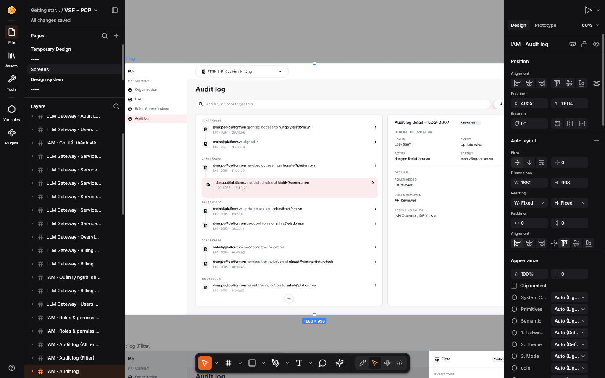
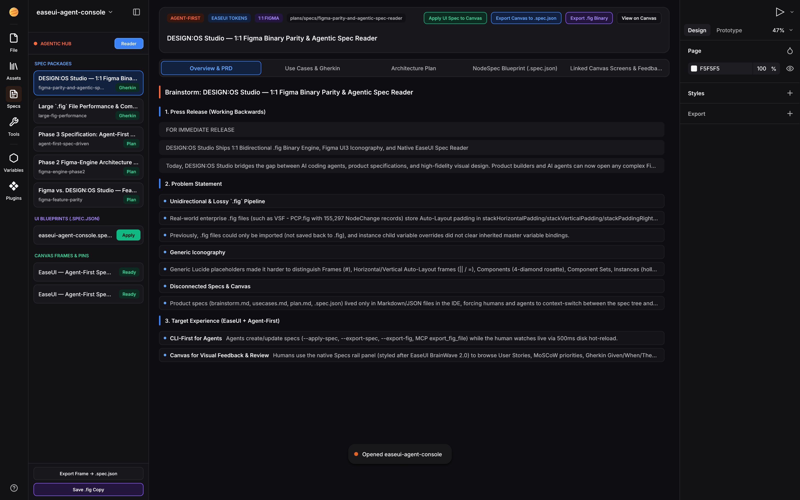
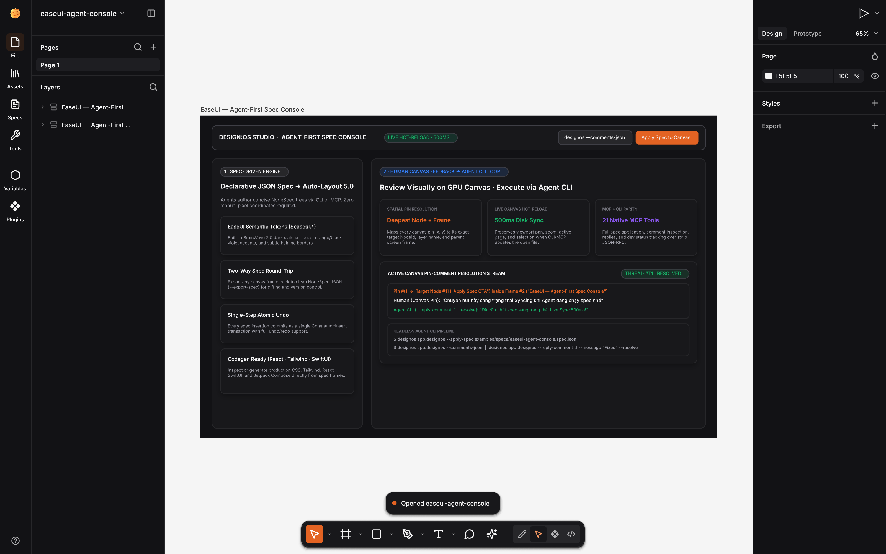
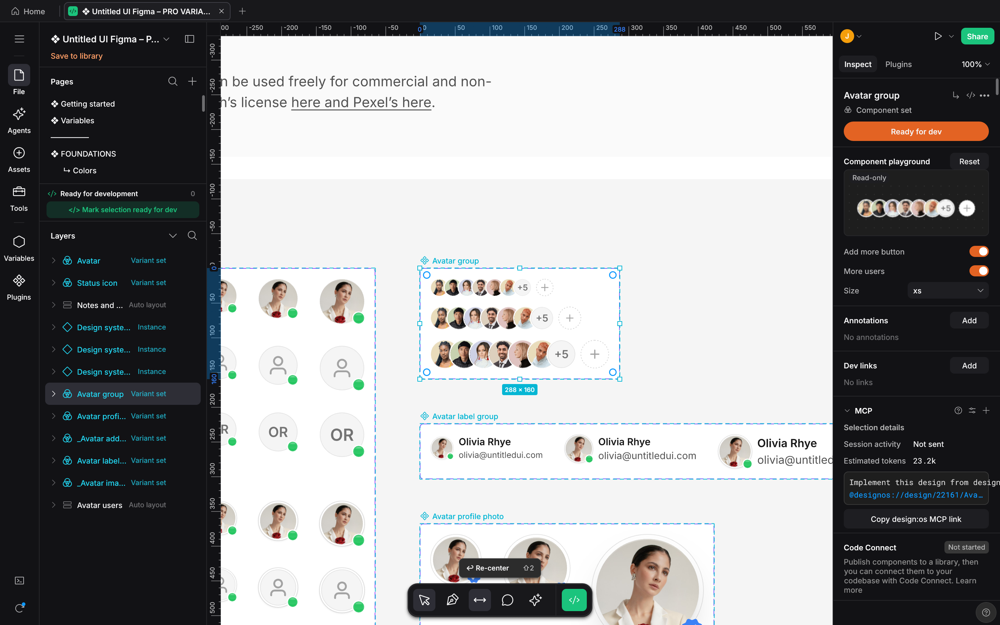
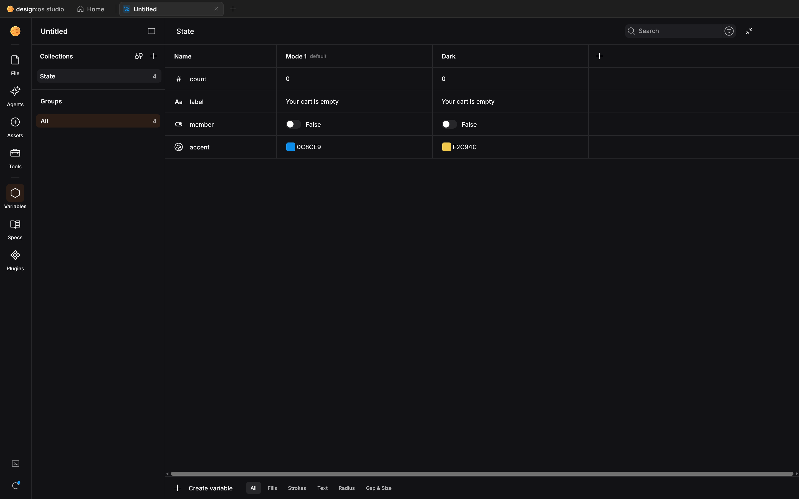
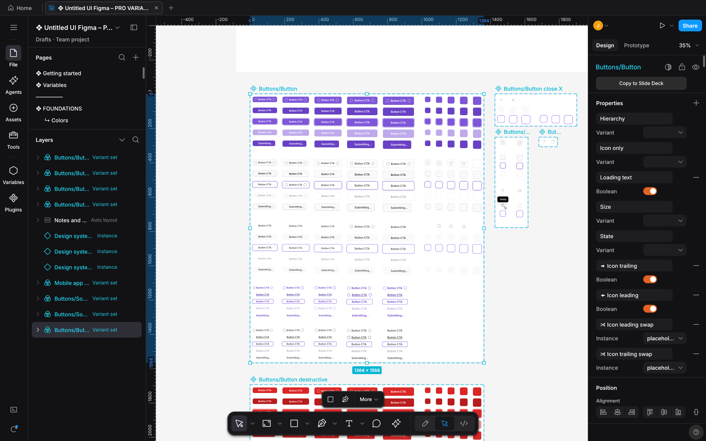
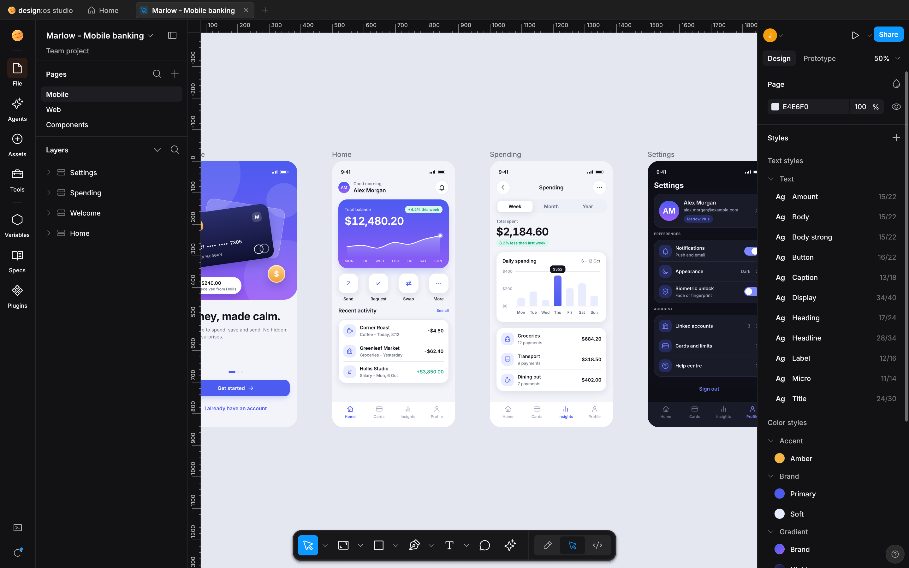

<p align="center">
  
</p>

<h1 align="center">DESIGN:OS Studio</h1>

<p align="center">
  <b>Native GPU-Accelerated Interface Design, Enterprise Figma Engine & Agentic Product Platform Built in Rust.</b><br>
  Part of the <b>DESIGN:OS / EaseUI</b> ecosystem — local-first, zero Electron, powered by <code>wgpu</code> (Metal / Vulkan / DX12),<br>
  with native <code>.fig</code> (700k+ record Kiwi v106 binary) <b>Read &amp; Write</b>, 1:1 Figma UI3 iconography, native Spec Reader, Dev Mode codegen, and 22 MCP tools.
</p>

<p align="center">
  
  
  
  
  
  
</p>

<br>

<p align="center">
  
  <br>
  <sub><b>DESIGN:OS Studio</b> rendering an enterprise <code>.fig</code> design system (<b>723,136 Kiwi records / 112,474 scene nodes</b>) natively on Apple Silicon Metal in <b>1.54s</b> with <b>0.0% idle CPU</b>.</sub>
</p>

<br>

## Why DESIGN:OS Studio?

<table>
  <tr>
    <td width="25%" valign="top">
      <h3>⚡ Enterprise Scale (700k+ Nodes)</h3>
      Engineered around Figma's C++/WebGPU principles and EaseUI's Infinite Canvas LOD: uniform <code>2048×2048</code> spatial grid culling, canonical geometry deduplication, 4-tier semantic zoom LOD, and <code>FrameKey</code> GPU texture reuse.
    </td>
    <td width="25%" valign="top">
      <h3>🎨 EaseUI UI + 1:1 Figma UI3 Icons</h3>
      Deep matte zinc surfaces (<code>#0E0E12</code> / <code>#18181C</code> / <code>#27272D</code>), signature BrainWave orange (<code>#FF6A3D</code>), <code>#2563EB</code> selection blue, and <b>1:1 Figma UI3 iconography</b> (<code>#</code> Frame, <code>||</code> / <code>=</code> Auto-Layout, 4-diamond Component, hollow-diamond Instance).
    </td>
    <td width="25%" valign="top">
      <h3>🗂️ Native <code>.fig</code> Binary Read &amp; Write</h3>
      Opens AND saves standard Figma <code>.fig</code> archives (<code>fig-kiwi</code> v106 binary schema, DEFLATE + Zstd <code>canvas.fig</code> + <code>meta.json</code> + <code>images/</code>) with full <code>parameterConsumptionMap</code>, <code>symbolOverrides</code>, and <code>handoffStatusMap</code> parity.
    </td>
    <td width="25%" valign="top">
      <h3>🤖 Native Spec Reader &amp; Agentic Hub</h3>
      Built-in <b>Spec Reader</b> (<code>--panel specs</code>) renders <code>brainstorm.md</code>, <code>usecases.md</code> (User Stories + Gherkin <code>Given/When/Then</code>), <code>plan.md</code>, and <code>.spec.json</code> alongside linked Canvas screens with 1-click Apply/Export/<code>.fig</code> Save.
    </td>
  </tr>
</table>

---

## Agent-First Workflow: Native Spec Reader + EaseUI Canvas + `.fig` Roundtrip

DESIGN:OS Studio is architected as an **Agentic Product Platform** where AI agents and developers author product specs (`brainstorm.md`, `usecases.md`, `plan.md`, `.spec.json`), generate screens via CLI (`designos`) or MCP (`designos-mcp`), inspect requirements inside the native **Spec Reader** (`--panel specs`), review visually on the GPU Canvas with **500ms live disk hot-reload**, and save directly to standard **Figma `.fig` binary files** (`--export-fig`).

<p align="center">
  
  <br>
  <sub><b>Native In-App Spec Reader (<code>--panel specs</code>):</b> Browse <code>plans/specs/{feature}/</code> packages and <code>examples/specs/*.spec.json</code> with structured MoSCoW badges, User Story cards, syntax-highlighted Gherkin <code>Given/When/Then</code> acceptance criteria, and 1-click <b>Apply Spec to Canvas</b> / <b>Save .fig</b> actions.</sub>
</p>

<p align="center">
  
  <br>
  <sub><b>Declarative Spec -> Auto-Layout 5.0 -> Native <code>.fig</code> Binary Roundtrip:</b> Screen generated from <a href="examples/specs/easeui-agent-console.spec.json"><code>examples/specs/easeui-agent-console.spec.json</code></a>, saved to a standard Figma <code>.fig</code> archive (<code>--export-fig</code>), and reopened with 1:1 Figma UI3 layer icons.</sub>
</p>

```bash
# 1. Generate or update a screen from a declarative EaseUI NodeSpec JSON
designos app.designos --apply-spec examples/specs/easeui-agent-console.spec.json

# 2. Save any document (.designos or .fig) directly to a standard Figma .fig binary archive
designos app.designos --export-fig out.fig

# 3. Launch the native Spec Reader & Agentic Product Hub (or pass --screenshot for headless QA)
designos app.designos --panel specs

# 4. Inspect document hierarchy, screen frames, and Dev Mode status as JSON
designos app.designos --inspect-json

# 5. Read human feedback pins from the Canvas (resolved to exact NodeId + parent Screen Frame)
designos app.designos --comments-json

# 6. Pin a comment, reply to human feedback, and mark the thread resolved
designos app.designos --select "Apply Spec CTA" --add-comment "Switch CTA to Syncing state while agent runs"
designos app.designos --reply-comment t1 --message "Updated spec and auto-reloaded on Canvas!" --resolve

# 7. Export any canvas frame back to a clean, diffable NodeSpec JSON
designos app.designos --select "EaseUI — Agent-First Spec Console" --export-spec out.spec.json
```

---

## Visual Tour

<table>
  <tr>
    <td width="50%" valign="top">
      
      <br>
      <sub><b>Dev Mode & Code Handoff:</b> Inspect layout measurements, resolved tokens, and live generated code in <b>React</b>, <b>Tailwind</b>, <b>CSS</b>, <b>SwiftUI</b>, or <b>Jetpack Compose</b>.</sub>
    </td>
    <td width="50%" valign="top">
      
      <br>
      <sub><b>Variables & Multi-Mode Collections:</b> Inspect and switch across primitive, semantic, and theme token collections (Light/Dark modes, Color/Float/String/Boolean tokens).</sub>
    </td>
  </tr>
  <tr>
    <td width="50%" valign="top">
      
      <br>
      <sub><b>Components & Variants:</b> Master components, variant sets, boolean/text/instance-swap properties, and canonical geometry sharing across thousands of instances.</sub>
    </td>
    <td width="50%" valign="top">
      
      <br>
      <sub><b>4-Tier Semantic Zoom LOD:</b> Bird's-eye overview of a 49,410-node page at 2% zoom using EaseUI Container Collapse (<code>&lt; 6px</code>) and sub-pixel culling.</sub>
    </td>
  </tr>
</table>

---

## Engine Architecture & Performance Benchmarks

DESIGN:OS Studio combines a deterministic CPU reference renderer (`tiny-skia`) with a custom `wgpu` GPU pipeline (`SceneCompiler` + `GeomCache` + multi-pass WGSL shaders).

### Verified Enterprise Benchmark (`VSF - PCP.fig` — 723,136 Kiwi Records / 112,474 Nodes)

| Metric | Unoptimized Baseline | DESIGN:OS Studio (Phase 2) | Improvement |
|---|---|---|---|
| **On-Disk Library File Size** | `6.80 GB` (pretty JSON + int arrays) | **`242 MB`** (compact JSON + `"hex:..."` images + 18 sparse defaults) | **`-96.5%` (`28.3×` smaller)** |
| **Cold Start + Load + 1440×900 GPU Render** | Metal staging buffer crash / OOM | **`1.48s – 1.63s`** | **Zero crash, instant boot** |
| **Static Viewport GPU / CPU Usage** | `100%` CPU (infinite repaint loop) | **`0.0%` CPU** (`FrameKey` GPU texture reuse) | **`Zero` idle CPU/GPU work** |
| **Top-Level Viewport & Hit-Test Culling** | $O(N)$ full-page linear scan | **`O(k)` Uniform Spatial Grid (`2048×2048`)** | **`SceneIndex::query_top_level`** |
| **Single-Node Drag / Resize Index Update** | Full 112k-node `SceneIndex::ensure` | **`O(subtree)` Incremental Propagation** | **`SceneIndex::update_subtree`** |
| **Component Instance & Repeated Shape Mesh** | Re-tessellated per `NodeId` | **Shared Canonical Pool (`GeomCache::shared`)** | **Zero duplicate Lyon / `cosmic-text` builds** |

### Key Rendering Innovations

1. **Pre-Resolve Spatial Culling (`SceneIndex`):** World transforms, bounding boxes, and clip rects are indexed in a flat `2048×2048` uniform spatial grid (`query_top_level`) and checked **before** resolving component instance overrides (`resolve_node`).
2. **4-Tier Semantic Zoom LOD (inspired by EaseUI Infinite Canvas):**
   - `< 0.75px`: Sub-pixel node culling.
   - `< 1.25px`: Micro-text culling; `1.25px..3.5px`: translucent text greeking bars (zero glyph tessellation during zoom-out).
   - `< 6.0px`: Container Collapse — draws the container's own fill/stroke and skips descending into interior children.
   - `>= 6.0px`: Full vector, text, and effect fidelity.
3. **Canonical Geometry Deduplication (`GeomCache`):** Normalizes `Frame`, `Component`, `ComponentSet`, and `Instance` container geometry via `canonical_kind` and deduplicates identical shapes, icons, and text runs across the entire document via `IdHasher` and `GeomCache::shared`.
4. **Hardware Scissor Clip Fallback & Offscreen Pass Cap:** Automatically converts axis-aligned rectangular clips (`max_r_px <= 2.5`) to zero-cost hardware scissor rects and caps offscreen render passes during interactive pan/zoom (`< 64` programs) to prevent Metal staging buffer exhaustion.

---

## Workspace Crate Map

| Crate | Path | Responsibility |
|---|---|---|
| **`designos-doc`** | `crates/designos-doc` | Core scene graph (`Document`, `Node`, `NodeId`, `NodeKind`), Spec-Driven EaseUI builder (`NodeSpec`, `LayoutSpec`, Auto-Layout 5.0 `relayout_subtree`), spatial comment target resolver (`resolve_comment_targets`), compact `.designos` serializer. |
| **`designos-fig`** | `crates/designos-fig` | Figma `.fig` (`fig-kiwi` v106 binary container + DEFLATE/Zstd) **importer AND exporter** (`export_fig`), Figma REST JSON importer/exporter, `parameterConsumptionMap` & `handoffStatusMap` reader, VectorNetwork converter, component instance resolver. |
| **`designos-render`** | `crates/designos-render` | Deterministic CPU renderer (`tiny-skia`), `SceneIndex` (`2048×2048` spatial grid + incremental `update_subtree`), parallel `TileCache`, `i_overlay` boolean ops, `cosmic-text`. |
| **`designos-gpu`** | `crates/designos-gpu` | `wgpu` GPU canvas compiler (`SceneCompiler`), canonical `GeomCache` (`lyon_tessellation` + 8ms frame budget), `PaintCache`, and custom WGSL multi-pass renderer. |
| **`designos-app`** | `crates/designos-app` | Native `egui`/`eframe` desktop studio (`designos-studio` & `designos`), EaseUI BrainWave 2.0 theme, 1:1 Figma UI3 icon set, native **Spec Reader** (`--panel specs`), 500ms live disk hot-reload, headless Agent CLI, virtualized Layers tree, Inspector, Dev Mode. |
| **`designos-library`** | `crates/designos-library` | Local project library (`Recents`, `Starred`, folders, thumbnails, 8 KB fast header probe, zero-alloc `HashSerializer` autosave). |
| **`designos-fonts`** | `crates/designos-fonts` | Bundled Inter variable font, asynchronous Fontsource downloader & local cache, metric-compatible font substitution. |
| **`designos-export`** | `crates/designos-export` | PNG, JPG, PDF, and vector SVG exporters + Dev Mode code generators (React, Tailwind, CSS, SwiftUI, Jetpack Compose). |
| **`designos-svg`** | `crates/designos-svg` | SVG parser and scene-graph importer. |
| **`designos-diff`** | `crates/designos-diff` | Perceptual image diffing library and CLI (`designos-diff`) with SSIM and anti-aliased edge tolerance. |
| **`designos-mcp`** | `crates/designos-mcp` | Local stdio Model Context Protocol server (`designos-mcp`) with 22 tools for AI agents (including spec-driven building, native `.fig` binary export, and canvas comment feedback loops). |

---

## Quick Start

### Build & Run from Source

```bash
git clone https://github.com/jangtrinh/design-os-studio.git
cd design-os-studio

# Launch DESIGN:OS Studio desktop app
cargo run --release -p designos-app --bin designos-studio

# Open a Figma .fig or .designos file directly
cargo run --release -p designos-app --bin designos-studio -- path/to/file.fig

# Save / convert any .designos or .fig file directly to a standard Figma .fig binary archive
cargo run --release -p designos-app --bin designos-studio -- path/to/file.designos --export-fig out.fig

# Open the native Spec Reader & Agentic Product Hub
cargo run --release -p designos-app --bin designos-studio -- --panel specs
```

### Headless GPU Screenshot & QA Automation CLI

DESIGN:OS Studio includes a built-in headless GPU/CPU rendering CLI for automated visual QA and CI pipelines:

```bash
# Render a specific frame from a library file at 60% zoom using the Metal/Vulkan GPU pipeline
designos-studio --open-id <file-id> --select "IAM · Audit log" --zoom 60 --gpu --size 1440x900 --screenshot out.png

# Render the native Spec Reader view for automated spec review
designos-studio --open-id <file-id> --panel specs --gpu --size 1600x1000 --screenshot specs.png

# Render in Dev Mode with React code generation panel open
designos-studio --open-id <file-id> --select "API Docs" --zoom 100 --tab dev --dev-lang react --gpu --screenshot dev.png

# Open the floating Variables & Modes inspector
designos-studio --open-id <file-id> --panel variables --gpu --screenshot variables.png

# Compare two renders with SSIM + anti-aliasing tolerance
cargo run --release -p designos-diff -- compare reference.png out.png --out diff.png
```

---

## Model Context Protocol (`designos-mcp`)

Build the headless MCP server for Claude Code, Cursor, Codex, or Antigravity:

```bash
cargo build --release -p designos-mcp --bin designos-mcp
```

Configure in your MCP client (`mcpServers`):

```json
{
  "mcpServers": {
    "design-os-studio": {
      "command": "/ABSOLUTE/PATH/TO/design-os-studio/target/release/designos-mcp",
      "args": ["--workspace", "/ABSOLUTE/PATH/TO/designs"]
    }
  }
}
```

See [crates/designos-mcp/README.md](crates/designos-mcp/README.md) for the full list of 22 MCP tools (`designos_open_file`, `designos_get_document`, `designos_list_nodes`, `designos_get_node`, `designos_get_variables`, `designos_generate_code`, `designos_create_node`, `designos_update_node`, `designos_delete_node`, `designos_apply_spec`, `designos_export_spec`, `designos_export_fig_file`, `designos_list_comments`, `designos_add_comment`, `designos_reply_comment`, `designos_resolve_comment`, `designos_set_dev_status`, `designos_undo`, `designos_redo`, `designos_save_file`, etc.).

---

## Roadmap

See [plans/specs/figma-feature-parity/roadmap.md](plans/specs/figma-feature-parity/roadmap.md) for our active Phase 3–6 Figma Feature Parity Roadmap.

---

## License

Dual-licensed under [MIT](LICENSE-MIT) or [Apache-2.0](LICENSE-APACHE), at your option.

- **Bundled Fonts:** Inter is © The Inter Project Authors under the SIL Open Font License 1.1 (`crates/designos-fonts/assets/inter/OFL.txt`).
- **Icons:** Editor icons use Lucide under the ISC License (`crates/designos-app/assets/icons/lucide/LICENSE`).
- **Trademarks:** DESIGN:OS Studio is an independent project by Jang Trinh and is not affiliated with, endorsed by, or sponsored by Figma, Inc.
