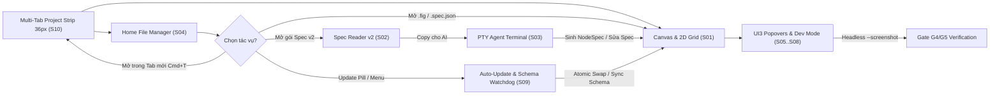

- Owner, revision, template version: po@designos.local · rev 2.3 · template v2

## 1. Problem và bối cảnh

Kỹ sư sản phẩm, nhà thiết kế hệ thống và tác tử lập trình AI (`claude`, `codex`, `grok`) cần một môi trường làm việc native 120fps hợp nhất mang thương hiệu **`design`:os studio** (luôn viết thường toàn bộ, in đậm chữ **`design`**, viết thường `:os studio`), nơi:
1. File thiết kế nhị phân `.fig` (Kiwi container v106) được đọc/ghi lossless 1:1 và tương tác trực tiếp trên toàn bộ 17 loại node cùng bố cục 2D CSS Grid.
2. Toàn bộ bề mặt Figma UI3 Dark Mode (`Desktop Tab Strip 36px`, `Home File Manager`, `Canvas`, `Left Rail 48px`, `Left Sidebar 240px`, `Right Inspector 240px`, `Bottom Floating Toolbar 528×48px`, `Type settings` 3-tab, `Actions Cmd+K`, `Zoom/View`, `Color/Variables Picker`, `Dev Mode </>`) hoạt động chuẩn xác 1:1.
3. Người dùng có thể mở và làm việc song song trên **nhiều tab dự án cùng lúc (`Multiple Tab Project Workspace`, `S10`)** với trạng thái `Document`, `History` (Undo/Redo), `Page`, `Selection`, `View` (Zoom/Pan) và `Dev Mode` được cô lập hoàn toàn theo từng tab.
4. Gói đặc tả `product-os-spec-driven` Format v2 (11 stage, 5 Role Views, 12-column `ui-contract.md`, `G1..G5` gates) và cửa sổ dòng lệnh PTY Agent Terminal gắn kết trực tiếp với Canvas và được xác minh tự động 100% ở chế độ nền (`with_active(false)`).
5. Hệ thống có **Cơ chế Tự động Cập nhật Kép (`Dual-Layer Auto-Update Architecture`)** giúp tự động cập nhật nguyên tử cho ứng dụng/CLI (`Stable | Beta | Nightly` kèm kiểm tra `SHA-256` và rollback `.bak`) đồng thời theo dõi thụ động sự thay đổi phiên bản của `/Applications/Figma.app` (`app.asar` & schema Kiwi `.fig`) để duy trì độ tương thích 99% 1:1 bền vững theo thời gian.

## 2. Mục tiêu sản phẩm (Product Goals & Success Metrics)

- **Độ tương thích nhị phân `.fig` v106**: Bảo toàn 100% `raw_fields`, `parameterConsumptionMap` (id=445), `symbolOverrides` và bố cục 2D CSS Grid khi round-trip `.fig` (`SCN-01-01..03`, `SCN-07-01..03`).
- **Độ phủ giao diện, Thương hiệu & Tương tác Figma UI3**: Đạt 99% độ khớp thị giác và hành vi trên cả 10 màn hình chuẩn `S01..S10`, 17 loại node, và 100% nhãn thương hiệu hiển thị đúng **`design`:os studio** (`SCN-04-01..SCN-06-03`, `SCN-09-01..SCN-10-03`).
- **Độ chính xác truy vết Spec Driven v2**: Khớp 100% giữa `REQ-01..REQ-12`, `US-01..US-10`, 60 dòng `ui-contract.md`, 30 kịch bản `SCN-*` và 5 cổng kiểm duyệt `G1..G5` (`SCN-02-01..03`).
- **Kiểm chứng nền không xâm lấn & Cập nhật nguyên tử**: 100% lệnh chụp ảnh kiểm thử (`--screenshot`) chạy ngầm với `with_active(false)` (`SCN-08-01..03`) và 100% gói cập nhật được xác thực `SHA-256` kèm cơ chế khôi phục `.bak` (`SCN-09-01..03`).

## 3. Kiến trúc Luồng tổng thể (End-to-End Flow)

## 4. Yêu cầu và quy tắc (`REQ-01..REQ-12`)

### 4.1 Lõi Canvas Figma 1:1, `.fig` v106 Binary & 2D CSS Grid

| ID | Requirement | Source | US |
|---|---|---|---|
| REQ-01 | Đọc và ghi trực tiếp định dạng nhị phân `.fig` (Kiwi v106) bảo toàn lossless các trường mở rộng (`raw_fields`, `parameterConsumptionMap`, `symbolOverrides`, `fontVariations`, `toggledOnOTFeatures`) và hỗ trợ bố cục Auto-Layout 2D CSS Grid (`fr`, `px`, `auto`, `col_span`, `row_span`). | contract BR-01 (D1) | US-01, US-06 |
| REQ-02 | Cho phép áp dụng trực tiếp bản thiết kế khai báo `.spec.json` (`NodeSpec`) lên Canvas hiện tại hoặc xuất Frame đang chọn ra `.spec.json` / `.fig` trong 1 cú nhấp. | contract BR-01, BR-05 (D1, D5) | US-01 |

### 4.2 Bộ đọc PRODUCT:OS Spec Driven v2 & Role Views

| ID | Requirement | Source | US |
|---|---|---|---|
| REQ-03 | Tự động phát hiện và nạp cả gói Spec Format v2 (`spec.manifest.json`, `config/pipeline.yaml`, `clarify/clarifications.md`, `contract/FC-001.md`, `prd/PRD.md`, `us/US-*.md`, `wireframe/W-01.md`, `prototype/P-01.md`, `design/tokens.md`, `tdd/test-plan.md`, `ux/ui-contract.md`, `handoff/READY.md`, `review/gates/*.md`) lẫn gói legacy (`brainstorm.md`, `usecases.md`, `plan.md`). | contract BR-02, BR-03 (D2, D3) | US-02 |
| REQ-04 | Hiển thị 5 Role Views chuẩn (`PO View`, `Dev View (US & AC)`, `QA & Coverage`, `Wireframes & UI Contract`, `Gates & Canvas`) cùng thanh 4-Metric KPI Strip, Attention Line và nút `Copy cho AI` trích dẫn chính xác dòng nguồn. | contract BR-02, BR-04 (D4) | US-02 |

### 4.3 Embedded PTY Agent Terminal & Live Canvas Bridge

| ID | Requirement | Source | US |
|---|---|---|---|
| REQ-05 | Tích hợp cửa sổ dòng lệnh PTY đa tab (`claude`, `codex`, `grok`, `$SHELL`) ngay trong Studio, tự động tiêm biến môi trường `DESIGNOS_*`, nhận trực tiếp nội dung `Copy cho AI` từ Spec Reader và đồng bộ `NodeSpec` sinh ra lên Canvas ở 120fps. | contract BR-04, BR-05 (D4, D5) | US-03 |

### 4.4 Màn hình Home, Chrome UI3, Popovers & Tương tác 17 loại Node

| ID | Requirement | Source | US |
|---|---|---|---|
| REQ-06 | Cung cấp màn hình Home & File Manager chuẩn Figma UI3 (`S04`) với 5 phân mục (`Drafts`, `All folders`, `Resources / Templates`, `Starred`, `Trash`), tìm kiếm, lọc theo loại file, sắp xếp, chuyển đổi Grid/List, huy hiệu loại file và menu ngữ cảnh chuột phải. | contract BR-06 (D6) | US-04 |
| REQ-07 | Hiển thị chuẩn xác hệ thống Chrome, Thương hiệu **`design`:os studio** (luôn viết thường, in đậm chữ **`design`**), Settings, Menus và Popovers của Figma UI3 (`S05..S08`): bảng màu `#1E1E1E`/`#2C2C2C`/`#383838`/`#0D99FF`, hộp thoại `Type settings` 3 tab (`Basic | Details | Variable`), thanh `Actions (Cmd+K)` neo dưới đáy, menu `Zoom/View` có ô nhập `%`, `Color Picker`, `Scoped Variables Picker` và `Dev Mode (</>)` Box Model + sinh mã 5 ngôn ngữ. | contract BR-07, BR-08, BR-14 (D6, D10) | US-05 |
| REQ-08 | Hỗ trợ tương tác trực tiếp chuẩn 1:1 Figma trên toàn bộ 17 loại node trên Canvas (`S01`): viền hover/selection `#0D99FF` và `#9747FF`, khoan sâu `double-click`, 8 chốt kéo kích thước, chốt bo góc, chốt kéo padding/gap màu hồng, đường đo khoảng cách `Alt` và lớp phủ ô chấm 2D CSS Grid. | contract BR-09 (D1, D6) | US-06 |

### 4.5 Dịch ngược Kiến trúc Figma (`REA`) & Kiểm chứng Nền (`Headless Verification`)

| ID | Requirement | Source | US |
|---|---|---|---|
| REQ-09 | Thực thi quy trình dịch ngược (`morluto/rea`) đối với `/Applications/Figma.app` (`app.asar`) và `/Users/jangtrinh/Downloads/VSF - PCP.fig` để trích xuất và kiểm chứng tự động schema nhị phân Kiwi v106, bảng ánh xạ biến và hệ token UI3. | contract BR-10 (D7) | US-07 |
| REQ-10 | Đảm bảo mọi lệnh chụp ảnh màn hình và kiểm thử giao diện tự động (`--screenshot`, `--panel`, `--menu`, `--popover`) chạy hoàn toàn ở chế độ nền (`with_visible(false).with_active(false)`), không chiếm quyền điều khiển cửa sổ macOS và kiểm chứng 99% parity cho Gate `G4`/`G5`. | contract BR-11, BR-12 (D8) | US-08 |

### 4.6 Cơ chế Tự động Cập nhật Kép (Dual-Layer Auto-Update Architecture)

| ID | Requirement | Source | US |
|---|---|---|---|
| REQ-11 | Cung cấp cơ chế tự động cập nhật 2 tầng (`updater.rs` + `designos update` + màn hình `S09`): (1) Tự động kiểm tra, tải ngầm, xác thực băm `SHA-256`, hoán đổi nguyên tử (`.staged` → `.bak` → rename) và hỗ trợ khôi phục (`Rollback`) theo 3 kênh `Stable \| Beta \| Nightly`; (2) Tự động theo dõi thụ động phiên bản `/Applications/Figma.app/Contents/Info.plist` & `app.asar` / Kiwi schema (`v106`) ở chế độ chỉ đọc để cảnh báo và đồng bộ schema tức thì (`Sync Figma Schema`). | contract BR-13 (D9) | US-09 |

### 4.7 Không gian Làm việc Đa Tab Dự án & Chuẩn Thương hiệu (`Multiple Tab Project Workspace & Brand Wordmark`)

| ID | Requirement | Source | US |
|---|---|---|---|
| REQ-12 | Cung cấp thanh **Figma UI3 Desktop Tab Strip (`36px`, `S10`)** hỗ trợ mở, ghim (`Pin`), nhân bản (`Duplicate`), đóng (`×` / `Cmd+W`) và chuyển đổi tức thì (`Cmd+T`, `Ctrl+Tab` / `Cmd+Shift+]`, `Cmd+1..9`) giữa nhiều tab dự án song song (`Design`, `FigJam`, `Slides`, `Specs`) với sự cô lập hoàn toàn trạng thái từng tab (`Document`, `History` undo/redo, active `Page`, `Selection`, `View` zoom/pan, `Dev Mode`, `dirty`, `file_path`), đồng thời áp dụng quy chuẩn thương hiệu viết thường **`design`:os studio** (chữ **`design`** in đậm `700`, `:os studio` nét thường `400`). | contract BR-14, BR-15 (D10, D11) | US-10 |

## 5. Phụ thuộc, Giả định và Bàn giao (Dependencies & Handoff)

- **Phụ thuộc nội bộ**: `crates/designos-doc`, `crates/designos-fig`, `crates/designos-render`, `crates/designos-gpu`, `crates/designos-export`, `crates/designos-app`, `crates/designos-mcp`.
- **Bàn giao**: Toàn bộ 12 yêu cầu `REQ-01..REQ-12` được phân rã vào `US-01..US-10`, kiểm chứng qua 30 kịch bản `SCN-01-01..SCN-10-03` và chốt tại `handoff/READY.md`.
