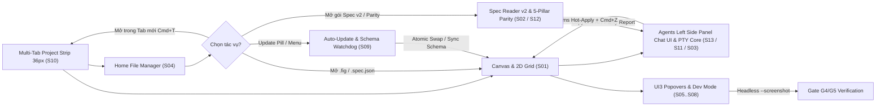

- Owner, revision, template version: po@designos.local · rev 2.8 · template v2

## 1. Problem và bối cảnh

Kỹ sư sản phẩm, nhà thiết kế hệ thống và tác tử lập trình AI (`claude`, `codex`, `agy`, `grok`) cần một môi trường làm việc native 120fps hợp nhất mang thương hiệu **`design`:os studio** (luôn viết thường toàn bộ, in đậm chữ **`design`**, viết thường `:os studio`), nơi:
1. File thiết kế nhị phân `.fig` (Kiwi container v106) được đọc/ghi lossless 1:1 và tương tác trực tiếp trên toàn bộ 17 loại node cùng bố cục 2D CSS Grid.
2. Toàn bộ bề mặt Figma UI3 Dark Mode (`Desktop Tab Strip 36px`, `Home File Manager`, `Canvas`, `Left Rail 48px`, `Left Sidebar 240px`, `Agents Left Side Panel 240px–320px`, `Right Inspector 240px`, `Bottom Floating Toolbar 528×48px`, `Type settings` 3-tab, `Actions Cmd+K`, `Zoom/View`, `Color/Variables Picker`, `Dev Mode </>`) hoạt động chuẩn xác 1:1.
3. Người dùng có thể mở và làm việc song song trên **nhiều tab dự án cùng lúc (`Multiple Tab Project Workspace`, `S10`)** với trạng thái `Document`, `History` (Undo/Redo), `Page`, `Selection`, `View` (Zoom/Pan) và `Dev Mode` được cô lập hoàn toàn theo từng tab.
4. Gói đặc tả `product-os-spec-driven` Format v2 (11 stage, 5 Role Views, 12-column `ui-contract.md`, `G1..G5` gates), bảng điểm **5-Pillar Quantitative Figma Parity Meter (`S12`)** và cửa sổ dòng lệnh PTY Agent Terminal (`S03` / `S11` / `S13`) gắn kết trực tiếp với Canvas và được xác minh tự động 100% ở chế độ nền (`with_active(false)`).
5. Hệ thống có **Cơ chế Tự động Cập nhật Kép (`Dual-Layer Auto-Update Architecture`, `S09`)**, **Hệ thống Biểu tượng Phosphor Icons Đồng nhất (`https://phosphoricons.com/`, `DIR-19`, `US-14`)**, và **Giao diện Chat UI Thuần tuý Bao trên PTY Terminal Shell (`Claude Code`, `Codex`, `Antigravity CLI` · `DIR-21`, `US-15`)** trên toàn bộ 13 màn hình `S01..S13`.

## 2. Mục tiêu sản phẩm (Product Goals & Success Metrics)

- **Độ tương thích nhị phân `.fig` v106**: Bảo toàn 100% `raw_fields`, `parameterConsumptionMap` (id=445), `symbolOverrides` và bố cục 2D CSS Grid khi round-trip `.fig` (`SCN-01-01..03`, `SCN-07-01..03`).
- **Độ phủ giao diện, Thương hiệu, Hệ Icon Phosphor & Tương tác Figma UI3**: Đạt 99%+ độ khớp thị giác và hành vi trên cả 13 màn hình chuẩn `S01..S13`, 17 loại node, 8 luồng tương tác `UF-01..UF-08`, 100% nhãn thương hiệu hiển thị đúng **`design`:os studio**, và 100% biến thể `crate::icons::Icon` (trừ `Icon::Logo`) kết xuất từ SVG `@phosphor-icons/core` (`256×256`) qua `resvg` khớp lưới điểm ảnh theo DPR (`SCN-04-01..SCN-06-03`, `SCN-10-01..SCN-15-03`).
- **Độ chính xác truy vết Spec Driven v2 & Parity Meter**: Khớp 100% giữa `REQ-01..REQ-18`, `US-01..US-15`, 78 dòng `ui-contract.md`, 46 kịch bản `SCN-*`, bảng điểm 5 trụ cột `parity-scorecard.json` và 5 cổng kiểm duyệt `G1..G5` (`SCN-02-01..03`, `SCN-12-01..03`).
- **Kiểm chứng nền không xâm lấn & Cập nhật nguyên tử**: 100% lệnh chụp ảnh kiểm thử (`--screenshot`, `--parity-report`) chạy ngầm với `with_active(false)` (`SCN-08-01..03`) và 100% gói cập nhật được xác thực `SHA-256` kèm cơ chế khôi phục `.bak` (`SCN-09-01..03`).

## 3. Kiến trúc Luồng tổng thể (End-to-End Flow)

## 4. Yêu cầu và quy tắc (`REQ-01..REQ-18`)

### 4.1 Lõi Canvas Figma 1:1, `.fig` v106 Binary & 2D CSS Grid

| ID | Requirement | Source | US |
|---|---|---|---|
| REQ-01 | Đọc và ghi trực tiếp định dạng nhị phân `.fig` (Kiwi v106) bảo toàn lossless các trường mở rộng (`raw_fields`, `parameterConsumptionMap`, `symbolOverrides`, `fontVariations`, `toggledOnOTFeatures`) và hỗ trợ bố cục Auto-Layout 2D CSS Grid (`fr`, `px`, `auto`, `col_span`, `row_span`). | contract BR-01 (D1) | US-01, US-06 |
| REQ-02 | Cho phép áp dụng trực tiếp bản thiết kế khai báo `.spec.json` (`NodeSpec`) lên Canvas hiện tại hoặc xuất Frame đang chọn ra `.spec.json` / `.fig` trong 1 cú nhấp. | contract BR-01, BR-05 (D1, D5) | US-01 |

### 4.2 Bộ đọc PRODUCT:OS Spec Driven v2 & Role Views

| ID | Requirement | Source | US |
|---|---|---|---|
| REQ-03 | Tự động phát hiện và nạp cả gói Spec Format v2 (`spec.manifest.json`, `config/pipeline.yaml`, `clarify/clarifications.md`, `contract/FC-001.md`, `prd/PRD.md`, `us/US-*.md`, `wireframe/W-01.md`, `prototype/P-01.md`, `design/tokens.md`, `tdd/test-plan.md`, `ux/ui-contract.md`, `handoff/READY.md`, `review/gates/*.md`) lẫn gói legacy (`brainstorm.md`, `usecases.md`, `plan.md`). | contract BR-02, BR-03 (D2, D3) | US-02, US-11 |
| REQ-04 | Hiển thị 5 Role Views chuẩn (`PO View`, `Dev View (US & AC)`, `QA & Coverage`, `Wireframes & UI Contract`, `Gates & Canvas`) cùng thanh 4-Metric KPI Strip, Attention Line và nút `Copy cho AI` trích dẫn chính xác dòng nguồn. | contract BR-02, BR-04 (D4) | US-02, US-12 |

### 4.3 Embedded PTY Agent Terminal & Live Canvas Bridge

| ID | Requirement | Source | US |
|---|---|---|---|
| REQ-05 | Tích hợp cửa sổ dòng lệnh PTY đa tab (`claude`, `codex`, `agy`, `grok`, `$SHELL`) ngay trong Studio, tự động tiêm biến môi trường `DESIGNOS_*`, nhận trực tiếp nội dung `Copy cho AI` từ Spec Reader và đồng bộ `NodeSpec` sinh ra lên Canvas ở 120fps. | contract BR-04, BR-05 (D4, D5) | US-03, US-11, US-15 |

### 4.4 Màn hình Home, Chrome UI3, Popovers & Tương tác 17 loại Node

| ID | Requirement | Source | US |
|---|---|---|---|
| REQ-06 | Cung cấp màn hình Home & File Manager chuẩn Figma UI3 (`S04`) với 5 phân mục (`Drafts`, `All folders`, `Resources / Templates`, `Starred`, `Trash`), tìm kiếm, lọc theo loại file, sắp xếp, chuyển đổi Grid/List, huy hiệu loại file và menu ngữ cảnh chuột phải. | contract BR-06 (D6) | US-04 |
| REQ-07 | Hiển thị chuẩn xác hệ thống Chrome, Thương hiệu **`design`:os studio** (luôn viết thường, in đậm chữ **`design`**), Settings, Menus và Popovers của Figma UI3 (`S05..S08`): bảng màu `#1E1E1E`/`#2C2C2C`/`#383838`/`#0D99FF`, hộp thoại `Type settings` 3 tab (`Basic \| Details \| Variable`), thanh `Actions (Cmd+K)` neo dưới đáy, menu `Zoom/View` có ô nhập `%`, `Color Picker`, `Scoped Variables Picker` và `Dev Mode (</>)` Box Model + sinh mã 5 ngôn ngữ. | contract BR-07, BR-08, BR-14, BR-22 (D6, D10, D17) | US-05, US-14 |
| REQ-08 | Hỗ trợ tương tác trực tiếp chuẩn 1:1 Figma trên toàn bộ 17 loại node trên Canvas (`S01`): viền hover/selection `#0D99FF` và `#9747FF`, khoan sâu `double-click`, 8 chốt kéo kích thước, chốt bo góc, chốt kéo padding/gap màu hồng, đường đo khoảng cách `Alt` và lớp phủ ô chấm 2D CSS Grid. | contract BR-09 (D1, D6) | US-06 |

### 4.5 Dịch ngược Kiến trúc Figma (`REA`) & Kiểm chứng Nền (`Headless Verification`)

| ID | Requirement | Source | US |
|---|---|---|---|
| REQ-09 | Thực thi quy trình dịch ngược (`morluto/rea`) đối với `/Applications/Figma.app` (`app.asar`) và `/Users/jangtrinh/Downloads/VSF - PCP.fig` để trích xuất và kiểm chứng tự động schema nhị phân Kiwi v106, bảng ánh xạ biến và hệ token UI3. | contract BR-10 (D7) | US-07 |
| REQ-10 | Đảm bảo mọi lệnh chụp ảnh màn hình và kiểm thử giao diện tự động (`--screenshot`, `--panel`, `--menu`, `--popover`, `--parity-report`) chạy hoàn toàn ở chế độ nền (`with_visible(false).with_active(false)`), không chiếm quyền điều khiển cửa sổ macOS và kiểm chứng 99%+ parity cho Gate `G4`/`G5`. | contract BR-11, BR-12 (D8) | US-08 |
| REQ-20 | Tái tạo tự động bộ 16 ảnh bằng chứng thị giác Retina 2x (`docs/screenshots/*.png`) ở chế độ nền (`with_visible(false).with_active(false)`) thông qua `scripts/capture-visual-proof.sh` phản ánh đầy đủ Phosphor Icons (`DIR-19`), `Agents` Pure PTY Chat Wrapper (`DIR-21`), `387/387 (100.00%)` Parity (`DIR-20`), đóng gói đa nền tảng (`DIR-22`), và nâng cấp `README.md` (12-Section AI-Ready README, 5-Gate `D1..D5`) cùng `docs/index.html` (9-Tier GitHub Pages, SEO/AEO/GEO `G1..G5`) theo chuẩn `https://github.com/jangtrinh/design-os-github-page` (`DIR-23`). | contract BR-25 (D20) | US-08, US-15 |

### 4.6 Cơ chế Tự động Cập nhật Kép & Đóng gói Bản phát hành Đa nền tảng (`Dual-Layer Auto-Update & Cross-Platform Release Packaging` · `DIR-11`, `DIR-22`)

| ID | Requirement | Source | US |
|---|---|---|---|
| REQ-11 | Cung cấp cơ chế tự động cập nhật 2 tầng (`updater.rs` + `designos update` + màn hình `S09`): (1) Tự động kiểm tra, tải ngầm, xác thực băm `SHA-256`, hoán đổi nguyên tử (`.staged` → `.bak` → rename) và hỗ trợ khôi phục (`Rollback`) theo 3 kênh `Stable \| Beta \| Nightly`; (2) Tự động theo dõi thụ động phiên bản `/Applications/Figma.app/Contents/Info.plist` & `app.asar` / Kiwi schema (`v106`) ở chế độ chỉ đọc để cảnh báo và đồng bộ schema tức thì (`Sync Figma Schema`). | contract BR-13 (D9) | US-09 |
| REQ-19 | Cung cấp quy trình đóng gói bản phát hành cuối cùng đa nền tảng (`macOS`, `Windows`, `Linux` · `DIR-22`) bao gồm cả 4 tệp thực thi (`designos-studio`, `designos`, `designos-mcp`, `designos-diff`): gói `.app` (`os.design.studio`) + đĩa cài `.dmg` kéo-thả vào `/Applications` + `install-cli.command` + `.tar.gz` trên macOS (`scripts/package-macos.sh`), trình cài đặt đồ họa NSIS `-setup.exe` (`packaging/windows/installer.nsi`) + script PowerShell `install.ps1`/`uninstall.ps1` + `.zip` trên Windows (`scripts/package-windows.ps1`), gói `.deb` Debian/Ubuntu + `.tar.gz` kèm `./install.sh` / `.desktop` / MIME XML / `AppRun` trên Linux (`scripts/package-linux.sh`), cùng bộ điều phối `scripts/build-release.sh` và `.github/workflows/release.yml` tự động sinh `dist/release-manifest.json` + `SHA256SUMS` cho `updater.rs`. | contract BR-24 (D19) | US-09 |

### 4.7 Không gian Làm việc Đa Tab Dự án & Chuẩn Thương hiệu (`Multiple Tab Project Workspace & Brand Wordmark`)

| ID | Requirement | Source | US |
|---|---|---|---|
| REQ-12 | Cung cấp thanh **Figma UI3 Desktop Tab Strip (`36px`, `S10`)** hỗ trợ mở, ghim (`Pin`), nhân bản (`Duplicate`), đóng (`×` / `Cmd+W`) và chuyển đổi tức thì (`Cmd+T`, `Ctrl+Tab` / `Cmd+Shift+]`, `Cmd+1..9`) giữa nhiều tab dự án song song (`Design`, `FigJam`, `Slides`, `Specs`) với sự cô lập hoàn toàn trạng thái từng tab (`Document`, `History` undo/redo, active `Page`, `Selection`, `View` zoom/pan, `Dev Mode`, `dirty`, `file_path`), đồng thời áp dụng quy chuẩn thương hiệu viết thường **`design`:os studio** (chữ **`design`** in đậm `700`, `:os studio` nét thường `400`). | contract BR-14, BR-15 (D10, D11) | US-10 |

### 4.8 Bộ Tác tử Figma AI 1:1, Lõi PTY 5-Runtime & Thước đo Định lượng `%` Parity

| ID | Requirement | Source | US |
|---|---|---|---|
| REQ-13 | Cung cấp trọn bộ **6 tác vụ Figma AI** (`Make Design / First Draft`, `Make Prototype`, `Rename Layers`, `Rewrite / Translate / Shorten Text`, `Populate Realistic Data`, `Design Gate Audit & Auto-Fix`) trên `Actions (⌘K)` (`S06`), `Agents` (`S11`/`S13`) và Canvas Context Menu, kết nối trực tiếp tới **5 CLI Runtime Presets (`claude`, `codex`, `agy`, `grok`, `$SHELL`)** kèm cơ chế áp dụng nóng `$DESIGNOS_LIVE_SPEC` trong `<50ms`, hoàn tác 1 bước `Cmd+Z` và đóng kín Gaps A–F của Figma `126.9.13`. | contract BR-16, BR-17, BR-18 (D12, D13) | US-11 |
| REQ-14 | Cung cấp bộ **Thước đo Định lượng 5 Trụ cột Độ khớp 1:1 với Figma (`S12`)** ($\text{Total} = 0.25 P_1 + 0.20 P_2 + 0.20 P_3 + 0.20 P_4 + 0.15 P_5$) thông qua `scripts/figma_parity_meter.py`, `research/parity-scorecard.json`, cờ CLI `designos --parity-report` và thẻ Live Parity Scorecard trong Spec Reader v2 (`S02` / `S12`). | contract BR-19 (D14) | US-12 |

### 4.9 Bảng `Agents` Left Side Panel (`DIR-17`), 9 Sai lệch Thị giác, 8 Userflows (`DIR-18`, `DIR-20`), Hệ thống Biểu tượng Phosphor (`DIR-19`) & Pure PTY Chat Wrapper (`DIR-21`)

| ID | Requirement | Source | US |
|---|---|---|---|
| REQ-15 | Đặt mục **`Agents` (`✦`)** ở vị trí thứ 2 trên Left Rail ngay dưới `File` (`DIR-17`) và kết xuất bảng **1:1 Figma UI3 `Agents` Left Side Panel (`240px–320px`, `S13`)** chiếm trọn chiều cao từ đỉnh panel với `< New chat / Shared` + `[AI]` + `[↗]` + `•••`, banner `#26354A`, `"What's next?"`, 3 nhóm gợi ý (`Tidy and polish`, `Generate designs`, `Create plugins and shaders`), cửa sổ VT100 PTY `>_ Terminal` nội tuyến (`claude`/`codex`/`grok`/`$SHELL`) và hộp nhập `"Ask for changes"` viền `#0D99FF`, đồng thời khắc phục toàn bộ **9 Visual Deltas (`DIR-18`)**. | contract BR-20 (D15) | US-13, US-15 |
| REQ-16 | Thực thi chuẩn xác máy trạng thái 1:1 cho **8 luồng tương tác người dùng đầu-cuối (`UF-01..UF-08`, `DIR-18`, `DIR-20`)**: `UF-01` (nhấn `File` trên Left Rail khi đang ở mục khác chuyển ngay về `File` trong 1 cú nhấp trước khi thu gọn), `UF-02` (`Agents` và `Assets` sở hữu toàn bộ chiều cao Left Side Panel), `UF-03` (đồng bộ hai chiều `Design \| Prototype \| </>` giữa Bottom Toolbar và Right Inspector), `UF-04` (chuyển đổi `Home <-> Multi-Tab` bảo toàn 100% state từng tab), `UF-05` (gợi ý và hộp nhập trong `Agents` Side Panel điều phối trực tiếp tới PTY/Canvas kèm 1 bước `Undo`), `UF-06..UF-08` (kiểm thử toàn trình `userflows_uf01_to_uf08_end_to_end_figma_parity`). | contract BR-21 (D16) | US-13 |
| REQ-17 | Đồng nhất 100% hệ thống biểu tượng (`crate::icons::Icon`, ngoại trừ biểu tượng thương hiệu `Icon::Logo`) của **`design`:os studio** trên toàn bộ 13 màn hình `S01..S13` sang bộ **Phosphor Icons chính thức (`https://phosphoricons.com/`, `@phosphor-icons/core` `viewBox="0 0 256 256"`, `fill="currentColor"`)** đóng gói tại `crates/designos-app/assets/icons/phosphor/*.svg` và rasterize qua `resvg` kèm bộ đệm `SVG_CACHE` theo `(Icon, physical_px)` và căn lưới điểm ảnh theo DPR (`round_to_pixel`) (`DIR-19`). | contract BR-22 (D17) | US-14 |
| REQ-18 | Thực thi bề mặt `Agents` (`RailItem::Agents`, `S13`) thuần tuý dưới dạng **Giao diện Chat UI Native bao trực tiếp trên PTY Terminal Shell (`Claude Code`, `Codex`, `Antigravity CLI` · `DIR-21`)**: cung cấp thanh chọn nhanh 1-click (`Claude Code \| Codex \| Antigravity`), bong bóng hội thoại User/Assistant (`AgentChatTurn` / `AgentChatRole`) stream trực tiếp stdout đã lọc mã ANSI (`sync_chat_from_pty` + `strip_ansi_codes`), phát hiện `NodeSpec` nội tuyến kèm nút/huy hiệu áp dụng lên Canvas (`1-step Undo`), đính kèm ngữ cảnh Selection + Pin-Comment (`+`) và chuyển đổi tức thì giữa luồng Chat sạch và màn hình VT100 Terminal thô mà không cần API key trả phí bên ngoài. | contract BR-23 (D18) | US-15 |
| REQ-21 | Thực thi trọn bộ **20 máy trạng thái vi tương tác chuẩn 1:1 Figma Desktop `126.9.13` (`MI-01..MI-20`, `ux/figma-micro-interactions-spec.md`)** bao gồm: tăng/giảm số bằng bàn phím `ArrowUp`/`ArrowDown` (`±1`/`±10`/`±0.1`) giữ nguyên vùng bôi đen (`MI-01`), bộ tính toán biểu thức toán học Shunting-Yard & toán tương đối `Mixed` (`MI-02`), kéo trượt nhãn tiền tố `Scrub` (`1×`/`10×`/`0.1×`, `Alt+Wheel`, `<2px` click-to-focus, `Escape` rollback, `MI-03`), tăng/giảm từng kênh màu Hex `RR`/`GG`/`BB` và viết tắt Hex `1–8` ký tự + tên màu CSS (`MI-04`, `MI-05`), chốt kéo trực tiếp trên Canvas cho Corner Radius (`MI-06`), Ellipse Arc/Donut/StartAngle (`MI-07`), Polygon/Star (`MI-08`), Auto-Layout Pink Padding/Gap (`MI-09`, `MI-10`), phím bổ trợ `Shift`/`Alt`/`Cmd`/`Space` (`MI-11`, `MI-12`), thước đo khoảng cách `Alt` `#F24822` & đường gióng thông minh (`MI-13`, `MI-14`), bộ đệm phím độ mờ `0–9` `400ms` (`MI-15`), điều hướng phân cấp bàn phím (`MI-16`), đồng bộ hover hai chiều Layer ↔ Canvas & đổi tên nhanh `Tab` (`MI-17`, `MI-18`), kính lúp chấm màu Eyedropper `I` (`MI-19`) và thao tác nhanh Component/Auto-Layout (`MI-20`). | contract BR-09, BR-26 (D1, D6) | US-17 |

## 5. Phụ thuộc, Giả định và Bàn giao (Dependencies & Handoff)

- **Phụ thuộc nội bộ**: `crates/designos-doc`, `crates/designos-fig`, `crates/designos-render`, `crates/designos-gpu`, `crates/designos-export`, `crates/designos-app` (`src/icons.rs`, `src/terminal.rs`, `src/updater.rs`, `src/widgets/field.rs`, `src/widgets/picker.rs`, `src/canvas/handles.rs`, `src/canvas/interact.rs`, `src/canvas/draw.rs`, `assets/icons/phosphor/*.svg`), `crates/designos-mcp`, `scripts/build-release.sh`, `scripts/package-macos.sh`, `scripts/package-windows.ps1`, `scripts/package-linux.sh`, `scripts/capture-visual-proof.sh`, `README.md`, `docs/index.html`, `.github/workflows/release.yml`.
- **Bàn giao**: Toàn bộ 21 yêu cầu `REQ-01..REQ-21` được phân rã vào `US-01..US-17`, kiểm chứng qua 52 kịch bản `SCN-*` và chốt tại `handoff/READY.md`.

