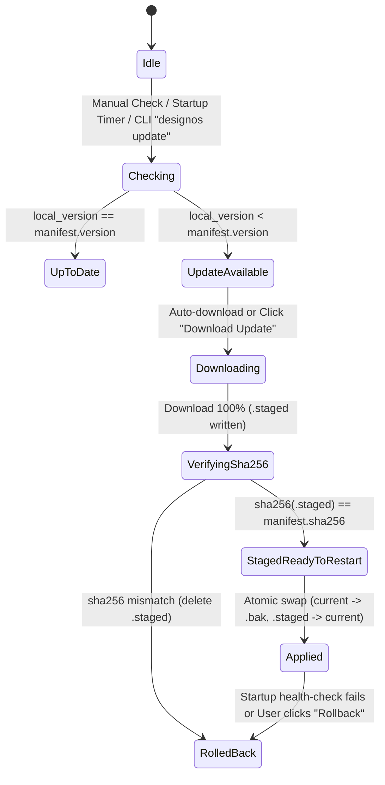

Tài liệu này mô tả máy trạng thái tương tác (Interactive State Machine), phím tắt chuẩn Figma UI3 và luồng chuyển màn hình giữa `S01..S09` trong **DESIGN:OS Studio**.

---

## 1. Sơ đồ Chuyển trạng thái Màn hình (Screen Navigation State Machine)

```mermaid
stateDiagram-v2
    [*] --> S04_Home: Launch / Click Home Icon
    S04_Home --> S01_Canvas: Open .fig / + New Design File
    S04_Home --> S02_SpecReader: Open Spec Format v2 Bundle
    S04_Home --> S09_AutoUpdate: Click Update Available Pill / Check for Updates
    S01_Canvas --> S02_SpecReader: Left Rail -> Specs (RailItem::Specs)
    S02_SpecReader --> S01_Canvas: Click "Apply Spec to Canvas" / "Focus Frame"
    S02_SpecReader --> S03_Terminal: Click "Copy cho AI" -> Paste Citation
    S01_Canvas --> S03_Terminal: Ctrl+` / Left Rail -> Terminal
    S03_Terminal --> S01_Canvas: Agent emits NodeSpec JSON -> Live Relayout
    S01_Canvas --> S05_TypeAndZoom: Click Typography "⋯" or "Zoom % ⌄"
    S01_Canvas --> S06_ActionsCmdK: Press Cmd+K / Click Bottom Toolbar Actions
    S01_Canvas --> S07_DevMode: Toggle Dev Mode "</>" (Shift+D)
    S01_Canvas --> S08_ColorAndVars: Click Fill/Stroke Swatch or Variable Pill
    S01_Canvas --> S09_AutoUpdate: Main Menu -> Desktop app -> Check for Updates
```

---

## 2. Máy Trạng thái Tự động Cập nhật Kép (`S09` Dual-Layer Auto-Update State Machine)



---

## 3. Bảng Phím tắt & Tương tác Chuẩn Figma UI3 (Keyboard & Pointer Map)

| Phím tắt / Thao tác chuột | Màn hình nguồn | Màn hình / Trạng thái đích | Hành vi chi tiết (Observable Behavior) | Kịch bản (`SCN`) |
|---|---|---|---|---|
| `V` / `F` / `R` / `O` / `P` / `T` / `C` | `S01` | `S01` (`Active Tool`) | Chuyển công cụ trên thanh nổi dưới đáy (`Move`, `Frame`, `Rectangle`, `Ellipse`, `Pen`, `Text`, `Comment`); tô xanh `#0D99FF` nút đang chọn. | `SCN-06-01` |
| `Hover` chuột trên phần tử Canvas | `S01` | `S01` (`Hover Outline`) | Vẽ đường viền `#0D99FF` `1px` (`#9747FF` cho Component/Instance) quanh hình hộp của bất kỳ node nào trong 17 loại `NodeKind`. | `SCN-06-01` |
| `Double-click` trên Frame/Group/Instance | `S01` | `S01` (`Drill-Down`) | Khoan sâu một cấp vào cây con; nếu là node `Text` thì mở con trỏ soạn thảo tại chỗ; nếu là `Vector` thì bật chế độ sửa đỉnh Bezier. | `SCN-06-01` |
| Kéo chốt bo góc / chốt hồng Auto-Layout | `S01` | `S01` (`Live Handle Drag`) | Cập nhật trực tiếp `corner_radius`, `padding` hoặc `item_spacing` / `grid_gap` kèm nhãn số nổi và ghi nhận lệnh `Undo`. | `SCN-06-02` |
| Giữ `Alt` (`Option`) khi chọn 1 node | `S01`, `S07` | `S01`, `S07` (`Redline Measure`) | Vẽ đường gióng đỏ/cam kèm khoảng cách pixel chính xác từ node đang chọn tới phần tử đang trỏ hoặc mép Frame cha. | `SCN-06-02`, `SCN-05-03` |
| Chọn `Flow: Grid` trong Right Inspector | `S01` | `S01` (`2D CSS Grid`) | Chuyển Frame sang `LayoutDirection::Grid`, hiển thị đường chấm chia ô lưới và nhãn track (`1fr`, `2fr`, `auto`, `px`) trên Canvas. | `SCN-01-02`, `SCN-06-03` |
| Nhấn `Cmd+K` hoặc nút `Actions` đáy | `S01` | `S06` (`Bottom Cmd+K`) | Mở hộp thoại `Actions` neo cách đáy cửa sổ `68px` với 4 tab `All | AI | Actions | Libraries` và chạy kiểm toán `Design Gate`. | `SCN-05-02` |
| Nhấn `⋯` ở mục `Typography` | `S01` | `S05` (`Type Settings`) | Mở popover `Type settings` 3 tab (`Basic | Details | Variable`), cho phép kéo thanh trượt trục `wght`, `wdth`, `opsz`, `slnt` và bật cờ OpenType. | `SCN-05-01` |
| Nhấn `Zoom % ⌄` ở góc trên bên phải | `S01` | `S05` (`Zoom/View Menu`) | Mở menu Zoom có ô nhập trực tiếp tỷ lệ `%` và các nút gạt `Pixel grid`, `Snap to pixel grid`, `Layout grids`, `Rulers`. | `SCN-05-02` |
| Nhấn `Shift+D` hoặc nút `</>` ở đáy | `S01` | `S07` (`Dev Mode`) | Chuyển Right Inspector sang `Dev Mode` màu xanh lá `#24CB71`, hiển thị sơ đồ Box Model và mã nguồn 5 ngôn ngữ (`CSS`, `Tailwind`, `React`, `SwiftUI`, `Compose`). | `SCN-05-03` |
| Nhấn ô màu hoặc biểu tượng 4 chấm `∷` | `S01` | `S08` (`Color / Variables`) | Mở `Color Picker` (`Custom | Libraries`) hoặc `Scoped Variables Picker` tự động lọc biến theo đúng phạm vi thuộc tính (`matches_scope`). | `SCN-05-03` |
| Nhấn `Copy cho AI` trong Spec Reader | `S02` | `S02` → `S03` | Sinh khối trích dẫn Markdown chuẩn (`File: <path>:<start>-<end>`, `Mục`, `Trang reader`, `Project`), lưu vào `last_ai_copy` và truyền sang PTY Terminal. | `SCN-02-02`, `SCN-03-02` |
| Nhấn `Update available` hoặc `Check for Updates…` | `S04`, `S01` | `S09` (`Auto-Update Modal`) | Mở hộp thoại `Auto-Update & Figma Schema Watchdog`, cho phép đổi kênh `Stable/Beta/Nightly`, áp dụng bản cập nhật `.staged`, khôi phục `.bak` hoặc chạy `Sync Figma Schema`. | `SCN-09-01..03` |
| Nhấn `+` / `Cmd+T` / `Cmd+W` / `Ctrl+Tab` / `Cmd+1..9` | `S10`, `S04`, `S01` | `S10` (`Multi-Tab Project Switch`) | Mở dự án mới trong tab riêng, đóng tab hiện hành, hoặc chuyển đổi tức thì giữa các tab dự án đang mở với trạng thái `Document`, `History` (Undo/Redo), `Page`, `Selection` và `Zoom/Pan` hoàn toàn độc lập; hiển thị thương hiệu **`design`:os studio** (chữ **`design`** in đậm). | `SCN-10-01..03` |
| Chạy CLI `--screenshot <path.png>` | CLI | `S01..S10` (`Headless`) | Khởi chạy với `with_visible(false).with_active(false)`, dựng hình ở chế độ nền và xuất file PNG không làm mất focus cửa sổ macOS. | `SCN-08-01..03` |
