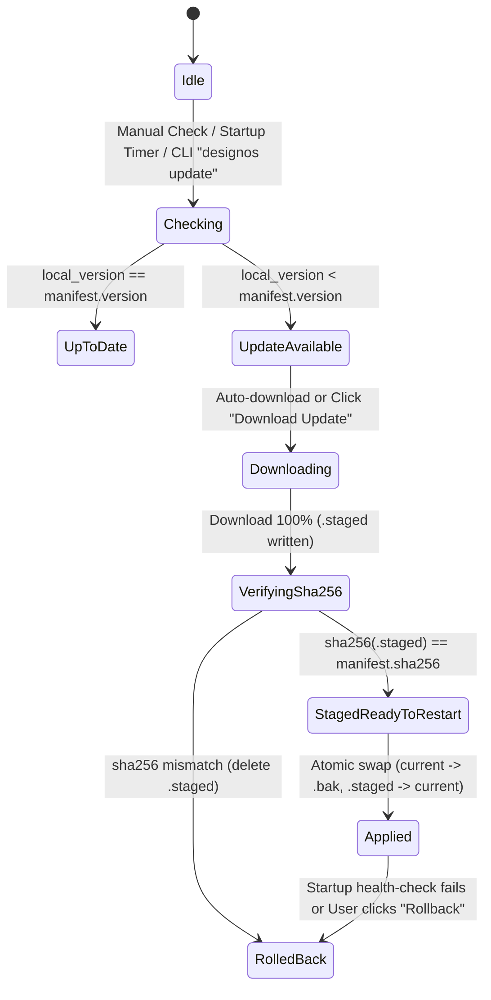

Tài liệu này mô tả máy trạng thái tương tác (Interactive State Machine), 8 luồng tương tác chuẩn 1:1 Figma (`UF-01..UF-08`), hệ thống biểu tượng Phosphor Icons đồng nhất (`DIR-19` / `US-14`), giao diện Chat UI native bao trực tiếp trên PTY terminal shell (`Claude Code` / `Codex` / `Antigravity CLI`, `DIR-21` / `US-15`), phím tắt chuẩn Figma UI3 và luồng chuyển màn hình giữa `S01..S13` trong **`design`:os studio**.

---

## 1. Sơ đồ Chuyển trạng thái Màn hình (Screen Navigation State Machine `S01..S13`)

```mermaid
stateDiagram-v2
    [*] --> S04_Home: Launch / Click Home Icon on S10 Tab Strip
    S04_Home --> S10_MultiTab: Open .fig / + New Design File (UF-04)
    S10_MultiTab --> S01_Canvas: Activate Project Tab (Isolated Document/History/View)
    S04_Home --> S02_SpecReader: Open Spec Format v2 Bundle
    S04_Home --> S09_AutoUpdate: Click Update Available Pill / Check for Updates
    S01_Canvas --> S13_AgentsSidePanel: Left Rail #2 -> Agents (✦) (UF-01 / UF-02 / DIR-21)
    S13_AgentsSidePanel --> S01_Canvas: Click File on Left Rail (1-Click Return UF-01) or Inline NodeSpec Apply
    S13_AgentsSidePanel --> S03_Terminal: Instant Toggle Chat Thread <-> Raw VT100 >_ Terminal or Pop-out [↗]
    S13_AgentsSidePanel --> S11_AgentSuite: Run Suggestion / Ask for changes (UF-05)
    S11_AgentSuite --> S01_Canvas: <50ms Live Spec Hot-Apply + 1-Step Cmd+Z Undo
    S01_Canvas --> S02_SpecReader: Left Rail -> Specs (RailItem::Specs)
    S02_SpecReader --> S12_ParityScorecard: View 5-Pillar Figma 1:1 Parity Meter
    S12_ParityScorecard --> S03_Terminal: Click "Copy Parity Report cho AI"
    S02_SpecReader --> S01_Canvas: Click "Apply Spec to Canvas" / "Focus Frame"
    S02_SpecReader --> S03_Terminal: Click "Copy cho AI" -> Paste Citation
    S01_Canvas --> S05_TypeAndZoom: Click Typography "⋯" or "Zoom % ⌄"
    S01_Canvas --> S06_ActionsCmdK: Press Cmd+K / Click Bottom Toolbar Actions
    S01_Canvas --> S07_DevMode: Toggle Dev Mode "</>" (Shift+D / UF-03)
    S01_Canvas --> S08_ColorAndVars: Click Fill/Stroke Swatch or Variable Pill
    S01_Canvas --> S09_AutoUpdate: Main Menu -> Desktop app -> Check for Updates
```

---

## 2. Máy Trạng thái Tự động Cập nhật Kép (`S09` Dual-Layer Auto-Update State Machine)



---

## 3. Bảng Phím tắt, 8 Userflows (`UF-01..UF-08`) & Tương tác Chuẩn Figma UI3 (`S01..S13`)

| Phím tắt / Thao tác chuột | Màn hình nguồn | Màn hình / Trạng thái đích | Hành vi chi tiết (Observable Behavior) | Kịch bản (`SCN`) |
|---|---|---|---|---|
| `V` / `F` / `R` / `O` / `P` / `T` / `C` | `S01` | `S01` (`Active Tool`) | Chuyển công cụ trên thanh nổi dưới đáy (`Move`, `Frame`, `Rectangle`, `Ellipse`, `Pen`, `Text`, `Comment`) dùng icon Phosphor chuẩn; tô xanh `#0D99FF` nút đang chọn. | `SCN-06-01`, `SCN-13-02`, `SCN-14-03` |
| `Hover` chuột trên phần tử Canvas | `S01` | `S01` (`Hover Outline`) | Vẽ đường viền `#0D99FF` `1px` (`#9747FF` cho Component/Instance) quanh hình hộp của bất kỳ node nào trong 17 loại `NodeKind`. | `SCN-06-01` |
| `Double-click` trên Frame/Group/Instance | `S01` | `S01` (`Drill-Down`) | Khoan sâu một cấp vào cây con; nếu là node `Text` thì mở con trỏ soạn thảo tại chỗ; nếu là `Vector` thì bật chế độ sửa đỉnh Bezier. | `SCN-06-01` |
| Kéo chốt bo góc / chốt hồng Auto-Layout | `S01` | `S01` (`Live Handle Drag`) | Cập nhật trực tiếp `corner_radius`, `padding` hoặc `item_spacing` / `grid_gap` kèm nhãn số nổi và ghi nhận lệnh `Undo`. | `SCN-06-02` |
| Giữ `Alt` (`Option`) khi chọn 1 node | `S01`, `S07` | `S01`, `S07` (`Redline Measure`) | Vẽ đường gióng đỏ/cam kèm khoảng cách pixel chính xác từ node đang chọn tới phần tử đang trỏ hoặc mép Frame cha. | `SCN-06-02`, `SCN-05-03` |
| Chọn `Flow: Grid` trong Right Inspector | `S01` | `S01` (`2D CSS Grid`) | Chuyển Frame sang `LayoutDirection::Grid`, hiển thị đường chấm chia ô lưới và nhãn track (`1fr`, `2fr`, `auto`, `px`) trên Canvas. | `SCN-01-02`, `SCN-06-03` |
| Nhấn `Cmd+K` hoặc nút `Actions` đáy | `S01` | `S06`, `S11` (`Bottom Cmd+K`) | Mở hộp thoại `Actions` neo cách đáy `68px` với 4 tab gạch chân `All \| Assets \| Plugins & widgets \| Design Gate`, nhãn `[AI]`/`[Development]` và 6 tác vụ Figma AI. | `SCN-05-02`, `SCN-11-02`, `SCN-13-02` |
| Nhấn `⋯` ở mục `Typography` | `S01` | `S05` (`Type Settings`) | Mở popover `Type settings` lọc nội dung riêng theo từng tab (`Basic \| Details \| Variable`), kéo trục biến thiên và bật cờ OpenType. | `SCN-05-01`, `SCN-11-04` |
| Nhấn `Zoom % ⌄` ở góc trên bên phải | `S01` | `S05` (`Zoom/View Menu`) | Mở menu Zoom có ô nhập trực tiếp tỷ lệ `%` và các nút gạt `Pixel grid`, `Snap to pixel grid`, `Layout grids`, `Rulers`. | `SCN-05-02` |
| Nhấn `Shift+D` hoặc `Draw \| Design \| </>` (`UF-03`) | `S01` | `S07` (`Dev Mode / Mode Sync`) | Đồng bộ hai chiều tức thì giữa Bottom Toolbar 3-way switcher và Right Inspector (`RightTab::Design`, `RightTab::Prototype`, hoặc `Inspect \| Plugins` kèm `v MCP` & `Code Connect` trong Dev Mode). | `SCN-05-03`, `SCN-13-02`, `SCN-13-03` |
| Nhấn ô màu hoặc biểu tượng 4 chấm `∷` | `S01` | `S08` (`Color / Variables`) | Mở `Color Picker` (kèm kiểm tra tương phản WCAG AA/AAA) hoặc `Scoped Variables Picker` có tiêu đề nhóm `/`. | `SCN-05-03`, `SCN-11-04` |
| Nhấn `Copy cho AI` / `Copy Parity Report cho AI` | `S02`, `S12` | `S02`/`S12` → `S03` | Sinh khối trích dẫn Markdown chuẩn (`File: <path>:<start>-<end>`), lưu vào `last_ai_copy` và truyền sang PTY Terminal. | `SCN-02-02`, `SCN-03-02`, `SCN-12-03` |
| Nhấn `Update available` hoặc `Check for Updates…` | `S04`, `S01` | `S09` (`Auto-Update Modal`) | Mở hộp thoại `Auto-Update & Figma Schema Watchdog`, đổi kênh `Stable/Beta/Nightly`, áp dụng `.staged`, khôi phục `.bak` hoặc chạy `Sync Figma Schema`. | `SCN-09-01..03` |
| Nhấn `+` / `Cmd+T` / `Cmd+W` / `Home <-> Tab` (`UF-04`) | `S10`, `S04`, `S01` | `S10` (`Multi-Tab Project Switch`) | Mở/chuyển đổi tức thì giữa `Home` và các tab dự án đang mở với trạng thái `Document`, `History` (Undo/Redo), `Page`, `Selection` và `Zoom/Pan` hoàn toàn độc lập; hiển thị thương hiệu **`design`:os studio**. | `SCN-10-01..03`, `SCN-13-03` |
| Nhấn `Agents` (`✦`) rồi nhấn `File` trên Left Rail (`UF-01`, `UF-02`, `UF-05`) | `S01`, `S13` | `S13` ↔ `S01` (`Agents Side Panel`) | Nhấn `Agents` (`✦`, mục #2 trên Left Rail) mở bảng `Agents` chiếm trọn chiều cao Left Side Panel (`240px–320px`) kèm VT100 PTY `>_ Terminal` và hộp nhập `#0D99FF` `"Ask for changes"`; nhấn `File` 1 lần chuyển ngay về `Pages & Layers`, nhấn lần 2 mới thu gọn panel. | `SCN-13-01`, `SCN-13-03` |
| Chọn pill `Claude Code \| Codex \| Antigravity` & gửi tin nhắn trong `Agents` (`DIR-21`) | `S13` | `S13` ↔ `S03` ↔ `S01` (`Pure PTY Chat Wrapper`) | Khởi chạy/chuyển phiên PTY `claude`/`codex`/`agy`, ghi lệnh vào stdin, đồng bộ stdout đã lọc mã ANSI (`sync_chat_from_pty` + `strip_ansi_codes`) vào bong bóng Assistant (`AgentChatTurn`), phát hiện `NodeSpec` nội tuyến để áp dụng lên Canvas (`1-step Undo`), đính kèm ngữ cảnh Selection/Pin-Comment (`+`) và chuyển đổi tức thì giữa Chat thread và màn hình VT100 Terminal thô. | `SCN-15-01..03` |
| Kết xuất biểu tượng `Icon` trên `S01..S13` (`DIR-19`) | `S01..S13` | `S01..S13` (`Phosphor Icons`) | Mọi biến thể `crate::icons::Icon` (trừ `Icon::Logo`) nạp SVG từ `assets/icons/phosphor/*.svg` (`256×256`), rasterize qua `resvg` vào `SVG_CACHE` theo `(Icon, physical_px)` và căn lưới điểm ảnh theo DPR (`round_to_pixel`). | `SCN-14-01..03` |
| Chạy CLI `--screenshot <path.png>` / `--parity-report` | CLI | `S01..S13` (`Headless`) | Khởi chạy với `with_visible(false).with_active(false)`, dựng hình/báo cáo ở chế độ nền không làm mất focus cửa sổ macOS. | `SCN-08-01..03`, `SCN-12-02` |
