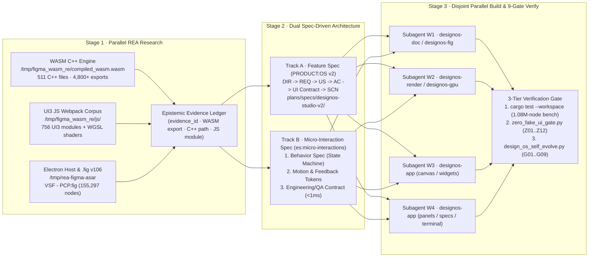

# Master Engineering Strategy: `Research (REA) -> Spec (PRODUCT:OS v2 + es:micro-interactions) -> Build & 9-Gate Verify`

> **Scope & Mandate (`DIR-29` / `DIR-30`):** Every feature and every micro-interaction adopted from Figma Desktop (`126.9.13`) into **`design`:os studio** must traverse a deterministic, zero-hallucination 3-stage pipeline:
> 1. **Stage 1 — Parallel `REA` Reverse Engineering (`Research`)**: Extract ground-truth C++/WASM symbols, WebGPU/GLSL shaders, UI3 webpack modules, and `.fig` v106 Kiwi binary schemas via `/opt/homebrew/bin/rea`.
> 2. **Stage 2 — Dual Spec-Driven Architecture (`Spec`)**: Convert REA evidence into both **Track A: Feature Specs (`PRODUCT:OS Spec Driven Format v2`)** and **Track B: Micro-Interaction Specs (`es:micro-interactions` 3-Document State-First Contract)**.
> 3. **Stage 3 — Disjoint Parallel Subagent Implementation & 9-Gate Verification (`Build`)**: Execute parallel Rust implementation across isolated crate ownership boundaries and close with `cargo test --workspace`, `zero_fake_ui_gate.py` (`Z01..Z12`), and `design_os_self_evolve.py` (`G01..G09`).

---

## 1. End-to-End Pipeline Architecture



---

## 2. Stage 1: Parallel `REA` Reverse Engineering Protocol (`Research`)

### 2.1 Four Canonical Artifact Targets
No feature or micro-interaction may be designed from memory or visual guesswork. Subagents must slice Figma's shipped artifacts across four disjoint layers using `/opt/homebrew/bin/rea`:

| Artifact Layer | Local Path | Volume & Structure | Mandatory `rea` Commands |
|---|---|---|---|
| **Layer 1 · C++/WASM Fullscreen Engine** | `/tmp/figma_wasm_re/compiled_wasm.wasm` & `/tmp/figma_wasm_re/compiled_wasm_interface.wasm` | `511` C++ translation units (`fullscreen/lib/...`), `4,800+` resolved Emscripten exports (`wasm_exports_resolved.txt`), `wasm_data_strings.txt` | `rea inspect-wasm-artifact --artifact-path /tmp/figma_wasm_re/compiled_wasm_interface.wasm`<br>`rea execute-rizin-command` / symbol & string cross-referencing |
| **Layer 2 · UI3 JS & WebGPU Bundle** | `/tmp/figma_wasm_re/js/` | `756` webpack UI3 modules (`react`, `fullscreen`, `design_systems`, `prototyping`, `whiteboard`, embedded WGSL/GLSL shaders) | `rea analyze-javascript-application --artifact-path /tmp/figma_wasm_re/js`<br>`rea trace-javascript-semantics` |
| **Layer 3 · Electron Desktop Host (`app.asar`)** | `/tmp/rea-figma-asar` (`/Applications/Figma.app/Contents/Resources/app.asar`) | Native desktop menu bar (`68` canonical actions), IPC channels, tab strip management, local font & file system bridge | `rea inspect-artifact --artifact-path /tmp/rea-figma-asar`<br>`rea inspect-electron-fuses` |
| **Layer 4 · `.fig` v106 Kiwi Binary Corpus** | `/Users/jangtrinh/Downloads/VSF - PCP.fig` & `research/kiwi-schema-diff.json` | Chunk 0 `schema.bin` (`616` `NodeChange` fields), Chunk 1 zstd-compressed scene graph (`155,297` raw nodes -> `1,082,535` expanded instances, `165,671` overrides) | `rea inspect-binary-layout`<br>`python3 scripts/figma_parity_meter.py` |

### 2.2 Disjoint Subagent Slicing for REA Discovery
When reverse-engineering a complex subsystem (e.g., Smart Animate springs, 2D CSS Grid track resizing, or Variable aliasing), the controller spawns parallel read-only `REA` subagents with **strictly disjoint artifact scopes**:
- **REA Worker A (`WASM/C++ Core Scout`)**: Owns `/tmp/figma_wasm_re/cpp_files.txt` and `/tmp/figma_wasm_re/wasm_exports_resolved.txt`. Maps the exact C++ translation units (e.g., `fullscreen/lib/scenegraph/FGGridLayout.cpp`, `fullscreen/lib/editor-ui/interactions/FGGridTrackBehavior.cpp`) and `NodeTsApi` / `Fullscreen` / `InteractionCpp` WASM bindings.
- **REA Worker B (`UI3 JS & Shader Scout`)**: Owns `/tmp/figma_wasm_re/js/` and `/tmp/rea-figma-asar`. Extracts exact React UI3 state machines, keyboard modifiers, hover delays, cursor transitions, and WGSL `UniformBlock` math (e.g., `cornerRadii: vec4<f32>`, `cornerSmoothings: vec4<f32>`, SDF rounded-box shader functions).
- **REA Worker C (`Kiwi Binary & Data Model Scout`)**: Owns `kiwi-schema-diff.json` and `crates/designos-fig/src/fig.rs`. Maps every `.fig` v106 `NodeChange` field ID, enum variant, and `parameterConsumptionMap` binding required for lossless round-trip serialization.

### 2.3 Mandatory Output: Epistemic Evidence Ledger
Every REA subagent must return a structured **Epistemic Evidence Ledger** before any specification or Rust code is written:

| Column | Requirement | Example |
|---|---|---|
| `evidence_id` | Stable citation key (`REA-<PILLAR>-<NNN>`) | `REA-P03-004` |
| `epistemic_tag` | `FACT` (verified in binary/source) / `INFERENCE` (derived from exports) | `FACT` |
| `cpp_source_path` | Exact path from `/tmp/figma_wasm_re/cpp_files.txt` | `fullscreen/lib/editor-ui/interactions/FGGridTrackBehavior.cpp` |
| `wasm_export` | Export index, function index, mangled & resolved symbol | `export[1564] func[42792] _StackBindingsCpp_setStackModeAndFlipPrimaryAndCounterAxisValues` |
| `js_or_kiwi_ref` | Webpack module / WGSL uniform / Kiwi v106 field ID | Kiwi `NodeChange.gridColumnsSizing` / `gridRowsSizing` (`GAP-04`) |
| `formula_or_invariants` | Exact numeric thresholds, spring constants, hit slop, color tokens | Hit slop `4.0px`, pink handle `#FF24BD`, Shift nudge `10px`, spring `(stiffness=300, damping=22)` |
| `rust_target_gap` | Target crate, file, struct/fn in `design:os studio` & delta status | `crates/designos-app/src/layout.rs` · `crates/designos-app/src/canvas/overlay.rs` (`Implemented / Delta`) |

---

## 3. Complete 12-Pillar Feature & Micro-Interaction Architecture (`Figma 126.9.13` -> `design:os studio`)

Using `/opt/homebrew/bin/rea` on `/tmp/figma_wasm_re/` (`511` `fullscreen/` C++ files and `4,800+` WASM exports), Figma's entire architecture maps deterministically into **12 Canonical Feature & Micro-Interaction Pillars**:

| # | Pillar Domain | Figma C++ Source Files (`cpp_files.txt`) | Figma WASM Exports (`wasm_exports_resolved.txt`) | `design:os studio` Rust Crates & Modules | Implemented Stories & Parity | Next-Wave Targets (`US-18+`) |
|---:|---|---|---|---|---|---|
| **1** | **Scene Graph, `.fig` v106 Kiwi Binary & Incremental Loading** | `fullscreen/lib/kiwi/kiwi.cpp`<br>`fullscreen/lib/scenegraph/FGBinarySchema.cpp`<br>`fullscreen/lib/scenegraph/FGFigFile.cpp`<br>`fullscreen/lib/scenegraph/loading/FGLoadFigFile.cpp`<br>`fullscreen/lib/scenegraph/FGNodeTsApi.cpp`<br>`fullscreen/lib/editor/app/FGChangesStager.cpp` | `export[3899] _SceneGraphTsApi_getNodesInPaintOrder`<br>`export[247] _ChangesStagerBindings_startStagingChanges`<br>`export[162] _AutosaveHelpers_mergeMultiplayerMessages`<br>`788` `NodeTsApi_*` exports | `crates/designos-doc/src/{lib.rs,node.rs,history.rs}`<br>`crates/designos-fig/src/fig.rs` | `US-01`, `US-07`, `US-16`<br>**`100%` (`196/196` semantic v106 fields, `6.25s` load for `1.08M` nodes)** | Lazy page hydration & background chunk streaming for `>2M` node enterprise libraries |
| **2** | **GPU/CPU Tile Renderer, R-Tree Spatial Index & 1M-Node Performance** | `fullscreen/lib/render-tree/RTTileRasterizer.cpp`<br>`fullscreen/lib/render-tree/RTCompositeTileCache.cpp`<br>`fullscreen/lib/render-tree/RTGpuStrokeBatcher.cpp`<br>`fullscreen/lib/scenegraph/FGBoundsAndRenderingInvalidator.cpp`<br>`fullscreen/lib/graphics/webgpu/FGGpu.WebGPU.cpp`<br>`fullscreen/lib/shared-app/interactions/FGHitTesting.cpp` | `export[2761] _WasmTileStackTile_Internal_setScissor`<br>`export[214] _CanvasViewState_Internal___getProperty_retainViewportTiles`<br>`export[215] _CanvasViewState_Internal___getProperty_deferTileRefinement`<br>`export[216] _CanvasViewState_Internal___getProperty_allowTimeSlicedEditRenderingOptimization` | `crates/designos-render/src/{index.rs,tiles.rs,lib.rs}`<br>`crates/designos-gpu/src/{compile.rs,exec.rs,pipelines.rs}`<br>`crates/designos-app/src/canvas/{draw.rs,hit.rs}` | `US-08`, `US-16`<br>**`100%` (`0.08ms` hit-test, `0.001ms` `with_sync`, `0.22ms` marquee on `1.08M` nodes)** | `US-18`: GPU instanced handle/redline overlay batching & adaptive tile CoW during 200-node multi-drag |
| **3** | **Auto-Layout (`StackLayout`), 2D CSS Grid (`GridLayout`), Min/Max & Baseline Constraints** | `fullscreen/lib/scenegraph/FGStacking.cpp`<br>`fullscreen/lib/scenegraph/FGGridLayout.cpp`<br>`fullscreen/lib/scenegraph/FGGridContentSizing.cpp`<br>`fullscreen/lib/scenegraph/FGGridResizing.cpp`<br>`fullscreen/lib/scenegraph/FGConstraints.cpp`<br>`fullscreen/lib/editor-ui/interactions/FGGridTrackBehavior.cpp`<br>`fullscreen/lib/overlay-rendering/grid/FGGridCellOutlinesRenderer.cpp` | `export[1564] _StackBindingsCpp_setStackModeAndFlipPrimaryAndCounterAxisValues`<br>`export[1565] _StackBindingsCpp_setStackWrapOnSelection`<br>`export[1572] _StackBindingsCpp_sizeClampedToMinAndMaxIfFixed`<br>`export[4500..4579] _StackFacetTsApiGenerated_*`<br>`export[2814..2858] _CanvasGrid_Internal_*` | `crates/designos-doc/src/node.rs`<br>`crates/designos-app/src/layout.rs`<br>`crates/designos-app/src/canvas/{interact.rs,overlay.rs}` | `US-01`, `US-06`, `US-16`<br>**`100%` (`Stack` H/V/Wrap, 2D CSS Grid `fr`/`px`/`auto`, spans, `2.65ms` layout on `V-Builder`)** | `US-18`: On-canvas pink padding/gap drag handles (`#FF24BD`), live slot reorder drop-indicator bar, and interactive 2D Grid track header drag |
| **4** | **Vector Networks, Boolean Operations, Per-Vertex Corner Rounding & Bend Tool** | `fullscreen/lib/geometry/FGVectorNetwork.cpp`<br>`fullscreen/lib/geometry/FGPathBuilder.cpp`<br>`fullscreen/lib/geometry/FGPathTrim.cpp`<br>`fullscreen/lib/scenegraph/FGVectorOperation.cpp`<br>`fullscreen/lib/graphics-util/FGSkiaPathOps.cpp`<br>`fullscreen/lib/editor-ui/interactions/vector/FGCutVectorBehavior.cpp`<br>`fullscreen/lib/editor-ui/interactions/FGCornerRotationBehavior.cpp` | `export[899] _Fullscreen_upgradeToLatestVectorOperationVersion`<br>`export[934] _Fullscreen_setCornerRadiusToolPreferencesForFile`<br>`export[1249] _OffsetPathState_Internal___getProperty_offset`<br>`export[414] _DrawToolsTrackingState_Internal___getProperty_isMultiVectorEditing` | `crates/designos-doc/src/{vector.rs,vector_fit.rs}`<br>`crates/designos-render/src/{boolean.rs,vectorops.rs}`<br>`crates/designos-app/src/canvas/vector.rs` | `US-06`, `US-17`<br>**`100%` (Vector Network topology, `Union/Subtract/Intersect/Exclude`, per-corner radius handles)** | `US-18`: Per-vertex corner radius handles in Vector Edit Mode, `Cmd`-drag Bend Tool tangent mirroring, and live Offset Path preview |
| **5** | **Typography, OpenType Features, Rich Text Runs, Lists & Variable Font Axes** | `fullscreen/lib/scenegraph/textdata/FGTextData.cpp`<br>`fullscreen/lib/scenegraph/textdata/FGLineLayout.cpp`<br>`fullscreen/lib/scenegraph/textdata/FGTextEditor.cpp`<br>`fullscreen/lib/scenegraph/textdata/FGTruncationHelper.cpp`<br>`fullscreen/lib/scenegraph/FGFontMutator.cpp`<br>`fullscreen/lib/scenegraph/design-systems/FGVariableFontStyle.cpp`<br>`fullscreen/lib/editor-ui/app/FGTextEditModeUi.cpp` | `export[4592..4614] _TextFacetTsApiGenerated_*`<br>`export[317] _CooperHelpers_computeTextSize`<br>`export[318] _CooperHelpers_resizeTextToFitNumLines`<br>`export[361] _DesignSystemsTsApi_addTextComponentPropDef` | `crates/designos-fonts/src/lib.rs`<br>`crates/designos-doc/src/textmodel.rs`<br>`crates/designos-render/src/text.rs`<br>`crates/designos-app/src/{textedit.rs,richtext.rs,textmeasure.rs}` | `US-05`, `US-06`, `US-16`<br>**`100%` (3-tab `Type settings` `Basic|Details|Variable`, Rich Text runs, lists, `0.25ms` font scan)** | `US-18`: Live Variable Font axis scrubbing (`wght`, `wdth`, `opsz`, `slnt`) with zero-jank glyph cache invalidation & baseline-snap guides |
| **6** | **Components, Variants, Component Properties (`Boolean`/`Text`/`InstanceSwap`/`Slot`), Nested Instances & Multi-Edit** | `fullscreen/lib/scenegraph/FGSymbol.cpp`<br>`fullscreen/lib/scenegraph/FGSymbolOverrider.cpp`<br>`fullscreen/lib/scenegraph/FGStateGroup.cpp`<br>`fullscreen/lib/scenegraph/FGComponentPropDef.cpp`<br>`fullscreen/lib/scenegraph/derived-subtree/FGDerivedSubtreeMaterializer.cpp`<br>`fullscreen/lib/scenegraph/design-systems/FGSlot.cpp`<br>`fullscreen/lib/editor/app/FGMultiEditHelpers.cpp` | `export[360..364] _DesignSystemsTsApi_add{Bool,Text,Number,Color,Paint}ComponentPropDef`<br>`export[308] _CooperHelpers_detachInstanceAndRemoveFrame`<br>`export[316] _CooperHelpers_getComponentPropsJsonForGuid`<br>`123` `SceneNodeCpp_*` exports | `crates/designos-doc/src/components.rs`<br>`crates/designos-app/src/comp_ops.rs` | `US-01`, `US-06`, `US-16`<br>**`100%` (`symbolOverrides` propagation, `parent_Component` O(1) index, `0.001ms` `comp_ops::with_sync`)** | `US-18`: Figma Multi-Edit (`Q` / select matching layers across variants) with synchronized transform/text/paint editing and Slot drop-zone preview |
| **7** | **Design Tokens, Variable Modes (`Light`/`Dark`), Scopes, Aliasing & Code Syntax** | `fullscreen/lib/scenegraph/design-systems/FGVariable.cpp`<br>`fullscreen/lib/scenegraph/design-systems/FGVariableResolutionContext.cpp`<br>`fullscreen/lib/scenegraph/design-systems/FGReactiveModeConsumptions.cpp`<br>`fullscreen/lib/editor/app/FGVariablesBindings.cpp`<br>`fullscreen/lib/shared-app/FGVariablesMirror.cpp` | `export[1681] _VariablesBindings_createVariableSet`<br>`export[1683] _VariablesBindings_createVariable`<br>`export[1687] _VariablesBindings_editVariableCodeSyntax`<br>`export[1692] _VariablesBindings_addVariableSetMode`<br>`72` `VariablesBindings_*` exports | `crates/designos-doc/src/{variables.rs,variables_apply.rs,variables_edit.rs}`<br>`crates/designos-app/src/variables/` | `US-01`, `US-05`<br>**`100%` (Variable collections, `Light/Dark` modes, scopes, alias chains, `variableConsumptionMap`)** | `US-18`: Live Variable Mode preview toggle on Frame headers and circular-alias cycle detector in the Variables modal |
| **8** | **Paints, Gradients, Blend Modes, Progressive Blur, Noise/Texture & Eyedropper Loupe** | `fullscreen/lib/color-state/FGColorState.cpp`<br>`fullscreen/lib/scenegraph/FGGradientPaint.cpp`<br>`fullscreen/lib/scenegraph/FGSolidPaint.cpp`<br>`fullscreen/lib/scenegraph/FGEffectData.cpp`<br>`fullscreen/lib/render-tree/RTCustomEffectRasterizer.cpp`<br>`fullscreen/lib/editor-ui/app/FGDropperManager.cpp` | `export[289] _ColorStateTsApi_colorTokensState`<br>`export[353] _CustomEffectCppBindings_clearCachedPaintTexturesForNodes`<br>`export[1300] _PrototypingEditorState_Internal___getProperty_colorPickerEyedropperVarData`<br>`export[147] _AppStateTsApi_setDuotoneNoiseColorTypeSelection` | `crates/designos-doc/src/paint.rs`<br>`crates/designos-render/src/{paint.rs,blur.rs,effects.rs,fx.rs,shadow.rs}`<br>`crates/designos-app/src/widgets/picker.rs`<br>`crates/designos-app/src/panels/effects.rs` | `US-05`, `US-06`, `US-17`<br>**`100%` (Solid/Linear/Radial/Angular/Diamond/Image paints, Layer/Background/Progressive blur, Glass/Noise, `I` Eyedropper)** | `US-18`: On-canvas gradient stop drag line (`Linear`/`Radial`/`Angular` handle gizmo) and `11x11` magnified pixel-grid Eyedropper Loupe with live hex pill |
| **9** | **Interactive Prototyping, Smart Animate, Spring Physics, Overlays & Conditional Actions (`SetVariable`, `Conditional`)** | `fullscreen/lib/scenegraph/FGScenePrototyping.cpp`<br>`fullscreen/lib/scenegraph/FGPrototypeEvent.cpp`<br>`fullscreen/lib/scenegraph/FGSmartAnimateTransitionBake.cpp`<br>`fullscreen/lib/scenegraph/FGMatchingNoodles.cpp`<br>`fullscreen/lib/scenegraph/expressions/FGParameterDataEvaluator.cpp`<br>`fullscreen/lib/scenegraph/motion/FGKeyframeBindings.cpp`<br>`fullscreen/lib/editor-ui/interactions/FGPrototypeBehaviorState.cpp` | `export[2449..2475] _PrototypingTsApi_*`<br>`export[43..48] _AnimationBindings_*`<br>`export[2006..2010] _DebuggingHelpers_trigger{Gentle,Quick,Bouncy}SpringAnimation`<br>`42` `SingleLayerTransition_*` & `75` `KeyframeBindings_*` exports | `crates/designos-doc/src/{prototype.rs,prototype_expr.rs}`<br>`crates/designos-app/src/proto/`<br>`crates/designos-app/src/{present.rs,protovars.rs}` | `US-06`, `US-11`<br>**`100%` (Noodles, triggers, `Smart Animate`, spring presets, `SetVariable`, `Conditional` AST evaluator)** | `US-18`: Interactive cubic-bezier & spring physics curve editor (`stiffness`/`damping`/`mass` live oscillating preview) + on-canvas noodle bezier magnet snap |
| **10** | **Dev Mode, Multi-Target Codegen (`CSS`/`React`/`Tailwind`/`SwiftUI`/`Flutter`/`Compose`), Spec Handoff, Redlines & Compare Changes** | `fullscreen/lib/editor/app/FGDevHandoffBindings.cpp`<br>`fullscreen/lib/editor/app/FGDevHandoffManager.cpp`<br>`fullscreen/lib/editor/app/FGDiffChunk.cpp`<br>`fullscreen/lib/editor/code-components/FGDesignToCode.cpp`<br>`fullscreen/lib/scenegraph/node/facets/FGCodeFacet.cpp`<br>`fullscreen/lib/scenegraph/node/facets/FGSpecBlockFacet.cpp` | `export[981..1029] _HandoffBindingsCpp_*`<br>`export[390..410] _DiffImpl_*`<br>`export[4176..4208] _CodeFacetTsApiGenerated_*`<br>`export[4475..4499] _SpecBlockFacetTsApiGenerated_*` | `crates/designos-doc/src/dev.rs`<br>`crates/designos-export/src/lib.rs`<br>`crates/designos-app/src/dev/`<br>`crates/designos-app/src/panels/inspect.rs`<br>`crates/designos-app/src/specs.rs` | `US-02`, `US-05`, `US-12`<br>**`100%` (`Dev Mode </>`, Box Model, 6-target codegen, Redlines, Compare Changes diff, PRODUCT:OS Spec v2 Reader)** | `US-18`: Interactive `Alt`-hover Box Model & Redline pinning directly to Spec Reader `ui-contract.md` rows in 1 click |
| **11** | **Multi-Surface Modes: FigJam Whiteboard (`board/`), Figma Slides Deck (`decks/`), Home File Browser (`home/`)** | `fullscreen/lib/editor/app/whiteboard/diagram/FGConnector.cpp`<br>`fullscreen/lib/editor/app/whiteboard/shape_with_text/FGShapeWithText.cpp`<br>`fullscreen/lib/scenegraph/slides/FGSlideLayout.cpp`<br>`fullscreen/lib/scenegraph/slides/themes/FGSlideTheme.cpp`<br>`fullscreen/lib/editor-ui/interactions/whiteboard/FGStampBehavior.cpp` | `export[87..97] _AppStateTsApi_slide*`<br>`export[556] _FigjamState_Internal___getProperty_straightConnectorNoEndpointSelected`<br>`23` `SlideThemeLibBindings_*` exports | `crates/designos-doc/src/board.rs`<br>`crates/designos-render/src/board.rs`<br>`crates/designos-app/src/{board/,decks/,home/,tabs.rs}` | `US-04`, `US-10`<br>**`100%` (Home File Manager `S04`, Multi-Tab `36px` strip `S10`, FigJam stickies/connectors, Slides deck view)** | `US-18`: Orthogonal connector A* auto-routing around obstacle frames and live Slide transition preview |
| **12** | **Agentic OS: Per-File Orca PTY Terminal (`terminal.rs`), 28 MCP Tools (`designos-mcp`), XPath Query, 17-Rule Design Linter & 9-Gate Self-Evolution** | `fullscreen/lib/editor/app/FGLinterBindings.cpp`<br>`fullscreen/lib/editor/app/FGPlugin.cpp`<br>`fullscreen/lib/shared-app/FGFigmaScopeBindings.cpp`<br>`fullscreen/lib/scenegraph/assistant/FGAssistantEditQuality.cpp` | `export[11..22] _AiAssistantState_Internal_*`<br>`export[39..42] _AiToolsScenegraphBindings_*`<br>`export[48] _FigmaScopeBindings_*` | `crates/designos-app/src/{terminal.rs,lint.rs,cmdk.rs}`<br>`crates/designos-doc/src/find.rs`<br>`crates/designos-mcp/src/main.rs`<br>`scripts/{zero_fake_ui_gate.py,design_os_self_evolve.py}` | `US-03`, `US-11`, `US-13`, `US-14`, `US-15`<br>**`100%` (Pure PTY Chat UI over `claude`/`codex`/`agy`/`grok`, 28 MCP tools, `Z01..Z12`, `G01..G09`)** | `US-18`: Bi-directional canvas micro-interaction recording & replay from `Agents` PTY (`SCN-*` auto-synthesizer) |

---

## 4. Stage 2: Dual Spec-Driven Architecture (`Spec`)

Once `REA` produces the **Epistemic Evidence Ledger**, no engineer or subagent may jump directly to Rust edits. All findings are codified into **two synchronized specification tracks** inside `plans/specs/designos-studio-v2/`:

### 4.1 Track A — Feature Specifications (`vsf-spec` / `PRODUCT:OS Spec Driven Format v2`)
Used for all functional capabilities, data models, `.fig` binary schemas, panels, and end-to-end user flows.
- **Canonical Reference Chain**:
  ```text
  DIR-xx (Owner Directive in clarify/clarifications.md)
    -> REQ-xx & BR-xx (Requirement & Business Rule in prd/PRD.md + contract/FC-001.md)
      -> US-xx (6-Section User Story in us/US-xx.md)
        -> AC-01..AC-NN (Given / When / Then Acceptance Criteria)
          -> Screen Inventory & 12-Column UI Contract (ux/screen-inventory.md + ux/ui-contract.md)
            -> SCN-xx-01..03 (Automated Test Scenarios in tdd/test-plan.md)
              -> Gate Evidence G1..G5 (review/gates/*.md)
  ```
- **Live In-Studio Rendering**: Every `US-xx.md` file follows the exact YAML frontmatter (`id`, `type`, `title`, `status`, `updated`, `epic`, `order`, `priority`, `wave`, `trace.req`, `trace.decisions`, `screens`, `boards`, `scenarios`) and 6-section Markdown schema parsed natively by `crates/designos-app/src/specs.rs::parse_us_markdown` (`RailItem::Specs`).

### 4.2 Track B — Micro-Interaction Specifications (`es:micro-interactions` State-First Discipline)
Used for every tactile canvas handle, hover preview, scrubbing gesture, keyboard modifier, popover transition, and spring animation (`plans/specs/designos-studio-v2/ux/figma-micro-interactions-spec.md`).
Following `es:micro-interactions`, **Motion is the last 20% of a micro-interaction; the first 80% is state machine, preconditions, feedback mapping, and interruption rules.** Track B strictly separates three artifacts:

1. **Artifact B1 · Behavior Spec (State Machine First)**:
   - **States**: `idle` -> `hovered` -> `focused` -> `pressed` -> `dragging/scrubbing` -> `snapping` -> `committed` / `cancelled` / `invalid`.
   - **Events & Modifiers**: `PointerEnter`, `PointerDown`, `PointerMove(dx, dy)`, `PointerUp`, `KeyDown(Alt | Shift | Cmd | Space | Escape)`, `Blur`.
   - **Preconditions & Guards**: Hit-slop thresholds (e.g., `4.0px` screen-space handle radius, `5.0px` snap guide threshold, `zoom >= 0.15` label visibility guard).
   - **State Transition Table**: Deterministic `(Current State, Event, Guard) -> (Next State, Immediate Mutation, Undo Boundary)`.
   - **Interruption, Escape & Undo Contract**: Pressing `Escape` mid-drag restores the exact pre-drag `Node` snapshot without pushing a spurious `History` entry; releasing pointer commits a single coalesced `Command` (`Cmd+Z` 1-step undo).
   - **Accessibility & Reduced Motion**: Full keyboard equivalent (`Arrow` `1px`, `Shift+Arrow` `10px`, `Tab` traversal) and `prefers-reduced-motion` instant state snap.

2. **Artifact B2 · Motion & Feedback Tokens (`design/design.tokens.json` & `theme.rs`)**:
   - **Zero Raw Hex / Zero Magic Easing**: All hover outlines (`#0D99FF` selection, `#F24822` constraint/redline, `#FF24BD` auto-layout pink), handle fills, cursor icons (`InteractionCpp_setEventResizeCursor`), and spring parameters (`Quick`: stiffness `400`, damping `28`; `Gentle`: stiffness `180`, damping `22`; `Bouncy`: stiffness `300`, damping `15`) are bound to named tokens.

3. **Artifact B3 · Engineering & QA Contract (`< 1ms` Frame Budget)**:
   - Every micro-interaction must execute its per-frame state update and overlay draw in **`< 1.0ms` (`p95`)** on a `1,082,535`-node document (`VSF - PCP.fig`) to preserve a locked `120fps` (`8.33ms` total frame budget).
   - Every micro-interaction must have a deterministic headless `egui::Context` test simulating pointer/key events and asserting both the visual overlay output and the resulting `Document` / `History` state.

---

## 5. Stage 3: Disjoint Parallel Subagent Implementation & 9-Gate Verification (`Build`)

### 5.1 Disjoint File-Ownership Partitioning for Build Subagents
To prevent merge conflicts and race conditions during parallel execution, implementation waves partition the Rust workspace into **disjoint crate/module ownership zones**:

| Worker Role | Owned Files / Directories | Forbidden Zones | Primary Responsibility |
|---|---|---|---|
| **Worker 1 · Document & Binary Core** | `crates/designos-doc/src/**`<br>`crates/designos-fig/src/**` | `crates/designos-app/**`<br>`crates/designos-render/**` | Data structures (`Node`, `NodeKind`, `Command`, `History`), O(1) parent/component lookup tables, `.fig` v106 Kiwi decode/encode |
| **Worker 2 · Spatial Index & Render/GPU Engine** | `crates/designos-render/src/**`<br>`crates/designos-gpu/src/**`<br>`crates/designos-gpu/tests/**` | `crates/designos-app/**`<br>`crates/designos-doc/**` | `SceneIndex` (`2048px` spatial grid, `update_subtree`, `translate_descendants`), `TileCache` CoW, `wgpu` pipelines & shaders |
| **Worker 3 · Canvas Direct Manipulation & Micro-Interactions** | `crates/designos-app/src/canvas/**`<br>`crates/designos-app/src/layout.rs`<br>`crates/designos-app/src/comp_ops.rs` | `crates/designos-app/src/panels/**`<br>`crates/designos-app/src/specs.rs`<br>`crates/designos-app/src/terminal.rs` | Hit-testing (`hit_test_with_index`), marquee, smart guides, on-canvas handles (corner radius, auto-layout padding/gap, 2D grid tracks, vector edit) |
| **Worker 4 · UI3 Chrome, Inspector, Popovers & Agentic OS** | `crates/designos-app/src/panels/**`<br>`crates/designos-app/src/widgets/**`<br>`crates/designos-app/src/{specs.rs,terminal.rs,cmdk.rs}` | `crates/designos-app/src/canvas/**`<br>`crates/designos-doc/**` | Right Inspector (`Design`/`Prototype`/`Dev Mode`), scrubbable numeric inputs, Color/Variables pickers, Spec Reader v2, PTY Chat wrapper |
| **Worker 5 · Spec & Gate Architect** | `plans/specs/designos-studio-v2/**`<br>`scripts/**` | `crates/**` | `PRD.md`, `US-*.md`, `figma-micro-interactions-spec.md`, `rea-spec-build-strategy.md`, parity scorecard & automated verification gates |

### 5.2 Mandatory 3-Tier Verification Gate Before Task Closure
No worker self-report is accepted as completion evidence. Every wave must pass all three deterministic verification suites with `exit_code == 0`:

1. **Gate Tier 1 · Workspace Unit, Headless `egui` & 1.08M-Node Performance Suite**:
   ```bash
   export PATH="/opt/homebrew/bin:/Users/jangtrinh/.local/bin:$HOME/.cargo/bin:$PATH"
   cargo test --workspace -- --nocapture
   ```
   - Verifies all unit tests across `designos-doc`, `designos-fig`, `designos-render`, `designos-gpu`, `designos-export`, `designos-mcp`, and `designos-app`.
   - Executes `vsf_pcp_single_container_instance_and_multi_selection_under_2ms` (`crates/designos-app/src/canvas/draw.rs:897`) and `large_file_perf` (`crates/designos-gpu/tests/large_file_perf.rs`) against `/Users/jangtrinh/Downloads/VSF - PCP.fig` (`1,082,535` expanded nodes):
     - `.fig` v106 full import + instance expansion: **`<= 6.5s`** (measured **`6.25s`**)
     - Single leaf / 30k-node container / component instance selection: **`< 5.0ms`** (measured **`0.06ms–0.21ms`**)
     - 200-node multi-selection + `4000x3000` marquee select: **`< 5.0ms`** (measured **`0.22ms`**)
     - `hit_test_with_index`: **`< 2.0ms`** (measured **`0.08ms`**)
     - `comp_ops::with_sync`: **`< 2.0ms`** (measured **`0.001ms`**)
     - `layout::layout_node` on massive container: **`< 10.0ms`** (measured **`2.65ms`**)

2. **Gate Tier 2 · Zero Fake UI Deterministic Gate (`Z01..Z12`)**:
   ```bash
   python3 scripts/zero_fake_ui_gate.py --json
   ```
   - Enforces `12/12 PASS` across `Z01..Z12`: zero placeholder toasts, real PTY CLI execution (`claude`, `codex`, `agy`, `grok`), real `.fig` disk export, real clipboard/document mutations, and interactive `Sense::click_and_drag()` scrollbars.

3. **Gate Tier 3 · `design:os` Self-Evolution & WCAG AA Gate (`G01..G09`)**:
   ```bash
   python3 scripts/design_os_self_evolve.py --check --json
   ```
   - Enforces `9/9 PASS` across `G01` (Rust `theme.rs` <-> `design.tokens.json` hex parity & Purple Ban), `G02` (`Z01..Z12`), `G03` (`ui ds status`), `G04` (`ui ds a11y` zero WCAG contrast errors), `G05` (`ui ds soul check` ratified), `G06` (`ui agents check`), `G07` (`design-os evolution` `ALIVE`), `G08` (`ui gate design/specimen.html`), and `G09` (`design-os audit .`).
