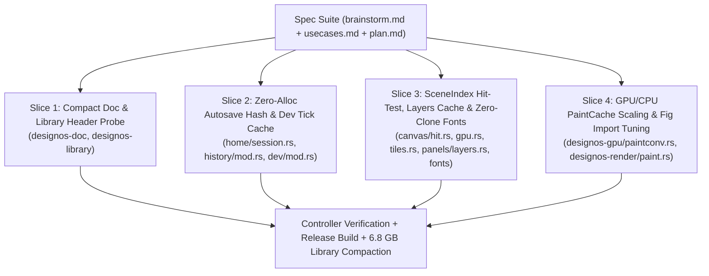

# Implementation Plan: Large `.fig` Performance & Multi-Agent Parallel Execution (`large-fig-performance`)

## Architecture & Disjoint File Ownership Matrix

To execute safely in parallel with zero merge conflicts, the work is partitioned into **4 strictly disjoint vertical slices**:

| Slice | Assigned Agent Role | Owned Files (Strictly Disjoint) | Verification Command |
|-------|---------------------|---------------------------------|----------------------|
| **Slice 1** | Storage & Serialization Lead | `crates/designos-doc/src/lib.rs` `crates/designos-doc/src/node.rs` `crates/designos-library/src/store.rs` | `cargo test -p designos-doc -p designos-library` |
| **Slice 2** | Session, Autosave & Dev-Mode Specialist | `crates/designos-app/src/home/session.rs` `crates/designos-app/src/history/mod.rs` `crates/designos-app/src/dev/mod.rs` | `cargo test -p designos-app --lib home` |
| **Slice 3** | Canvas Hit-Test, Layers & Fonts Specialist | `crates/designos-fonts/src/ensure.rs` `crates/designos-fonts/src/lib.rs` `crates/designos-app/src/fonts.rs` `crates/designos-app/src/canvas/gpu.rs` `crates/designos-app/src/canvas/tiles.rs` `crates/designos-app/src/canvas/hit.rs` `crates/designos-app/src/canvas/interact.rs` `crates/designos-app/src/panels/layers.rs` | `cargo test -p designos-fonts && cargo test -p designos-app --lib` |
| **Slice 4** | GPU/CPU Paint Cache Specialist | `crates/designos-gpu/src/paintconv.rs` `crates/designos-render/src/paint.rs` | `cargo test -p designos-gpu -p designos-render` |

---

## Detailed Slice Specifications

### Slice 1: Compact `Document` Serialization & Fast `Library` IO
- **What it delivers:** 50x smaller `.designos` / `.designos` files on disk, 100% backward compatibility with legacy array-encoded images, microsecond `Library::file_kind` header probing, and `Library::import_file_with_doc`.
- **Files:**
  - `crates/designos-doc/src/lib.rs`: `serde_images` hex serializer + hex/array deserializer; `Document::to_json` uses `serde_json::to_string(self)`.
  - `crates/designos-doc/src/node.rs`: `#[serde(default, skip_serializing_if = "...")]` on `Node`, `ComponentLink`, `TextProps`, `FrameProps`.
  - `crates/designos-library/src/store.rs`: `Library::file_kind` reads first 8 KB before `"nodes"`; add `pub fn import_file_with_doc(&self, path: &Path, project: &str, folder: Option<&str>) -> Result<(FileEntry, Document)>`.

### Slice 2: Zero-Allocation `doc_hash`, Single-Pass Library Import & Cached `dev_tick`
- **What it delivers:** Eliminates multi-GB JSON string allocations on the UI thread during autosave probes/file open, eliminates re-reading imported files from disk for thumbnails, and stops `dev_tick` from scanning 723k nodes every frame.
- **Files:**
  - `crates/designos-app/src/home/session.rs`:
    1. Replace `doc_hash(doc: &Document) -> u64` with a zero-allocation `HashSerializer` (`serde::Serializer` writing directly to `DefaultHasher` without formatting JSON strings, and hashing `doc.images` by `(key, bytes.len(), head/tail sample)`).
    2. In `import_into_library`, call `lib.import_file_with_doc(p, project, folder)` and pass `doc` directly to `thumb::refresh_in_background(lib.clone(), e.id, doc)`.
  - `crates/designos-app/src/history/mod.rs`:
    1. In `history_open_file(&mut self)`, reuse `self.autosave.saved_hash` when non-zero (or compute `doc_hash(&self.doc)` once) so `open_library_file` and `save_to_library_as` don't hash the document twice.
  - `crates/designos-app/src/dev/mod.rs`:
    1. Add `checked_rev: Option<u64>` and `has_tracked_cached: bool` to `DevState`. In `dev_tick`, when `!self.dev.enabled`, only call `has_tracked(&self.doc)` when `self.dev.checked_rev != Some(rev)`.

### Slice 3: `SceneIndex`-Culled Canvas Hit-Testing, Cached Layers Rows & Zero-Clone Font Loader
- **What it delivers:** Sub-millisecond cursor hover/click hit-testing on 723k-node pages, zero-clone Layers panel rendering with cached row flattening, and zero-clone background font loading.
- **Files:**
  - `crates/designos-fonts/src/ensure.rs` & `crates/designos-fonts/src/lib.rs`:
    1. Add `pub fn ensure_font_requests_with(requests: &[FontRequest], db: &SharedFontDb, fetcher: &dyn FontFetcher) -> EnsureReport` and have `ensure_fonts_with` delegate to it. Re-export `ensure_font_requests_with` from `designos-fonts`.
  - `crates/designos-app/src/fonts.rs`:
    1. In `FontLoader::load_for(&mut self, doc: &Document)`, move `requests` into the spawned thread and call `designos_fonts::ensure_font_requests_with(&requests, &db, &GoogleFonts::from_env())` instead of `let doc = doc.clone();`.
  - `crates/designos-app/src/canvas/gpu.rs` & `crates/designos-app/src/canvas/tiles.rs`:
    1. Expose `pub fn index(&self) -> &designos_render::SceneIndex` on `GpuView` (`&self.compiler.index`) and `TileView` (`self.cache.index()`).
  - `crates/designos-app/src/canvas/hit.rs` & `crates/designos-app/src/canvas/interact.rs`:
    1. Add `pub fn hit_test_with_index(doc: &Document, page: NodeId, p: Vec2, tol: f32, index: Option<&designos_render::SceneIndex>) -> Option<NodeId>` and `pub fn deep_hit_test_with_index(doc: &Document, page: NodeId, p: Vec2, tol: f32, index: Option<&designos_render::SceneIndex>) -> Option<NodeId>`.
    2. In `hit_in` and `deep_in`, when `index` is `Some(idx)` and `idx.bounds_of(cid)` returns `Some(b)`, if `!b.grow(tol).contains(p)`, skip `cid` immediately!
    3. In `interact.rs`, pass the active `SceneIndex` (`if app.canvas.gpu.active() { Some(app.canvas.gpu.index()) } else { Some(app.canvas.tiles.index()) }`) to hit-testing.
  - `crates/designos-app/src/panels/layers.rs`:
    1. Cache `rows_cache: Vec<Row>` in `LayersState` keyed by `(page, rev, expanded_gen, filter)` so `visible_rows` only rebuilds when the tree, page, expansion state, or filter string changes.
    2. In the visible row loop (`first..last`), extract a small copyable/owned `RowInfo` from `app.doc.get(row.id)` instead of `app.doc.get(row.id).cloned()` so full `Node` geometry/paths are never cloned during UI painting.

### Slice 4: GPU & CPU `PaintCache` Image Scaling
- **What it delivers:** Prevents decoded image cache thrashing on large `.fig` files containing hundreds of bitmaps.
- **Files:**
  - `crates/designos-gpu/src/paintconv.rs`: Increase decoded image cache limit from `256` to `2048`.
  - `crates/designos-render/src/paint.rs`: Increase decoded image cache limit from `96` to `1024`.
